# Midterm Slide-by-Slide Explanation and Q&A / 中期答辩逐页讲解与双语问答

对应材料：[25 页 Background Updated PDF](2026-09-29_12-40_Huang_Midterm_Defense_English_Background_Updated.pdf)、[对应 PPTX](Huang_Midterm_Defense_English_Background_Updated.pptx)、[论文源稿](../论文/Huang_FEHU_Midterm_Paper.tex)。核对日期：2026-09-29。本稿与当前主讲稿采用同一版本：第 3 页介绍价值分类与 FEHU，第 4 页定义 Task 1b 的输入、输出及测试限制。

## 使用方法

这是一份按旁观研究者、论文评审和答辩教授视角整理的 **25 页逐页双语讲解与 172 组问答**，不限制为 30 分钟。每章严格对应一页 PPT，包含该页截图、画面阅读顺序、中英文解释及本页追问。第 23、24 页虽在主讲中隐藏，仍完整覆盖。

阅读顺序固定为 **本页截图 → 如何读图 → 本页双语讲解 → 针对缺口的补充（适用页）→ 教授问题与答案**。截图显示当前 PPT 的实际内容；标为“建议文案／建议放法”的内容是本稿给出的页内修改建议，不表示已出现在截图中。本稿不替代另行计时、当前目标为 21 分钟的主讲稿，长度也不计入 PPT 的 25 页限制。

- 每题都有英文问题、中文问题、英文口头回答和中文对照。英文用于答辩练习，中文帮助理解；现场按提问语言回答。
- **【必练】**：该页最应掌握的问题；**【追问】**：概念、实现或实验细节；**【质疑】**：教授可能挑战的结论和证据。标记表示练习优先级，不保证实际提问。
- 答案以当前材料和保存结果为准，明确区分“已经观察到”“一种可能解释”“计划验证”。带有 “I would / I plan to” 的句子不是已经完成的工作。
- 回答先给结论，再给依据和必要限定。不要一遇到问题就读出整段；教授继续追问时，再展开公式、数字和例子。
- 拼写是 **aligned**；新闻是 **news**。推荐说 **“the actor’s reported conduct is aligned with a particular value”**，避免笼统说 **“the news is aligned”**。

### 六处缺口在本稿中的落实位置 / Where the requested explanations appear

| 缺口 / Gap | 对应页 / Slides | 已补内容 / Added explanation |
| --- | --- | --- |
| 应用过于概括 / Abstract applications | [3](#p03) 的应用备答 / Application follow-ups | 用户、具体问题、输入输出和应用验证边界；作为背景追问保留 / Users, tasks, outputs and validation limits as background follow-ups |
| 看不见生成样本 / Missing generated example | [10](#p10) | 明确标识的虚构样本卡、文本与标签、实际训练模型 / Labeled illustrative sample and training destination |
| AI 生成标签的合理性 / Fallible AI labels | [10](#p10)、[11](#p11) | 含噪监督的实验依据；错误标签与未注明项的区别 / Noisy-supervision rationale and its limits |
| 指标与校准解释过晚 / Late metric definitions | [6](#p06)、[12](#p12)、[13](#p13) | 先讲 Precision/Recall，再讲校准，最后用 TP/FP/FN 分解提升 / Intuition before formulas and measured error counts |
| 更强基线的意义不明确 / Stronger-baseline context | [19](#p19)、[22](#p22) | Organizer 方法背景、研究价值与匹配验证方案 / Method context and controlled research questions |
| RQ 与结论没有闭合 / Missing RQ answers | [7](#p07)、[25](#p25) | 每个 RQ 的证据页、当前答案、未完成工作 / Evidence, answers and remaining work per RQ |

### 逐页索引 / Slide-by-slide index

| 页码 / Slide | 本页讲解重点 / Explanation focus |
| --- | --- |
| [01](#p01) | 研究对象与标题 / Research task and title |
| [02](#p02) | Aligned 的定义、证据与争议 / Definition and evidence for alignment |
| [03](#p03) | 价值圆图、分类来源、FEHU 与应用边界 / Value wheel, taxonomy provenance, FEHU and potential uses |
| [04](#p04) | 主体输入、多标签与双方向、Task 1 测试边界 / Supplied actors, multiple labels, both directions and test inputs |
| [05](#p05) | 长尾曲线与三类困难 / Long-tail support and error types |
| [06](#p06) | 个人贡献与 Micro-F1 直觉 / Contribution and metric intuition |
| [07](#p07) | 三个 RQ 对应哪些证据 / RQ-to-evidence roadmap |
| [08](#p08) | 相关工作的信息流 / Related-work information flow |
| [09](#p09) | 两条实验线、编码器与 LoRA / Experiment tracks and model |
| [10](#p10) | 生成样本、训练对象与 AI 标签依据 / Synthetic examples and label rationale |
| [11](#p11) | 部分标注、错误标注与损失 / Missing versus incorrect labels |
| [12](#p12) | 融合流程与校准直觉 / Fusion and calibration intuition |
| [13](#p13) | 数据口径与误报／漏检计数 / Metrics and error counts |
| [14](#p14) | 表示实验与模型配置 / Representation versus model changes |
| [15](#p15) | 排序改善与实际预测差距 / Ranking versus decisions |
| [16](#p16) | Masking 与运行稳定性 / Masking and seed variation |
| [17](#p17) | 融合阶段、增量与区间 / Stage gains and uncertainty |
| [18](#p18) | 门控的 Micro/Macro 取舍 / Gate trade-offs |
| [19](#p19) | 官方成绩、更强基线与研究价值 / Official results and stronger baseline |
| [20](#p20) | QA 改对与改错的证据 / Direction-case analysis |
| [21](#p21) | 已支持结论与未解决问题 / Evidence boundaries |
| [22](#p22) | 控制实验如何检验贡献 / Tests of contribution |
| [23](#p23) | 融合打分、校准和执行规则 / Technical decision rules |
| [24](#p24) | 引用各自支撑什么 / Roles of the references |
| [25](#p25) | RQ1–RQ3 逐项答案与剩余工作 / RQ-by-RQ conclusion |
| [速查](#quick-reference) | 术语、数字与易错说法 / Quick reference |

<a id="p01"></a>
## 第 01 页｜Title / 研究标题

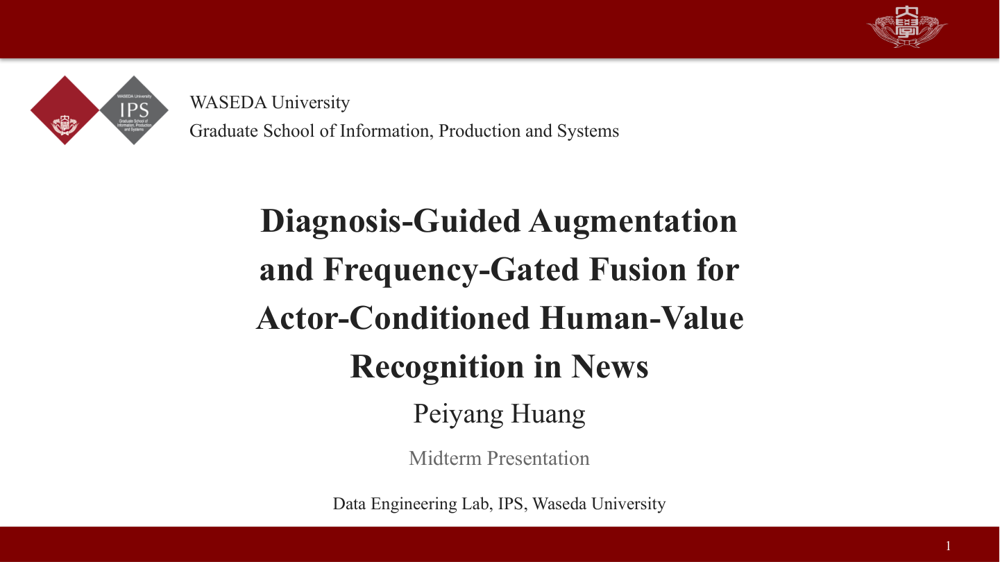

**画面阅读顺序（中）** 从标题中的研究对象开始，再解释两种方法，最后交代中期汇报范围。

**Reading order (EN)** Read the research task first, then the two methods and the midterm scope.

### 本页讲解 / Slide explanation

**English explanation** My study asks which values a particular actor’s reported conduct supports or contradicts in news. Actor-conditioned means that the same article can receive different labels for different supplied actors. Diagnosis-guided augmentation addresses missed labels during training, while frequency-gated fusion revises predictions at inference. The presentation reports implemented systems and current evidence, followed by the comparisons still needed for the final thesis.

**中文讲解** 本研究询问：新闻中某个主体被报道的行为支持或违背哪些价值。以主体为条件，意味着同一文章针对不同给定主体可以有不同标签。诊断驱动增强处理训练阶段的漏检，频次门控融合处理推理阶段的预测修订。本次中期汇报先说明已经实现的系统和证据，再交代最终论文还需要完成的比较。

### 本页问答 / Questions for this slide

关键词：human-value recognition；actor-conditioned；diagnosis-guided augmentation；frequency-gated fusion。

### P01-Q01【必练】你究竟在研究什么？

**Q (EN)** What is the research problem in one or two sentences?

**问（中）** 请用一两句话说明你的研究问题。

**A (EN)** I study how to identify which human values are supported or contradicted by a particular actor’s reported conduct in news. The difficulty is to connect the evidence to the correct actor and direction under limited, imbalanced supervision. I investigate targeted training data and selective revision of prompt predictions as two ways to address these errors.

**答（中）** 我研究如何从新闻中识别：某个特定主体被报道的行为支持或违背了哪些人类价值。困难在于，在监督数据有限且不平衡的情况下，把证据归到正确主体，并判断正确方向。我分别研究有针对性的训练数据，以及对提示模型预测的选择性修订。

### P01-Q02【追问】标题中的三个修饰语是什么意思？

**Q (EN)** What do “actor-conditioned,” “diagnosis-guided,” and “frequency-gated” mean?

**问（中）** actor-conditioned、diagnosis-guided、frequency-gated 分别是什么意思？

**A (EN)** Actor-conditioned means that the same article can produce different predictions for different supplied actors. Diagnosis-guided means that generation targets labels selected from observed training scarcity and baseline failures. Frequency-gated means that the fusion system allows removal and addition only for directed labels whose official training count exceeds 130. These terms describe specific decisions, not general guarantees of improvement.

**答（中）** Actor-conditioned 指同一篇文章针对不同的给定主体，可以输出不同标签。Diagnosis-guided 指依据训练样本不足和基线识别失败来选择生成目标。Frequency-gated 指融合系统只对官方训练频次超过 130 的有向标签执行删除和补充。这些词描述具体设计，不代表必然有效。

### P01-Q03【质疑】这是 AI alignment 研究吗？

**Q (EN)** Are you aligning an AI model with human values?

**问（中）** 你是在让 AI 模型与人类价值观对齐吗？

**A (EN)** My evaluated task is value recognition in input text. “Aligned” is a relation between reported conduct and one value in the taxonomy. I am not evaluating whether the model itself behaves according to human preferences, and I am not using an RLHF objective. Better recognition might inform later applications, but it does not establish safer or more aligned model behavior.

**答（中）** 当前评价的是输入文本中的价值识别。“Aligned”描述的是报道行为与某个分类体系中的价值之间的关系。我没有评价模型自身是否按照人类偏好行动，也没有使用 RLHF 目标。识别能力可以为后续应用提供信息，但不能据此证明模型行为更安全或更符合人类价值。

### P01-Q04【质疑】为什么这足以构成中期研究？

**Q (EN)** What is already completed, and what is still a hypothesis?

**问（中）** 哪些工作已经完成，哪些仍然是假设？

**A (EN)** I have implemented the training and fusion pipelines, run repeated encoder comparisons, analyzed saved fusion stages, and obtained official test scores. What remains unresolved is the causal contribution of diagnosis-guided generation and of the augmented encoder inside fusion. This is a midterm study with working systems and measurable findings, while the final thesis still needs matched controls and stronger reliability checks.

**答（中）** 已完成训练与融合流程、编码器重复实验、保存输出的融合阶段分析，并取得官方测试成绩。尚未解决的是：诊断驱动生成本身贡献多少，以及增强编码器在融合中贡献多少。因此，中期已经有可运行系统和可测量结果，最终论文还需要匹配对照和更充分的可靠性验证。

<a id="p02"></a>
## 第 02 页｜A news topic does not identify an actor’s values

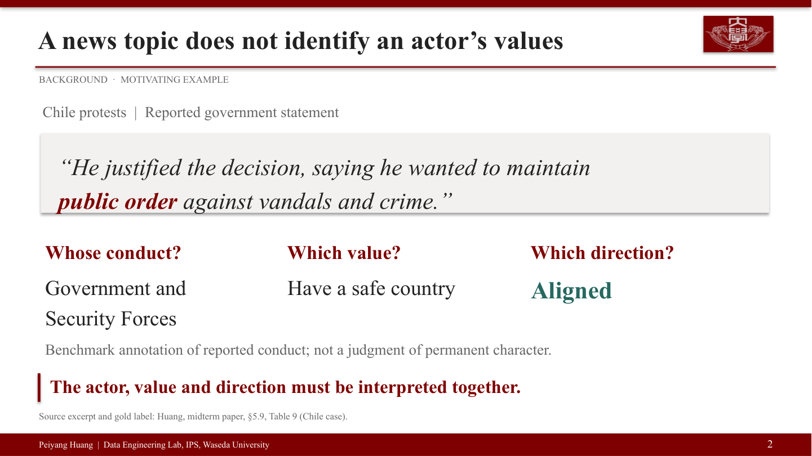

**画面阅读顺序（中）** 先读上方报道摘录，再从左到右看主体、价值、方向三栏，最后读标注范围的说明。

**Reading order (EN)** Read the quoted report, then the actor, value and direction columns, followed by the scope note.

### 本页讲解 / Slide explanation

**English explanation** The sentence reports the government’s justification for emergency measures. The actor is Government and Security Forces, the value is “Have a safe country,” and the released annotation assigns aligned. The link is the stated purpose of maintaining public order and safety. That explains the annotation, but does not establish that the measures actually improved safety. The full article also supports contradictory labels for other values, so the actor cannot be reduced to one overall moral judgment.

**中文讲解** 上方句子报道的是政府为紧急措施提出的理由。主体是政府与安全部队，价值是“拥有一个安全的国家”，发布标注给出 aligned；连接依据是维护公共秩序和安全的目的。这解释了标注，但没有证明措施实际上提高安全。全文还为其他价值提供 contradictory 标注，因此不能给整个主体下一个总体道德判断。

### 本页问答 / Questions for this slide

关键词：aligned；contradictory；actor attribution；evidence；intention / action / outcome；gold annotation。

### P02-Q01【必练】aligned 到底是什么？凭什么说这个例子 aligned？

**Q (EN)** What exactly does “aligned” mean, and why is the Chile example labeled aligned?

**问（中）** aligned 到底是什么意思？为什么智利这个例子能标成 aligned？

**A (EN)** Aligned means that the target actor’s reported conduct is interpreted as supporting a specified value. Here the actor is Government and Security Forces, and the value is “Have a safe country.” The article reports the government’s justification for emergency measures: maintaining public order and restoring safety. The released gold explanation explicitly uses that justification to assign alignment. This explains the benchmark label; it does not prove that the measures actually made people safer, or that the government was morally right overall.

**答（中）** Aligned 指目标主体被报道的行为，被解释为支持某个指定价值。这里主体是“政府与安全部队”，价值是“拥有一个安全的国家”。文章报道政府以维护公共秩序、恢复安全为理由采取紧急措施，发布的 gold explanation 明确依据这一理由标注为 aligned。这解释了基准标签的来源，但不能证明这些措施实际上让人更安全，也不能证明政府整体上道德正确。

### P02-Q02【追问】这个判断的完整证据链是什么？

**Q (EN)** Can you make the reasoning explicit instead of just saying “the gold label says so”?

**问（中）** 不要只说 gold 是这样标的，能把推理依据讲出来吗？

**A (EN)** The chain is actor, attributed conduct, value definition, and direction. First, the justification belongs to the government, not the protesters. Second, it concerns emergency measures and public order. Third, the released definition of “Have a safe country” includes protecting citizens and responding to crime. These links support the annotation’s interpretation. The vulnerable step is treating a reported protective purpose as sufficient evidence of alignment; that deserves explicit scrutiny.

**答（中）** 证据链是“主体—归属的行为—价值定义—方向”。第一，相关辩解属于政府，不能归给抗议者。第二，行为涉及紧急措施和公共秩序。第三，发布的“拥有一个安全的国家”定义包含保护公民、应对犯罪。这样才能解释标注的依据。其中最值得质疑的一步是：报道中的保护目的，是否足以构成 aligned 的证据。这一点应当明确讨论。

### P02-Q03【质疑】政府说自己为了安全，就一定 aligned 吗？

**Q (EN)** Does claiming a good intention automatically make an action aligned?

**问（中）** 只要声称目的良好，就能自动判为 aligned 吗？

**A (EN)** No. A stated intention, an observed action, and a reported consequence are different kinds of evidence. I should identify which one supports the label and examine conflicting evidence in the full article. For this case, the benchmark uses the stated public-order justification. I can report that accurately while acknowledging that the excerpt alone cannot establish the actual consequences. I have not established a universal rule that intentions override outcomes.

**答（中）** 不能。声称的意图、观察到的行为和报道的后果，是不同类型的证据。我应该说明标签依据哪一类，并检查全文中的冲突信息。这个案例的基准采用了维护秩序的目的性解释。我可以准确说明这一点，同时承认仅靠摘录不能证明实际后果。目前也没有建立“意图总是优先于后果”的普遍规则。

### P02-Q04【追问】同一主体为什么还能有 contradictory 标签？

**Q (EN)** Can the same actor be aligned with one value and contradictory to another?

**问（中）** 同一主体能不能支持一种价值，同时违背另一种价值？

**A (EN)** Yes. The labels are value-specific. In this same Chile record, the government has aligned “Have a safe country,” but contradictory “Be just” and “Have freedom of action.” The explanations concern different aspects of the reported conduct, including force and restrictions on assembly. We should preserve these distinctions instead of collapsing the actor into a single good-or-bad label.

**答（中）** 可以，因为标签针对具体价值。同一篇智利记录中，政府对“拥有一个安全的国家”是 aligned，对“公正”和“行动自由”却是 contradictory。解释涉及不同方面，包括武力使用和集会限制。应保留这些区别，而不是把主体压缩成单一的“好”或“坏”。

### P02-Q05【追问】aligned 和 contradictory 可以同时存在吗？

**Q (EN)** Can one actor have both directions for the same value in one article?

**问（中）** 同一篇文章中，同一主体对同一个价值能同时有两个方向吗？

**A (EN)** Yes, the task permits both directions when the article supports them through different actions or contexts. For example, an institution might protect some people in one reported event and endanger them in another. That is a hypothetical illustration, not the Chile gold label for value 26. This is why the output uses independent directed labels rather than forcing a single direction for every value.

**答（中）** 可以，如果文章中不同的行为或情境分别支持两个方向。例如，某机构在一个事件中保护人，在另一个事件中又使人面临危险。这是说明性假设，不是智利案例中价值 26 的 gold。也因此，输出采用独立的有向标签，而不是强制每个价值只能选一个方向。

### P02-Q06【追问】没提到一个价值，就意味着 contradictory 吗？

**Q (EN)** Is an unmentioned or unsupported value automatically contradictory?

**问（中）** 没有提到、没有证据支持某个价值，就等于违背该价值吗？

**A (EN)** No. Contradictory requires evidence of opposition to or violation of the value. Lack of evidence may justify predicting neither direction. Computationally, “contradictory” is itself a positive target class, such as the tuple for value 26 and direction 0. A negative training target means that a particular tuple is absent; it does not mean that the actor contradicts the value.

**答（中）** 不等于。Contradictory 需要有反对或违背价值的证据；缺乏证据时，可以两个方向都不预测。在计算上，contradictory 本身也是一个需要识别的正类，例如“价值 26、方向 0”这个元组。训练中的负标签只是某个元组不存在，不等于主体违背该价值。

### P02-Q07【质疑】gold 是谁标的？所有标签都由人验证过吗？

**Q (EN)** Who created the gold labels, and were they all manually verified?

**问（中）** gold 标签是谁创建的？是否每个都经过人工验证？

**A (EN)** I use the organizer-released labels. The underlying NEVU paper describes an LLM-assisted pipeline with model agreement, further verification, and targeted human review of unresolved cases. It is not exhaustive manual verification of every label. Therefore, agreement with gold is a reproducible benchmark outcome, while annotation ambiguity and model-related bias remain possible. I should not claim that this particular Chile label had unanimous human review without its provenance record.

**答（中）** 我使用主办方发布的标签。底层 NEVU 论文描述的是 LLM 辅助流程，包括模型一致性、进一步核验，以及对未解决案例的定向人工审核，并非每个标签都经过完整人工验证。因此，与 gold 一致是可复现的基准结果，但仍可能存在标注歧义和模型相关偏差。没有这个标签的审核记录，就不能声称智利案例经过人工一致通过。

来源：[NEVU §4.3 与附录 E](https://arxiv.org/html/2603.17838v1#S4.SS3)。该来源描述底层数据集流程，不能把其全库统计直接当成 FEHU 子集统计。

### P02-Q08【质疑】这种标注是否只是政治立场或情感分析？

**Q (EN)** How is this different from sentiment, political stance, or your own moral opinion?

**问（中）** 这与情感分析、政治立场识别，或者你个人的道德判断有什么区别？

**A (EN)** Sentiment concerns evaluative tone, and stance usually concerns support for a proposition or target. Here I must identify a supplied actor, a defined value, and a direction supported by the report. A negatively worded article may still describe value-supporting conduct. To limit personal judgment, I use the released definitions and inspect actor-linked evidence. That makes the task explicit, but it does not eliminate the normative assumptions of the taxonomy or annotations.

**答（中）** 情感分析关注评价语气，立场识别通常关注对某个命题或对象的支持态度。这里需要识别给定主体、定义明确的价值，以及报道证据所支持的方向。语气负面的文章，也可能描述支持某个价值的行为。为减少个人判断，我依据发布的定义检查与主体相连的证据；这样能明确任务，但不能消除分类体系和标注中的规范性假设。

本页案例依据：[开发集 gold](../../dataset/gold_labels/dev/dev_human_values.json)，`guid=0-4716-3-1`、actor `0-4716-3-1-1`；[价值定义](../../dataset/hv_categories/human_value_taxonomy.json)。

<a id="p03"></a>
## 第 03 页｜Human values and the FEHU task

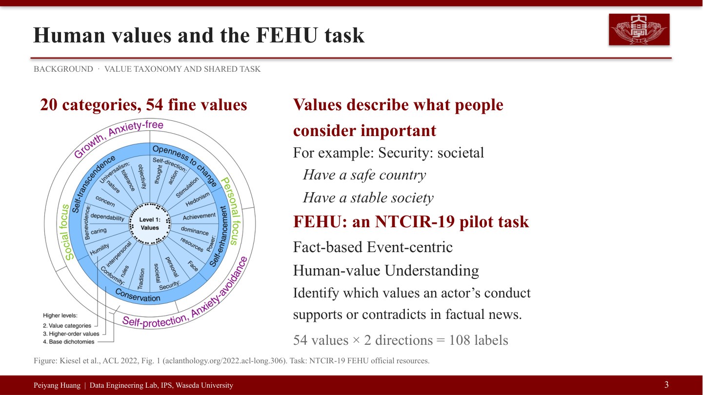

**画面阅读顺序（中）** 先用右上方一句话解释 human values，再从左侧圆图的黑点读到分类扇区；用右侧的两个社会安全价值连接第 2 页案例。随后介绍 FEHU 的全称和评测任务身份，最后解释底部的 54 × 2 = 108。外圈概念作为追问准备，不逐项朗读。

**Reading order (EN)** Define human values using the upper-right text, then read the wheel from its black dots to its categories. Connect the two societal-security examples to slide 2. Introduce FEHU and finish with 54 × 2 = 108. Keep the outer rings for follow-up questions.

### 本页讲解 / Slide explanation

**English explanation** Human values describe goals and ways of acting that people consider important. They include safety and freedom, but also achievement and pleasure. The wheel is Figure 1 from Kiesel and colleagues’ ACL 2022 paper, which consolidated a taxonomy mainly based on Schwartz’s value theory. Its 54 fine values belong to 20 broader categories. Here, “Have a safe country” and “Have a stable society” are two fine values within “Security: societal.”

FEHU stands for Fact-based Event-centric Human-value Understanding. It is a pilot evaluation task within NTCIR-19, with shared data and evaluation rules for recognizing values associated with actors in news. FEHU uses this taxonomy and adds the distinction between conduct supporting and contradicting a value, giving 108 possible directed labels. This slide introduces the vocabulary and benchmark; the next slide specifies the article-level task evaluated in my research.

**中文讲解** 人类价值观描述人们重视的目标与行为方式，既包括安全、自由，也包括成就和享乐。圆图来自 Kiesel 等人在 ACL 2022 论文中的图 1；他们主要基于 Schwartz 的价值理论整理出这套分类。54 个细粒度价值归入 20 个较宽泛的类别。例如，“拥有一个安全的国家”和“拥有一个稳定的社会”是“社会安全”类别下的两个细价值。

FEHU 的全称是 Fact-based Event-centric Human-value Understanding，即“基于事实、以事件为中心的人类价值理解”。它是 NTCIR-19 中的试点评测任务，通过共享数据和评价规则，比较系统识别新闻主体相关价值的能力。FEHU 沿用这套分类，并区分行为是在支持还是违背某个价值，因此有 108 个可能的有向标签。本页建立共同词汇和任务背景，下一页再明确本研究评价的文章级任务。

### 圆图备查：层次与术语 / Reading the value wheel

| 图中位置 / Position | 含义 / Meaning | 与本研究的关系 / Role here |
| --- | --- | --- |
| 中心边缘黑点 / Black dots around the center | Level 1：54 个具体价值 / 54 fine values | Task 1b 的价值部分；黑点不表示样本量或模型表现 / Value component of Task 1b; dots are not counts or scores |
| 内圈扇区 / Inner sectors | Level 2：20 个价值类别 / 20 broader categories | 把细价值归组；Task 1a 评价这些类别 / Group fine values; evaluated by Task 1a |
| 外侧蓝色圈 / Outer blue ring | Level 3：Openness to change 开放求变；Self-enhancement 自我提升；Conservation 维持稳定与秩序；Self-transcendence 超越自身利益 | 更抽象的理论归类；当前模型不单独预测这四类 / More abstract groupings, not separately predicted here |
| 最外侧两组划分 / Two outer divisions | Level 4a：Personal / Social focus 个人／社会关注；Level 4b：Growth, Anxiety-free / Self-protection, Anxiety-avoidance 成长／自我保护取向 | 理论上的关注对象和动机取向；不是 aligned／contradictory / Theoretical orientations, not FEHU directions |

本地分类文件中，高层归属可有重叠，例如 `Have pleasure` 同时归入 `Openness to change` 和 `Self-enhancement`；因此不要把整张图说成所有层级都严格互斥的分类树。/ Higher-level memberships can overlap: the released taxonomy assigns `Have pleasure` to both `Openness to change` and `Self-enhancement`. The entire diagram is therefore not a mutually exclusive tree at every level.

**图上 20 个类别的速查。** 下表给每类一个官方细价值例子，帮助解释图中文字；不是要求主讲时逐项背诵，也不是额外的预测结果。/ **The 20 categories at a glance.** Each row gives one released fine-value example for interpreting the figure, not an additional prediction.

| Level 2 类别 / Category | 中文理解 | 一个 Level 1 例子 / One fine-value example |
| --- | --- | --- |
| Self-direction: thought | 思想自主 | Have freedom of thought / 思想自由 |
| Self-direction: action | 行动自主 | Have freedom of action / 行动自由 |
| Stimulation | 寻求新鲜与刺激 | Have an exciting life / 令人兴奋的生活 |
| Hedonism | 享乐 | Have pleasure / 享受快乐 |
| Achievement | 成就 | Be ambitious / 有抱负 |
| Power: dominance | 对他人的影响与支配 | Have influence / 具有影响力 |
| Power: resources | 对资源的掌握 | Have wealth / 拥有财富 |
| Face | 社会形象与声誉 | Have social recognition / 获得社会认可 |
| Security: personal | 个人安全与安稳 | Have good health / 身体健康 |
| Security: societal | 社会安全与稳定 | Have a safe country / 拥有安全的国家 |
| Tradition | 尊重传统 | Be respecting traditions / 尊重传统 |
| Conformity: rules | 遵守规则 | Be compliant / 遵从规则 |
| Conformity: interpersonal | 人际交往中的克制与礼貌 | Be polite / 有礼貌 |
| Humility | 谦逊 | Be humble / 谦虚 |
| Benevolence: caring | 对身边人的关怀 | Be helpful / 乐于助人 |
| Benevolence: dependability | 对身边人可靠、负责 | Be responsible / 负责任 |
| Universalism: concern | 广泛关怀公平与福祉 | Have equality / 实现平等 |
| Universalism: nature | 关怀自然 | Be protecting the environment / 保护环境 |
| Universalism: tolerance | 包容不同的人与观点 | Be broadminded / 心胸开阔 |
| Universalism: objectivity | 重视客观与理性 | Have an objective view / 保持客观看法 |

上述例子与层级对应依据：[发布的价值定义](../../dataset/hv_categories/human_value_taxonomy.json)和[20 类映射](../../dataset/hv_categories/human_value_level2_values.json)。圆图表示理论关系；只有回到文章中某个主体的具体行为，才能判断 FEHU 方向。

### 应用备答：用户、任务与输出 / Users, tasks and outputs

以下为解释研究用途的口头备答，不是本页画面中已有的应用实验。/ These are oral follow-ups about potential uses, not application experiments shown on the slide.

| 谁使用 / User | 具体任务 / Concrete task | 标签能提供什么 / Contribution of labels |
| --- | --- | --- |
| 新闻传播研究者 / Media researcher | 在同一事件范围内，比较不同报道如何呈现同一机构的行为 / Compare portrayals of one institution across reports about the same event | 按主体、价值和方向组织待核对案例，避免只按新闻主题比较 / Organize candidate cases by actor, value and direction |
| 新闻资料分析员 / News research analyst | 检索“地方当局限制思想自由”的报道，而不是所有提到自由或当局的文章 / Retrieve reports describing restrictions on freedom of thought by local authorities | 用 `actor + value + direction` 筛选候选报道，再回原文确认 / Filter candidate reports, then verify against the source |
| 编辑或摘要评估者 / Editor or summary evaluator | 检查摘要是否把抗议者的诉求写成政府的主张，或把受访者预测写成已发生后果 / Check whether a summary swaps actors or turns a forecast into an observed outcome | 提供结构化核查目标；还需要来源定位和人工或独立验证 / Provide structured checking targets, with additional evidence verification |

**口头必须补充 / Say explicitly:** “These are proposed workflows. I have evaluated the label-recognition component, not a deployed retrieval or summarization product.” / “这些是拟议工作流程。我评价了标签识别组件，还没有评价实际部署的检索或摘要产品。”

### 本页问答 / Questions for this slide

关键词：human values；Schwartz；Kiesel et al.；value taxonomy；Level 1–4；54 / 20 / 108；FEHU；NTCIR-19；pilot shared task；motivational conflict；reported conduct。

### P03-Q01【必练】human values 是什么？为什么享乐和权力也算价值？

**Q (EN)** What do you mean by human values, and why do pleasure and power appear in the taxonomy?

**问（中）** 这里的“人类价值观”是什么意思？为什么享乐、权力也在图里？

**A (EN)** Here, values are goals or ways of acting that people may regard as important. The inventory includes personal aims as well as concern for others. Calling something a value does not mean that every action pursuing it is morally right. In FEHU, I identify the particular value implicated by reported conduct and its direction; I do not collapse all values into one good-or-bad score.

**答（中）** 这里的价值指人们可能重视的目标或行为方式，既包括个人追求，也包括对他人的关怀。某种追求属于价值，不代表追求它的所有行为都道德正确。在 FEHU 中，我识别报道行为涉及哪个具体价值，以及行为与该价值的关系，不把所有价值压成一个“好或坏”的分数。

### P03-Q02【追问】54 个价值、20 个类别从哪里来？是你或 Schwartz 直接提出的吗？

**Q (EN)** Where do the 54 values and 20 categories come from? Are they your contribution or exactly Schwartz’s original inventory?

**问（中）** 54 个价值和 20 个类别是谁定义的？属于你的贡献吗？能直接说成 Schwartz 原始分类吗？

**A (EN)** They are the consolidated inventory used by Kiesel and colleagues in ACL 2022 and adopted by FEHU. The paper builds mainly on Schwartz’s refined theory and integrates additional values from other inventories; it also introduces the category “Universalism: objectivity.” I should attribute this exact inventory to that consolidation, rather than call it my taxonomy or assume every item came unchanged from Schwartz. I use the released definitions to keep evaluation comparable.

**答（中）** 这是 Kiesel 等人在 ACL 2022 中整理、并由 FEHU 采用的分类。该论文主要依据 Schwartz 的精细化理论，同时整合其他价值清单中的条目，还引入了“Universalism: objectivity”类别。因此，这套具体清单应归于该整合工作，不能说成我的分类，也不能认为每项都原封不动地来自 Schwartz。我使用发布的定义来保证评价可比。

依据 / Source：[Kiesel et al., §3 and Fig. 1](https://aclanthology.org/2022.acl-long.306.pdf)。

### P03-Q03【必练】圆图怎样读？黑点、扇区和 Level 1／2 分别是什么？

**Q (EN)** How should I read the dots and sectors, and why is Level 1 finer than Level 2?

**问（中）** 黑点和扇区表示什么？为什么 Level 1 反而比 Level 2 更细？

**A (EN)** The black dots represent the 54 fine values at Level 1. The sectors group them into 20 Level-2 categories, with more abstract groupings farther out. These level names follow the released taxonomy. For example, “Have a safe country” and “Have a stable society” share the parent “Security: societal.” The diagram explains the label vocabulary; it does not show my model’s predictions, training frequencies, or experimental results.

**答（中）** 黑点代表 Level 1 的 54 个细价值，扇区把它们归成 Level 2 的 20 个类别，再向外是更抽象的归类。层级名称沿用发布体系。例如，“拥有一个安全的国家”和“拥有一个稳定的社会”共同属于“社会安全”。圆图解释标签词汇，不表示我的模型预测、训练频次或实验结果。

### P03-Q04【追问】外圈的四种取向和两组划分分别表示什么？

**Q (EN)** What do the higher-order values and the two outer divisions mean?

**问（中）** Openness to change 等四种高层价值，以及最外圈两组划分，是什么意思？

**A (EN)** As a reading aid, openness to change concerns autonomy and new experiences; conservation concerns preserving stability and established order. Self-enhancement concerns one’s own achievement or influence, while self-transcendence concerns others and the wider world. The outer divisions describe personal versus social focus, and growth versus self-protection orientations. These are conceptual groupings, not diagnoses of an actor’s psychology. In particular, “Conservation” here is not the environmental-protection label, and “Personal focus” does not mean contradictory.

**答（中）** 为了读图，可以把开放求变理解为自主和新体验，把 conservation 理解为维护稳定及既有秩序；自我提升关注自身成就或影响力，自我超越关注他人及更广泛的世界。最外圈区分个人／社会关注，以及成长／自我保护取向。这些是概念归类，不是对主体心理状态的诊断。尤其不能把这里的 Conservation 当作环境保护标签，也不能把 Personal focus 理解成 contradictory。

### P03-Q05【质疑】圆图中相对的价值，就是 FEHU 的相反方向吗？

**Q (EN)** Are values on opposite sides of the wheel the same as aligned and contradictory labels?

**问（中）** 圆图中位于相对位置的价值，是不是就对应 aligned 和 contradictory？

**A (EN)** No. The wheel describes potential tensions between different value goals. FEHU direction describes the relation between one actor’s conduct and one specified fine value. “Contradictory to freedom of action” is not automatically “aligned with conservation,” because those claims require different evidence. Nor should opposite sectors become hard exclusion rules: one article can contain different actions that implicate several goals, including both directions of one value.

**答（中）** 不是。圆图讨论不同价值目标之间可能存在的张力；FEHU 方向讨论某个主体的行为与某一个指定细价值的关系。“违背行动自由”不能自动换成“支持维持秩序”，因为二者需要不同证据。相对扇区也不应变成硬性互斥规则：同一篇文章可以包含不同的行为，涉及多个目标，甚至同一价值的两个方向。

### P03-Q06【追问】safe country 和 stable society 有什么区别？可以总是一起预测吗？

**Q (EN)** How do “Have a safe country” and “Have a stable society” differ?

**问（中）** “拥有一个安全的国家”和“拥有一个稳定的社会”有什么区别？是否应该同时预测？

**A (EN)** The released definitions emphasize protecting citizens and the state’s ability to address threats or crime for a safe country. A stable society concerns maintaining social structure and avoiding disorder. They can overlap in a report, but sharing a coarse category does not make them interchangeable. I must check the evidence for each fine value separately; identifying the parent category alone does not justify both fine labels.

**答（中）** 发布定义中，安全的国家偏重保护公民，以及国家应对威胁、犯罪的能力；稳定的社会偏重维持社会结构、避免混乱。二者可能在一篇报道中重叠，但同属一个粗类不代表可以互换。我必须分别检查每个细价值的证据，不能仅凭识别出父类就同时赋予两个细标签。

### P03-Q07【必练】FEHU、NTCIR-19、pilot task 分别是什么？

**Q (EN)** What is FEHU, how does it relate to NTCIR-19, and what does “pilot task” mean?

**问（中）** FEHU 和 NTCIR-19 是什么关系？pilot task 是什么意思？

**A (EN)** FEHU stands for Fact-based Event-centric Human-value Understanding. It is one pilot shared task in the NTCIR-19 evaluation campaign. Researchers use common task definitions, data and scoring rules to compare recognition systems. “Pilot” describes the task’s status in that campaign; FEHU is not the name of my model. My contribution is the training and inference methods evaluated within this task, with the present study focusing on Task 1b.

**答（中）** FEHU 全称是 Fact-based Event-centric Human-value Understanding，是 NTCIR-19 评测活动中的一个试点共享任务。研究者使用统一任务定义、数据和评分规则来比较识别系统。“Pilot”说明它在该评测活动中的任务身份，FEHU 并不是我的模型名称。我的贡献是在这个任务中评价的训练与推理方法，当前研究重点是 Task 1b。

依据 / Source：[NTCIR-19 official task list](https://research.nii.ac.jp/ntcir/ntcir-19/tasks.html)；[FEHU task definitions](https://github.com/WangYao-GoGoGo/ntcir19_fehu#tasks-overview)。

### P03-Q08【质疑】Fact-based 是否意味着新闻全部真实、价值判断绝对客观？

**Q (EN)** Does “Fact-based” mean that every report is verified and every value judgment is objective?

**问（中）** 既然叫 Fact-based，是否说明每篇新闻都经过事实核验、价值标签都是客观真理？

**A (EN)** The task asks for value interpretation grounded in reported events and actors. That does not make my system an independent fact checker, and a benchmark match does not establish an actor’s private intention or a universal moral truth. “Event-centric” emphasizes conduct in context rather than a permanent personality label. I should distinguish what the report states, what the annotation interprets, and what my model predicts.

**答（中）** 任务要求依据报道中的事件和主体进行价值解释，但这不代表我的系统完成了独立事实核验，匹配基准也不能证明主体的真实内心意图或普遍道德真理。“Event-centric”强调情境中的行为，而非永久人格标签。我应区分报道陈述、标注解释和模型预测三个层次。

### P03-Q09【追问】为什么是 108？没涉及某个价值时算第三种方向吗？

**Q (EN)** Why are there 108 labels, and is “not relevant” a third direction?

**问（中）** 为什么是 108 个标签？没有涉及某价值时，要不要再设一个“中立”方向？

**A (EN)** FEHU combines 54 fine values with two directions: aligned is 1 and contradictory is 0. Each combination is a possible label. The official label inventory has no third neutral direction; an unsupported value can be absent from the output set. But absence is not itself proof of neutrality, and an unspecified synthetic label is not automatically a verified negative. Slide 11 explains how training handles that distinction.

**答（中）** FEHU 将 54 个细价值与两个方向组合：aligned 的方向编码是 1，contradictory 是 0，每个组合都是一个可能标签。官方没有第三种中立方向；没有支持证据的价值可以不进入输出集合。但未输出不等于已证明中立，生成数据中未注明的标签也不自动等于已核实负例。第 11 页解释训练如何处理这个区别。

### P03-Q10【质疑】这套体系适用于所有文化吗？为什么不自己重新定义？

**Q (EN)** Is this taxonomy universally valid, and why not design your own value inventory?

**问（中）** 这套分类在所有文化中都成立吗？为什么不自己定义更合适的分类？

**A (EN)** I use it as the benchmark’s operational definition, not as proof that it exhausts every culture’s values. A fixed inventory makes system comparisons possible, while interpretations and coverage can still be challenged. Replacing it would require new annotation guidelines and validation and would change the evaluated problem. Cross-cultural validity is therefore a separate research question, not a conclusion established by my FEHU scores.

**答（中）** 我把它作为基准对任务的操作性定义，而不是证明它穷尽了所有文化的价值。固定清单让系统之间可以比较，但具体解释与覆盖范围仍可质疑。如果替换分类，就需要重新设计标注指南并验证，也会改变正在评价的问题。因此，跨文化有效性是另一项研究问题，不能由我的 FEHU 分数证明。

### P03-Q11【必练】有什么实际用途？已经证明了吗？

**Q (EN)** Who would use this, and have you evaluated those applications?

**问（中）** 谁会用这个系统？这些应用已经得到验证了吗？

**A (EN)** A media researcher could compare how reports about the same event portray one institution’s actions. A news analyst could retrieve reports about authorities restricting freedom of thought by filtering actor, value and direction. An editor could use those tuples as checking targets when a summary assigns an action to an actor. These are proposed workflows, and evidence still needs verification. My current experiments measure recognition, so downstream retrieval quality and summary quality require separate evaluation.

**答（中）** 媒体研究者可以比较同一事件的不同报道如何呈现某机构的行为。新闻分析员可以通过主体、价值和方向，筛选当局限制思想自由的候选报道。编辑可以把这些元组用作核查目标，检查摘要把某项行为归给谁。这些都是拟议流程，证据仍需验证。当前实验测量识别能力，下游检索和摘要质量还需要单独评价。

### P03-Q12【质疑】为什么不能直接让大模型总结新闻？

**Q (EN)** Why not simply ask an LLM to summarize the article?

**问（中）** 为什么不直接让大模型总结文章？

**A (EN)** A fluent summary can still merge actors or omit the distinction between supporting and violating a value. The structured task lets me evaluate these decisions using explicit actor–value–direction tuples. This does not prove that my pipeline is better than every summarizer. It provides a measurable intermediate capability that could be tested within a summarization system later.

**答（中）** 流畅的摘要仍可能混淆主体，或省略支持与违背价值的区别。结构化任务让我能通过明确的“主体—价值—方向”元组评价这些决策。这并不证明本流程优于所有摘要模型，而是提供一种可测量的中间能力，之后可以放入摘要系统单独验证。

### P03-Q13【质疑】能用这些标签评价某个人或国家的价值观吗？

**Q (EN)** Can these outputs be used to score a person’s or a country’s moral character?

**问（中）** 能否用这些输出给个人或国家的道德品质打分？

**A (EN)** The evidence supports a narrower interpretation: how a particular report represents particular conduct. News selection, source framing, and missing context affect that representation. Aggregating these labels into a permanent moral score would require assumptions that my experiments do not validate. A responsible analysis should retain the article, actor, value, and supporting context together.

**答（中）** 现有证据只支持较窄的解释：某篇报道如何呈现某个具体行为。新闻选择、来源叙述方式和缺失背景都会影响这种呈现。把标签累积成永久性的道德评分，需要本研究没有验证的假设。合理的分析应同时保留文章、主体、价值及其支持背景。

### P03-Q14【追问】你是否把圆图做成了图模型或层次分类器？

**Q (EN)** Does your model explicitly encode the wheel as a graph or a hierarchical classifier?

**问（中）** 你是否把这张圆图的结构直接编码成图模型或层次分类器？

**A (EN)** The current encoder has 108 sigmoid outputs for directed labels; it does not implement the wheel as a graph or use a dedicated hierarchical loss. The released fine-to-coarse mapping is used to obtain Task 1a outputs. The taxonomy defines label meanings, but displaying its structure is not evidence that the model explicitly enforces that structure. Testing a hierarchy-aware model would require an additional controlled comparison.

**答（中）** 当前编码器使用 108 个 sigmoid 输出表示有向标签，没有把圆图实现成图模型，也没有专门的层次损失。发布的细到粗映射用于获得 Task 1a 输出。分类体系定义标签含义，但展示结构图不代表模型已经显式施加这种结构。若要检验利用层次关系的模型，需要额外的控制比较。

依据：本页圆图及所引 [ACL 2022 论文](https://aclanthology.org/2022.acl-long.306/)；[本地价值定义](../../dataset/hv_categories/human_value_taxonomy.json)；[本地任务说明](../../README.md)；中期论文 §2–3。

<a id="p04"></a>
## 第 04 页｜The task predicts values for each supplied actor

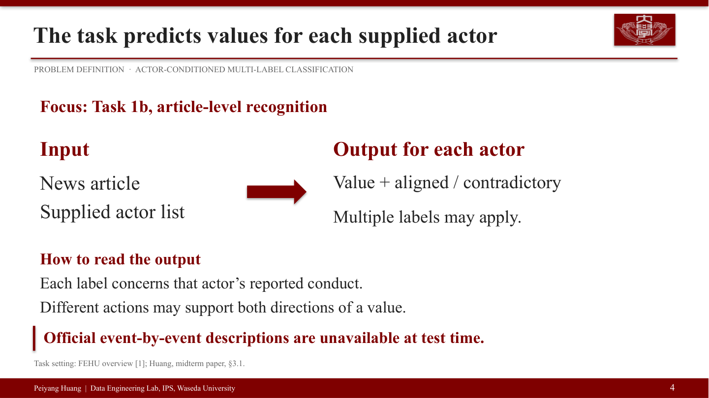

**画面阅读顺序（中）** 先读上方 Task 1b、article-level，明确本研究范围；沿箭头从“文章＋给定主体列表”读到每个主体的“价值＋方向”集合。接着解释下方 reported conduct 和双方向两句，最后强调底部的 Task 1 测试输入限制。

**Reading order (EN)** Start with the Task 1b article-level focus. Follow the arrow from the article and supplied actors to each actor’s value-and-direction set. Explain reported conduct and the possibility of both directions, then state the Task 1 test-input restriction.

### 本页讲解 / Slide explanation

**English explanation** My main task is article-level recognition for supplied actors. For each article–actor pair, the system returns a set of value-and-direction labels. An article can mention several actors, and each actor can receive several labels. If the report describes different actions by the same actor, both directions of one value may be supported; this is not a way to express model indecision. At Task 1 test time, official event-by-event descriptions are unavailable. Any intermediate descriptions used by my system must be generated from the article itself.

**中文讲解** 本研究的主要任务，是对给定主体进行文章级价值识别。每个“文章—主体”组合对应一个价值与方向的标签集合。文章可以涉及多个主体，每个主体也可以有多个标签。如果报道中同一主体的不同举动分别支持、违背某个价值，那么两个方向都可能成立；这不是表达模型拿不准的方式。在 Task 1 测试时，官方按事件整理的描述不可用，系统使用的中间描述必须从文章本身生成。

### 本页补充：用一个例子解释双方向 / A worked example of both directions

**虚构教学例子，不是 FEHU 原始样本，也不是实验输出。** / **Illustrative fiction, not a released FEHU record or an experimental prediction.**

> On Monday, the city council allowed residents to hold a peaceful rally. On Friday, it banned a separate peaceful rally solely because the organizers criticized it.
>
> 周一，市议会允许居民举行和平集会。周五，仅因组织者批评议会，它禁止了另一场和平集会。

| 项目 / Item | 如何解释 / Interpretation |
| --- | --- |
| 输入 / Input | 同一篇文章；给定主体包括市议会和居民 / One article, with the council and residents among the supplied actors |
| 当前目标 / Target actor | 市议会；不能把它的决定误归给居民 / The council; its decisions must not be attributed to the residents |
| 第一项证据 / First piece of evidence | 允许和平集会，为 `Have freedom of action — aligned` 提供依据 / Allowing the rally supports this directed value |
| 第二项证据 / Second piece of evidence | 因批评而禁止另一场和平集会，为 `Have freedom of action — contradictory` 提供依据 / Banning the other rally for its criticism supports the opposite direction |
| 本例讨论的输出子集 / Discussed output subset | 对同一主体、同一细价值保留两个方向；没有声称列全其他相关价值 / Both directions for the same actor and fine value; other relevant labels are not exhaustively listed |

两个输出针对不同的行为，不把同一行为同时宣判为真与假，也不相互抵消。若只有一项行为且证据不足，不能用“双方向”替代核查。真实答辩中的 aligned 证据争议见 [第 2 页](#p02)。/ The labels refer to different actions and do not cancel out. With only one action and insufficient evidence, predicting both is not a substitute for checking the report. See [slide 2](#p02) for the real example’s evidence limitations.

### 本页问答 / Questions for this slide

关键词：Task 1b；article-level；article–actor pair；supplied actors；multi-label classification；both directions；evidence attribution；Task 1a projection；Task 2；test-input protocol。

### P04-Q01【必练】输入和输出具体是什么？什么叫 article-level？

**Q (EN)** What exactly is the input, the output, and the prediction unit in your main task?

**问（中）** 主要任务的输入、输出及预测单元分别是什么？

**A (EN)** Task 1 supplies the news article and its actor list. Task 1b predicts a set of fine-value-and-direction pairs for each article–actor unit, keeping the article and actor identifiers. “Article-level” means that the prediction concerns that actor in the report as a whole; it does not mean assigning one label to the entire article. Several labels can be selected, so this is multi-label classification rather than choosing one of 108 mutually exclusive classes.

**答（中）** Task 1 提供新闻文章及其主体列表。Task 1b 对每个文章—主体单元预测细价值与方向的集合，并保留文章和主体标识。“文章级”指结合整篇报道理解该主体，不是给整篇文章只分配一个标签。多个标签可以同时被选中，因此是多标签分类，不是在 108 个互斥类别中单选。

### P04-Q02【追问】主体既然已经给出，你还需要做什么？

**Q (EN)** If the actors are supplied, what remains difficult, and do you extract their names yourself?

**问（中）** 主体既然由组织者提供，难点还在哪里？你还需要抽取名字吗？

**A (EN)** Actor extraction is outside this evaluated task, but connecting a reported action to the correct supplied actor remains necessary. The model can confuse an action’s performer, its recipient, or the speaker describing it. I condition predictions on the target actor and join records by supplied article and actor IDs, not approximate names or list positions. Correct IDs prevent mechanical mismatches; they do not guarantee correct semantic attribution.

**答（中）** 当前评价不包含主体抽取，但仍需要把报道行为归给正确的给定主体。模型可能混淆行为实施者、受影响者，以及描述这件事的说话者。我以目标主体为条件预测，按给定文章与主体 ID 关联记录，不使用近似名字或列表位置。正确 ID 能避免机械错配，却不能保证语义归属正确。

### P04-Q03【必练】同一主体、同一价值为什么能有两个相反方向？

**Q (EN)** How can the same actor be both aligned with and contradictory to the same value?

**问（中）** 同一个主体为什么可以对同一种价值既 aligned 又 contradictory？

**A (EN)** The labels summarize conduct across an article, which may contain distinct actions. In the illustrative example, the council permits one peaceful rally and suppresses another because of criticism. The first supports freedom of action; the second contradicts it. Keeping both labels preserves both pieces of evidence. It does not assert that one identical action has incompatible outcomes, nor does it give the actor a permanent contradictory personality.

**答（中）** 标签概括整篇文章中的行为，而文章可能包含不同举动。虚构例子中，议会允许一场和平集会，又因批评而压制另一场；前者支持行动自由，后者违背行动自由。保留两个标签能保留两项证据。这不是说同一个完全相同的行为有互不相容的结果，也不是判断主体具有永久矛盾的人格。

### P04-Q04【质疑】拿不准方向时，为什么不总是两个都输出？

**Q (EN)** Why not output both directions whenever the model is uncertain?

**问（中）** 如果方向拿不准，为什么不能两个都输出保底？

**A (EN)** Both directions require evidence, not merely uncertainty. If gold contains only aligned and I predict both, one tuple matches and the other is a false positive; the benchmark also counts a reversal for that single-direction gold pair. If the report supports both through distinct conduct, retaining both is appropriate. The decision is therefore about evidence for each label, not a hedge that automatically improves the score.

**答（中）** 双方向需要各自的证据，不能只因为不确定。若 gold 只有 aligned，而我两个都输出，就得到一个匹配元组和一个假阳性；对这个单方向 gold 组合，基准还会计方向反转。只有报道中的不同举动分别支持两方向时，才适合同时保留。因此应分别判断每个标签的依据，而不是把双方向当作自动提高分数的保底策略。

### P04-Q05【追问】Event-centric 为什么还能是 article-level？Task 2 又是什么？

**Q (EN)** Why is an event-centric task evaluated at article level, and how does Task 2 differ?

**问（中）** 既然以事件为中心，为什么这里是文章级？与 Task 2 有何区别？

**A (EN)** Event-centric describes the focus on actors’ conduct in reported events; article-level specifies the scope of the output. Task 1 predicts for an article–actor pair. Task 2 adds a supplied subevent identifier and predicts for an article–subevent–actor unit. My system may use intermediate event descriptions to reason about Task 1, but its reported output is still article-level. I do not claim Task 2 scores here or assume article gold must equal a simple union of subevent labels.

**答（中）** 以事件为中心说明关注报道事件中的主体行为，文章级则规定输出范围。Task 1 针对文章—主体组合预测；Task 2 还增加给定子事件标识，针对文章—子事件—主体单元预测。系统可以借助中间事件描述推理，但当前报告的输出仍是文章级。我没有在这里声称 Task 2 成绩，也不假设文章 gold 必须等于子事件标签的简单并集。

### P04-Q06【质疑】底部说子事件测试时不可用，究竟限制哪个任务？

**Q (EN)** Which test setting does the restriction on official event-by-event descriptions apply to?

**问（中）** “测试时没有官方按事件描述”是针对所有任务，还是专指这里的 Task 1？

**A (EN)** It applies to the Task 1 test articles in this slide’s scope. Training and development include official subevents, and Task 2 supplies subevents for its own separate test articles. Those inputs cannot be borrowed to supply withheld structure for Task 1. Any Task 1 intermediate description must be derived from the available article. Comparisons using official development subevents therefore have extra input and should be identified as diagnostic settings.

**答（中）** 这句话针对本页范围内的 Task 1 测试文章。训练和开发数据有官方子事件，Task 2 也为自己的另一组测试文章提供子事件，但不能把这些输入当成 Task 1 未提供的结构来借用。Task 1 的中间描述必须来自可用文章。因此，使用官方开发子事件的比较具有额外输入，应明确标为诊断性设置。

### P04-Q07【质疑】自己生成子事件是不是绕过规则？会不会引入幻觉？

**Q (EN)** Does generating your own event descriptions bypass the input restriction, and can they introduce errors?

**问（中）** 自己生成事件描述是否绕过测试限制？会不会引入错误？

**A (EN)** Deriving an intermediate representation from the supplied article does not introduce the withheld official annotations. However, the generated text can omit an action, confuse its actor, or invent a causal link. It is a model output, not new ground truth. My representation experiments compare such configurations, and the evidence examples show why the original article remains important when judging disputed directions. Using generated segments does not establish that segmentation is always beneficial.

**答（中）** 从给定文章构造中间表示，没有额外引入未提供的官方标注。但生成文本可能漏掉行为、混淆主体，或编造因果联系；它是模型输出，不是新的 gold。表示实验比较了这些配置，证据案例也说明判断争议方向时原文仍然重要。使用生成片段不等于已经证明切分总是有益。

### P04-Q08【追问】既然重点是 Task 1b，后面的 Task 1a 成绩如何得到？

**Q (EN)** How do you obtain Task 1a predictions if your main output is Task 1b?

**问（中）** 主要预测 Task 1b，那后面展示的 Task 1a 是如何得到的？

**A (EN)** My systems map each predicted fine value to its released coarse parent, discard direction, and remove duplicates. “Have a safe country” and “Have a stable society” both map to “Security: societal,” so either or both yields one coarse category. A direction-only correction can change Task 1b while leaving this Task 1a projection unchanged. This is my output construction; Task 1a could also be modeled directly in another system.

**答（中）** 本系统把预测的每个细价值映射到官方粗父类，去掉方向，再去重。“拥有一个安全的国家”和“拥有一个稳定的社会”都映射到“社会安全”，因此其中一个或两个出现时，粗输出都是一个类别。只改方向会改变 Task 1b，却不会改变这种 Task 1a 投影。这是我的输出构造方式，其他系统也可以直接建模 Task 1a。

### P04-Q09【质疑】是否允许空输出？能否发现体系外的新价值？

**Q (EN)** Can an actor receive no labels, and can the system predict values outside the taxonomy?

**问（中）** 主体能否没有标签？系统能否预测分类体系外的新价值？

**A (EN)** Empty predictions are valid under the task schema. The evaluated inventory is closed, so only released value IDs are scored. My fusion implementation retains at least one tuple when the primary set is nonempty, but that is a system heuristic, not a task requirement. Open-vocabulary value discovery would require different annotation and evaluation. An empty output also does not establish that the actor has no values in real life.

**答（中）** 任务格式允许空预测。评价标签空间是封闭的，只对发布的价值 ID 评分。融合实现对原本非空的主集合保留至少一个元组，但这是系统启发式，不是任务要求。若要发现体系外的新价值，需要另一套标注与评价；空输出也不能证明主体在现实中没有价值观。

### P04-Q10【质疑】输出标签正确，是否就说明解释也正确？

**Q (EN)** What makes an output correct, and does matching a label validate the explanation?

**问（中）** 什么才算输出正确？标签匹配是否足以证明解释正确？

**A (EN)** For Task 1b, the predicted fine value and direction must match gold for the correct article and actor. A correct topic with the wrong actor or direction is not a correct directed tuple. Matching that tuple does not independently verify the reported fact or the faithfulness of a generated explanation. Evidence attribution and explanation quality need additional analysis; my label metrics should not be described as a complete reasoning evaluation.

**答（中）** Task 1b 要求在正确文章和主体下，预测的细价值与方向匹配 gold。主题找对但主体或方向错了，并不算正确的有向元组。即使元组匹配，也没有独立证明新闻事实真实，或模型解释忠实反映了其推理。证据归属与解释质量仍需要额外分析，标签指标不能说成完整的推理能力评价。

依据：中期论文 §3；[本地任务输入与输出说明](../../README.md)；[官方任务仓库](https://github.com/WangYao-GoGoGo/ntcir19_fehu)。本页口头说明聚焦 Task 1b；Task 1a 投影是备答内容，不是当前画面中的表格。


<a id="p05"></a>
## 第 05 页｜Long-tail labels add to actor and direction errors

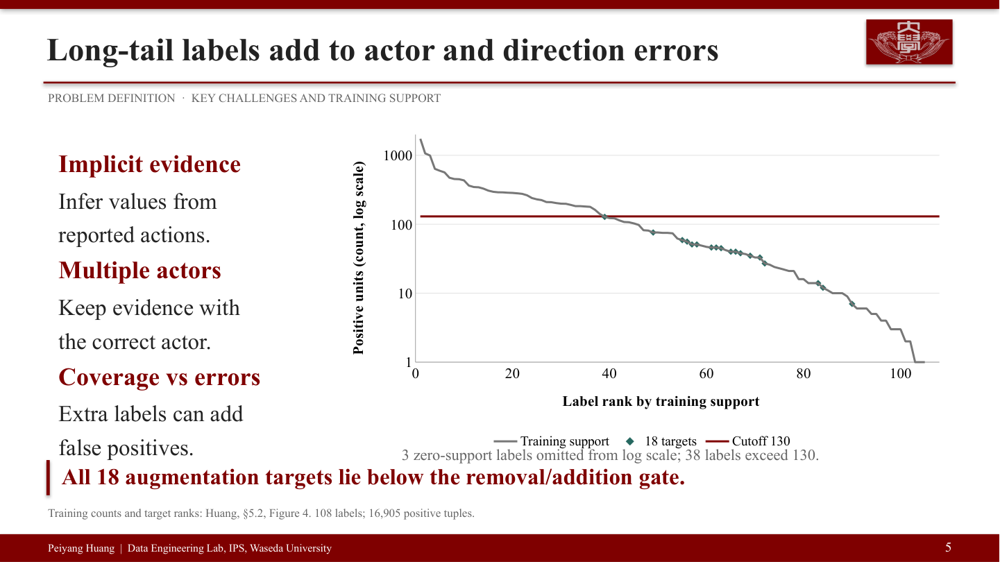

**画面阅读顺序（中）** 先解释左侧三类困难，再读右侧频次曲线与 130 的横线，最后定位 18 个目标点。

**Reading order (EN)** Read the three challenges, then the frequency curve, the cutoff line and the target markers.

### 本页讲解 / Slide explanation

**English explanation** The curve ranks directed labels by their official training support. The long tail means that many classes receive little supervision, while a few are common. Three zero-support classes are omitted from the logarithmic plot. The 18 augmentation targets lie below the revision gate, so their primary predictions pass through removal and addition. This protects them from those edits but also prevents addition from recovering a missing rare value. Frequency is a diagnostic variable, not a proven explanation of every error.

**中文讲解** 曲线按照官方训练支持数排列有向标签。长尾意味着少数类别常见，许多类别监督很少；三个零支持类别没有画在对数图上。18 个增强目标都位于修订门控之下，因此增删阶段会保留其主预测。这能避免这些修改删除稀有标签，却也无法通过补充找回缺失的稀有价值。频次用于诊断，不是每个错误都已证实的原因。

### 本页问答 / Questions for this slide

关键词：long tail；class imbalance；implicit evidence；false positives；label support。

### P05-Q01【必练】主要困难是什么？

**Q (EN)** What makes this task difficult beyond ordinary topic classification?

**问（中）** 相比普通主题分类，这个任务难在哪里？

**A (EN)** Value evidence is often implicit, several actors share the same article, and the correct direction depends on the attributed conduct. The label distribution is also highly uneven. A model may recognize that an article concerns security but still choose the wrong actor, miss a rare value, or reverse its direction. These are different errors and need different diagnostics.

**答（中）** 价值证据经常是隐含的，同一文章包含多个主体，方向又取决于归属的行为；标签分布也很不均衡。模型可能知道文章涉及安全，却仍分错主体、漏掉稀有价值，或者判断相反方向。这些是不同错误，需要分别诊断。

### P05-Q02【追问】频次图到底数的是什么？为什么不是 108 个点？

**Q (EN)** What does the frequency curve count, and why are only 105 classes shown?

**问（中）** 频次曲线统计什么？为什么只显示 105 个类别？

**A (EN)** It counts unique directed labels across official training article–actor units, totaling 16,905 positive tuples. There are 108 possible classes, but three have zero training support and cannot appear on a logarithmic frequency axis. The 105 plotted classes are the nonzero ones. These counts are not article counts, and multiple actors and labels can contribute within one article.

**答（中）** 它统计官方训练集中各“文章—主体”单元的唯一有向标签，共 16,905 个正元组。可能类别共有 108 个，其中三个训练支持数为零，无法显示在对数频次轴上，所以画了 105 个非零类别。这不是文章数量；一篇文章可以贡献多个主体和多个标签。

### P05-Q03【质疑】稀有就一定难？频次是不是错误的原因？

**Q (EN)** Does low frequency prove why a label fails?

**问（中）** 频次低是否就证明了标签识别失败的原因？

**A (EN)** No. Frequency is a diagnostic feature, not an isolated causal explanation. Some labels may also be ambiguous, poorly represented in the input, or difficult to distinguish from neighboring values. The targets combine low support with observed failure, but a causal claim about data scarcity requires controlled comparisons. That is why equal-sized generic generation and oversampling are planned.

**答（中）** 不能。频次是诊断特征，不是已经隔离出的因果解释。有些标签还可能定义模糊、输入没有保留证据，或难以与相邻价值区分。目标选择同时考虑低支持和观察到的失败，但要声称数据稀缺导致失败，仍需要控制实验，所以计划比较等量通用生成和过采样。

### P05-Q04【追问】多预测一些标签，不能直接解决召回问题吗？

**Q (EN)** Why not lower the threshold and predict many more labels?

**问（中）** 为什么不降低阈值，多预测一些标签？

**A (EN)** That can raise recall, but unsupported labels increase false positives and lower precision. Predicting all 108 labels would also include wrong directions. Conversely, predicting nothing avoids reversals but has zero recall. The goal is useful recovery at a reasonable error rate, which is why I examine precision, recall, F1, and direction errors together.

**答（中）** 这样可以提高召回，但没有依据的标签会增加假阳性，降低精确率。全预测 108 个标签还会包含错误方向。反过来，什么都不预测虽然不会反转方向，却没有召回。因此，目标是在合理错误率下找回有效标签，需要同时看精确率、召回率、F1 和方向错误。

<a id="p06"></a>
## 第 06 页｜Individual contribution and working hypothesis

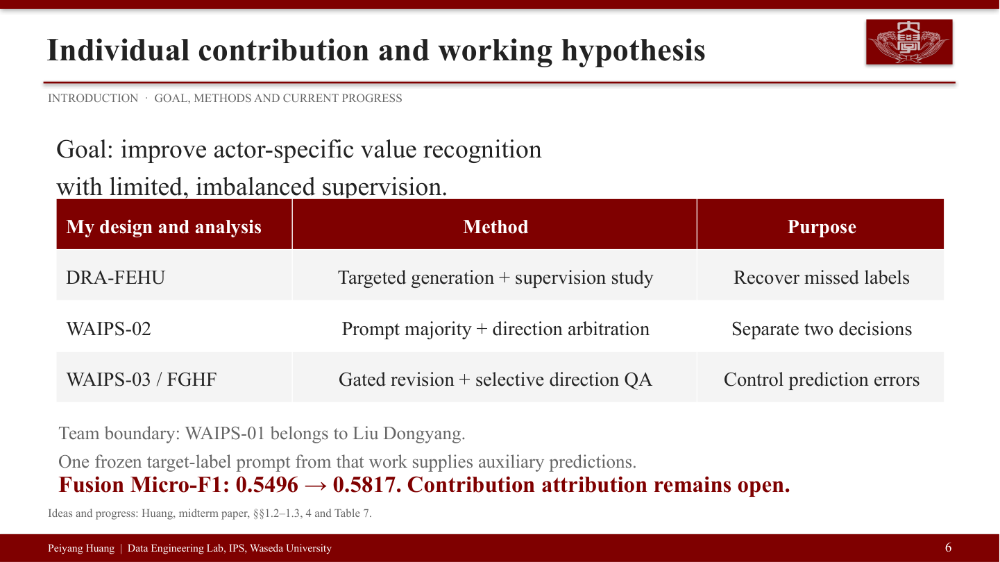

**画面阅读顺序（中）** 先读目标句，再逐行说明三种方法各负责什么，最后解释底部成绩与个人贡献边界。

**Reading order (EN)** Read the goal, the role of each method, and then the result and ownership notes.

### 本页讲解 / Slide explanation

**English explanation** My contribution covers targeted training examples, prompt aggregation, and selective fusion with direction checks. Before interpreting the score, precision means how many predictions match the reference, and recall means how many reference labels are recovered. Micro-F1 balances these two using pooled counts. A higher F1 alone does not tell us which error decreased. Here, the final fusion has both higher precision and higher recall than the primary system, although removal and addition have different effects. The 3.21-point gain belongs to the complete saved fusion comparison, with augmentation’s contribution still unresolved.

**中文讲解** 我的贡献包括定向训练样本、提示聚合，以及带方向检查的选择性融合。解释分数前，先说明精确率看预测中有多少匹配参考，召回率看参考标签找回多少；Micro-F1 根据汇总计数平衡两者。仅 F1 变高不能说明哪种错误减少。在本实验中，最终融合的精确率和召回率都高于主系统，但删除与补充的作用不同。3.21 个百分点属于完整保存融合结果的比较，增强贡献仍待隔离。

### 本页优化：第一次出现分数时先解释意义 / Introduce the metric before the gain

**English insert, before reading 0.5496 → 0.5817:** “Precision asks how many proposed labels match the reference. Recall asks how many reference labels we recover. Micro-F1 balances the two over all actor–label decisions. I will show the separate error changes in the stage analysis.”

**中文插入句，在报数之前说：**“精确率看提出的标签有多少匹配参考，召回率看找回多少参考标签。Micro-F1 在全部主体—标签决策上平衡两者。后面的分阶段分析会分别说明误报与漏检怎样变化。”

本页只需建立直觉，公式与计数放到第 13 页。图中融合起点是 **E6b/G0**；**E1** 是第 14 页比较中的另一种提示配置，其计数单列在 [P13-Q11](#p13)。/ The fusion starts from E6b/G0. E1 is a separate prompt configuration compared on slide 14; its counts are explained in P13-Q11.

### 本页问答 / Questions for this slide

关键词：individual contribution；DRA-FEHU；WAIPS-02；WAIPS-03 / FGHF；attribution。

### P06-Q01【必练】哪些是你做的，哪些是队友做的？

**Q (EN)** What are your individual contributions within the team submission?

**问（中）** 团队提交中哪些是你的个人贡献？

**A (EN)** My work covers diagnosis-guided augmentation and its supervision study, the WAIPS-02 prompt aggregation system, and the WAIPS-03 frequency-gated fusion and direction checking. WAIPS-01 is Liu Dongyang’s team system. WAIPS-03 uses one frozen target-label prompt from his work as an auxiliary member; I should credit that component separately and not present his full system as my own.

**答（中）** 我的工作包括诊断驱动增强及其监督方式研究、WAIPS-02 提示聚合系统，以及 WAIPS-03 的频次门控融合与方向复核。WAIPS-01 是队友 Liu Dongyang 的系统。WAIPS-03 使用了他工作中的一个固定目标标签提示作为辅助成员，应单独说明来源，不能把他的完整系统当成自己的成果。

### P06-Q02【质疑】是否只是把现成技术拼在一起？

**Q (EN)** Is the contribution more than combining existing methods?

**问（中）** 你的贡献是否只是组合已有方法？

**A (EN)** The components are largely established. My contribution is the task-specific design and empirical analysis: diagnosing missed directed labels, testing how unspecified synthetic labels are supervised, and separating candidate revision from direction checking. The staged results show different precision–recall effects. I should not claim that LoRA, masking, ensemble voting, or calibration were invented here, and the value of the combination still needs matched ablations.

**答（中）** 大部分组件确实已有。我的贡献是针对该任务的设计和实证分析：诊断漏掉的有向标签、检验合成数据中未注明标签的监督方式，以及把候选修订与方向检查分开。阶段结果显示不同的精确率与召回率变化。我不应声称发明了 LoRA、掩码、投票或校准，组合的价值也仍需要匹配消融验证。

### P06-Q03【质疑】3.21 个百分点是否就是增强数据的贡献？

**Q (EN)** Does the 3.21-point gain demonstrate the contribution of augmentation?

**问（中）** 提升 3.21 个百分点是否证明了数据增强的贡献？

**A (EN)** It demonstrates the observed difference between the fixed primary predictions and the final saved fusion output on development. It does not isolate augmentation. Fusion also changes candidate selection and direction, and its historical encoder export is not tied to an exact checkpoint from the repeated training comparison. The encoder ablation is needed before assigning that gain to augmented training.

**答（中）** 它表示开发集上固定主预测与最终保存融合输出之间的观察差异，不能隔离出增强贡献。融合同时改变候选选择与方向，而且其中的历史编码器导出没有对应到重复训练实验中的精确检查点。需要编码器消融，才能把增益归因于增强训练。

### P06-Q04【必练】Micro-F1 提高，究竟是少漏检还是少误报？

**Q (EN)** Does the higher Micro-F1 mean fewer missed labels, fewer false positives, or both?

**问（中）** Micro-F1 提高到底表示少漏检、少误报，还是两者都有？

**A (EN)** F1 alone cannot distinguish those explanations. In this saved G0-to-G4 comparison, false positives fall from 1,442 to 1,272 and false negatives from 938 to 888, so both improve overall. The stages differ: removal reduces false positives but increases misses, and addition recovers labels while adding some false positives. That is why I report the separate counts, precision and recall alongside the final F1.

**答（中）** 仅凭 F1 不能区分这些解释。在保存的 G0 到 G4 比较中，假阳性从 1442 降到 1272，假阴性从 938 降到 888，所以整体两者都有改善。但各阶段不同：删除减少假阳性却增加遗漏；补充恢复标签，也带来部分假阳性。因此必须同时报告分项计数、精确率与召回率。

<a id="p07"></a>
## 第 07 页｜Three research questions guide the evaluation

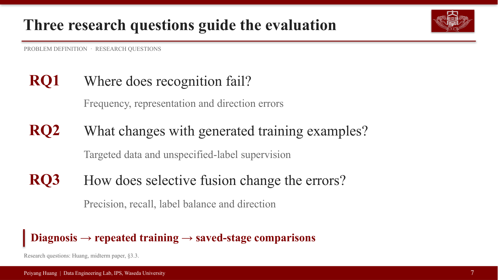

**画面阅读顺序（中）** 按 RQ1、RQ2、RQ3 三行阅读，每行对应后面一组实验，不把三行当成三个已完成的结论。

**Reading order (EN)** Read each RQ as a question linked to a later experiment, with a defined evidence requirement.

### 本页讲解 / Slide explanation

**English explanation** RQ1 asks where recognition fails, examined through label support, representation changes and direction errors. RQ2 asks what generated records and their supervision rules change in repeated encoder training. RQ3 asks how removal, addition, gating and direction checking change predictions. I will return to these same questions in the conclusion. The current evidence is descriptive for RQ1, supports conditional training improvements for RQ2, and supports a saved-output fusion gain for RQ3. Causal attribution and stability remain incomplete.

**中文讲解** RQ1 询问识别在哪些地方失败，通过标签支持、表示变化和方向错误来观察。RQ2 询问生成记录及其监督方式怎样改变重复编码器训练。RQ3 询问删除、补充、门控与方向检查怎样改变预测。结论页会按相同问题回答。目前 RQ1 有描述性证据，RQ2 支持有条件的训练改善，RQ3 支持保存输出上的融合增益；因果归因与稳定性尚未完成。

### 本页优化：每个 RQ 对应什么证据 / Map each RQ to its evidence

| RQ | 要回答的判断 / Required answer | 后续证据页 / Evidence slides | 当前完成程度 / Current status |
| --- | --- | --- | --- |
| RQ1 | 哪些错误随频次、表示和方向变化？/ Which errors vary with frequency, representation and direction? | 5、14、20 | 已有诊断与案例，未完成错误原因的独立验证 / Diagnosis available; mechanisms not isolated |
| RQ2 | 生成数据和监督策略改善什么，又牺牲什么？/ What improves or worsens under generated-data and supervision conditions? | 10–11、15–16 | 已有三种子比较；缺少等量通用生成、过采样与完整质量审核 / Repeated comparisons available; matched data controls and auditing pending |
| RQ3 | 增删、门控、QA 怎样改变误报、遗漏和方向？/ How do the fusion stages change false positives, misses and direction? | 12、17–20、23 | 已有保存阶段差异；完整组件归因、预算匹配、API 重跑未完成 / Saved-stage evidence available; full attribution and reruns pending |

**衔接句 / Transition:** “The following experiments answer these questions at different levels of certainty. I will return to the same three questions on the conclusion slide.” / “后续实验对这些问题给出不同强度的证据，结论页会按相同三个问题逐项回答。”

### 本页问答 / Questions for this slide

关键词：RQ1 diagnosis；RQ2 augmentation and supervision；RQ3 selective fusion；falsifiability。

### P07-Q01【必练】三个研究问题分别回答什么？

**Q (EN)** How do RQ1, RQ2, and RQ3 connect to the experiments?

**问（中）** 三个研究问题与实验分别如何对应？

**A (EN)** RQ1 diagnoses failures involving label frequency, input representation, and direction. RQ2 compares generated-data conditions and supervision rules through repeated encoder training. RQ3 compares saved fusion stages to examine removal, addition, gating, and direction checks. The sequence moves from identifying errors to testing interventions, but the two experiment tracks do not yet establish one complete causal chain.

**答（中）** RQ1 诊断标签频次、输入表示和方向相关失败。RQ2 通过重复编码器训练比较生成数据条件与监督规则。RQ3 比较保存的融合阶段，研究删除、补充、门控和方向检查。它们从错误识别走向干预验证，但目前两条实验线还没有建立完整的因果链。

### P07-Q02【质疑】什么结果会否定你的假设？

**Q (EN)** What evidence would make you reject your working hypothesis?

**问（中）** 出现什么结果，你会否定工作假设？

**A (EN)** If equal-sized generic data or oversampling performs as well as targeted generation, I cannot attribute the benefit to diagnosis-guided selection. If fusion performs equally well without the encoder, encoder support is unnecessary under that protocol. If direction QA has no repeatable net benefit, it should not remain a default component merely because it was part of the initial design.

**答（中）** 如果等量通用数据或过采样与定向生成表现相当，就不能把收益归因于诊断选择。如果去掉编码器后融合一样好，那么在该协议下编码器支持就没有必要。如果方向 QA 没有可重复的净收益，也不能仅因最初设计包含它，就继续当作默认组件。

### P07-Q03【追问】三个问题中，当前证据最强和最弱的是什么？

**Q (EN)** Which conclusion is best supported, and which remains the most uncertain?

**问（中）** 哪个结论支持最充分？哪个最不确定？

**A (EN)** The clearest evidence is the measured behavior of the saved fusion stages: removal improves precision, addition restores recall, and the final output improves development Micro-F1. The weakest attribution is that targeted augmentation caused the final fusion gain. Repeated training supports a ranking improvement under the tested setup, but it does not close that attribution gap.

**答（中）** 最清楚的是保存融合阶段的可测行为：删除提高精确率，补充恢复召回，最终输出提高开发集 Micro-F1。最缺乏支持的是“定向增强导致最终融合增益”这一归因。重复训练支持当前设置下的排序改善，但没有补上这条归因缺口。

<a id="p08"></a>
## 第 08 页｜Related work uses a different information flow

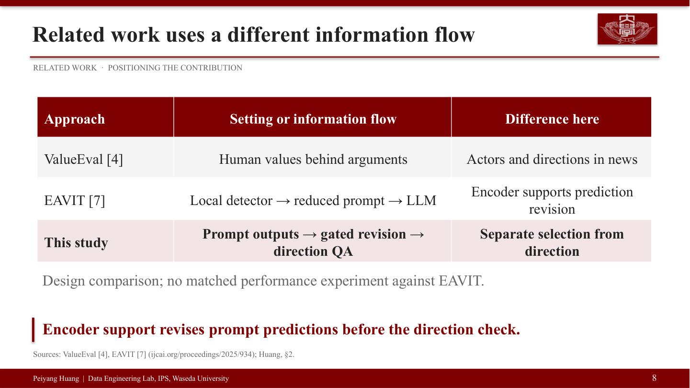

**画面阅读顺序（中）** 沿表格三行比较任务和信息流，再读底部关于缺少匹配性能实验的说明。

**Reading order (EN)** Compare the task and information flow across the three rows, then read the comparison limit.

### 本页讲解 / Slide explanation

**English explanation** ValueEval provides the argument-based value-recognition background. EAVIT uses a local detector to narrow value definitions supplied to an online language model. My design starts with prompt predictions and uses encoder scores to revise candidate labels before checking direction. This clarifies where my system differs. It does not establish superiority over EAVIT, and synthetic generation itself is not new. The contribution must be judged through the specific FEHU controls and error analysis.

**中文讲解** ValueEval 提供论证领域价值识别的背景。EAVIT 使用本地检测器缩减传给在线语言模型的价值定义。本系统从提示预测开始，利用编码器分数修订候选，再检查方向。这说明设计区别，不能证明优于 EAVIT；合成生成本身也不是新概念。贡献需要依据 FEHU 的具体对照与错误分析判断。

### 本页问答 / Questions for this slide

关键词：ValueEval；EAVIT；information flow；partial annotations；self-consistency。

### P08-Q01【必练】与 ValueEval、EAVIT 的主要区别是什么？

**Q (EN)** How does your study differ from ValueEval and EAVIT?

**问（中）** 你的研究与 ValueEval、EAVIT 有什么主要区别？

**A (EN)** ValueEval studies values behind arguments, while my task conditions news predictions on supplied actors and explicit directions. EAVIT uses a local detector to narrow the value definitions passed to an online LLM. My fusion instead starts from prompt predictions and uses encoder scores to support selective revision before a direction check. This is a difference in information flow, not evidence of superior performance over EAVIT.

**答（中）** ValueEval 研究论证背后的价值，本任务则对新闻中的给定主体预测明确方向。EAVIT 通过本地检测器缩减传给在线 LLM 的价值定义集合。本系统从提示预测出发，用编码器分数支持选择性修订，再检查方向。这是信息流区别，不是优于 EAVIT 的性能证据。

### P08-Q02【质疑】EAVIT 是否也用了合成数据？你的创新不能只说数据增强吧？

**Q (EN)** Does EAVIT already use synthetic training data, and what does that imply for novelty?

**问（中）** EAVIT 是否已经使用合成训练数据？这对创新性意味着什么？

**A (EN)** Yes, EAVIT already includes synthetic and explanation-based training. I therefore should not claim that generating value-related examples is new by itself. The narrower question here concerns failure-selected directed labels, the treatment of unspecified synthetic annotations, and how encoder support interacts with selective fusion in FEHU. Those specific claims must be supported by their own comparisons.

**答（中）** 是的，EAVIT 已包含合成数据和解释相关训练，所以不能把生成价值样本本身称为创新。这里更具体的问题是：按识别失败选择有向标签、如何处理合成数据中未注明的标签，以及编码器支持如何与 FEHU 的选择性融合交互。这些具体主张需要各自的对照。

来源：[EAVIT，IJCAI 2025](https://www.ijcai.org/proceedings/2025/934)；论文 §2。

### P08-Q03【追问】你的 voting 就是 self-consistency 吗？

**Q (EN)** Is your voting method the same as self-consistency?

**问（中）** 你的投票方法是否就是 self-consistency？

**A (EN)** They share the idea of aggregating multiple outputs, but the protocols differ. Classical self-consistency aggregates sampled reasoning paths. WAIPS-02 uses different prompt formulations and exact directed-label agreement; WAIPS-03 also varies segmentation and model configuration. These outputs are not independent human judgments, so agreement is useful support rather than a guarantee of correctness.

**答（中）** 两者都聚合多个输出，但协议不同。经典 self-consistency 聚合采样的推理路径。WAIPS-02 使用不同提示表述与精确有向标签一致性，WAIPS-03 还改变切分和模型配置。这些输出不是独立的人类判断，一致只能提供支持，不能保证正确。

### P08-Q04【追问】“partial labels”是每个样本只有一个真实类别的那种吗？

**Q (EN)** What do you mean by partial labels in this multi-label setting?

**问（中）** 这里 partial labels 的具体含义是什么？

**A (EN)** Here some entries of a multi-label target vector are known and others are unspecified. Several labels may be true simultaneously. This differs from the common single-label formulation where one true class is hidden inside a candidate set. The cited multi-label work motivates handling incomplete annotations, but my experiments test a particular masking and weighting implementation rather than reproducing that entire method.

**答（中）** 这里指多标签目标向量中，一部分条目已知，其他条目未注明，而且可以有多个标签同时成立。它不同于“候选集合里只有一个真实类别”的常见单标签部分标签设定。引用的多标签研究为不完整标注提供背景，但本实验测试的是具体掩码与加权实现，并非复现那篇论文的全部方法。

### P08-Q05【质疑】如何公平地与 EAVIT 比较？

**Q (EN)** What would a fair comparison with EAVIT require?

**问（中）** 怎样才算与 EAVIT 公平比较？

**A (EN)** I would adapt both methods to the same FEHU inputs and label space, use the same evaluation split, and control access to training data and model resources. I would also report token usage and latency because their online information flows differ. Until such an experiment is completed, the slide supports architectural positioning only, not a ranking between the methods.

**答（中）** 应把两种方法适配到相同 FEHU 输入和标签空间，使用同一评价划分，并控制训练数据与模型资源。因为在线信息流不同，还应报告 token 用量和延迟。在完成这种实验前，这页只能说明方法定位，不能给两种方法排性能高低。

<a id="p09"></a>
## 第 09 页｜Two experiment tracks answer different questions

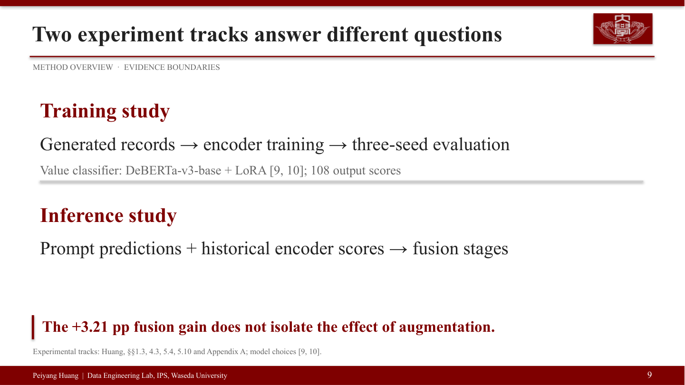

**画面阅读顺序（中）** 上半部分是训练实验，下半部分是推理融合实验；中间分隔线表示两组证据不能直接合并归因。

**Reading order (EN)** The upper half is the training study and the lower half is the inference study, separated to keep their evidence distinct.

### 本页讲解 / Slide explanation

**English explanation** The upper track tests how official and generated training records affect a DeBERTa-v3-base classifier adapted with LoRA. The lower track combines prompt outputs with historical encoder scores. These scores are not linked to an exact checkpoint from the repeated training comparison. Therefore, a fusion gain does not tell us how much synthetic training contributed. The next controlled experiment will keep prompt predictions fixed and replace only the encoder condition.

**中文讲解** 上半部分检验官方与生成记录如何影响使用 LoRA 适配的 DeBERTa-v3-base 分类器。下半部分把提示输出与历史编码器分数组合，但这些分数没有关联到重复训练比较中的精确检查点。因此，融合增益不能告诉我们合成训练贡献了多少。下一步控制实验应固定提示预测，只替换编码器条件。

### 本页问答 / Questions for this slide

关键词：training / inference；DeBERTaV3；LoRA；sigmoid；checkpoint provenance；continuous scores。

### P09-Q01【必练】两条实验线为什么不能合并解释？

**Q (EN)** Why do you separate the encoder training study from the fusion study?

**问（中）** 为什么把编码器训练研究与融合研究分开？

**A (EN)** The training study compares data and supervision conditions across three seeds. The fusion study uses fixed prompt predictions and a historical encoder score export. That export is not traceable to one exact checkpoint in the repeated comparison. Both tracks provide evidence, but they do not establish that the measured encoder improvement caused the fusion improvement. A matched encoder replacement experiment is required.

**答（中）** 训练研究以三个随机种子比较数据和监督条件；融合研究使用固定提示预测和历史编码器分数导出。该导出无法追溯到重复对照中的某个精确检查点。两条线都有证据，但不能证明测得的编码器改善导致了融合改善，需要在其他条件固定时替换编码器的实验。

### P09-Q02【追问】DeBERTaV3 是什么？为什么选它？

**Q (EN)** What is DeBERTaV3, and why use it here?

**问（中）** DeBERTaV3 是什么？为什么在这里使用？

**A (EN)** It is a pretrained Transformer encoder for language understanding. DeBERTa models content and position information separately in attention; V3 uses replaced-token detection and gradient-disentangled embedding sharing during pretraining. I use the existing base model as a practical local classifier for repeated experiments. Its suitability here is an empirical choice, not evidence that it is the strongest possible FEHU backbone.

**答（中）** 它是用于语言理解的预训练 Transformer 编码器。DeBERTa 在注意力中分别建模内容与位置信息；V3 在预训练中使用替换 token 检测及梯度解耦的嵌入共享。我使用现成 base 模型作为可重复实验的本地分类器。这是实际实验选择，不能证明它是 FEHU 的最强骨干模型。

来源：[DeBERTaV3 原论文](https://arxiv.org/abs/2111.09543)。

### P09-Q03【追问】文章如何变成 108 个分数？为什么不用 softmax？

**Q (EN)** How does the encoder produce predictions, and why use sigmoid rather than softmax?

**问（中）** 编码器如何输出预测？为什么用 sigmoid 而非 softmax？

**A (EN)** The input pairs the article text with an actor-conditioned field. A linear head maps the pooled representation to 108 logits, and an independent sigmoid converts each logit to a score between zero and one. Softmax would make the classes compete for a total probability of one, which does not match multiple simultaneous labels. Sigmoid scores still require evaluation and calibration; they are not automatically reliable confidence estimates.

**答（中）** 输入把文章文本与包含目标主体的信息配对。线性分类头将池化表示映射为 108 个 logit，再分别用 sigmoid 得到 0 到 1 的分数。Softmax 会让类别竞争总和为 1 的概率，不适合多个标签同时成立。Sigmoid 分数仍需要评价与校准，不能自动视为可靠置信度。

### P09-Q04【追问】LoRA 到底训练什么？rank 16 是什么意思？

**Q (EN)** What does LoRA train, and what does rank 16 mean?

**问（中）** LoRA 具体训练什么？rank 16 是什么意思？

**A (EN)** LoRA keeps a pretrained weight matrix fixed and learns a low-rank update, written as ΔW = (α/r)BA. Rank r limits the intermediate dimension of the update. Here r is 16, α is 32, and dropout is 0.1, applied to query and value projections. The classification head is also task-specific. This reduces adaptation parameters; I have not shown that rank 16 is optimal for this task.

**答（中）** LoRA 固定预训练权重矩阵，学习低秩更新，可写为 ΔW = (α/r)BA。秩 r 限定更新的中间维度。这里 r=16、α=32、dropout=0.1，作用于 query 和 value 投影；分类头也针对任务训练。这能减少适配参数，但没有证明 rank 16 对本任务最优。

来源：[LoRA 原论文](https://arxiv.org/abs/2106.09685)；当前设置见论文 §5.4。

### P09-Q05【追问】模型多大？长新闻是否会被截断？

**Q (EN)** What are the model size and input limits?

**问（中）** 模型规模和输入限制是什么？

**A (EN)** The base model has 12 layers and hidden size 768. Its model card separates about 86 million backbone parameters from 98 million embedding parameters, so 86 million is not the total. My input limit is 512 tokens. Long articles can lose relevant evidence through truncation, which may hurt actor and value recognition. I have not isolated the performance cost of truncation.

**答（中）** Base 模型有 12 层，隐藏维度 768。模型卡把约 8600 万骨干参数与 9800 万嵌入参数分开报告，所以不能把 8600 万当作总参数量。当前输入上限为 512 tokens，长文章可能因截断丢失相关证据，影响主体与价值识别；尚未单独测量截断带来的性能损失。

### P09-Q06【追问】训练设置和重复性怎样？

**Q (EN)** What training settings were held fixed across the repeated comparisons?

**问（中）** 重复比较中固定了哪些训练设置？

**A (EN)** The main protocol uses AdamW with learning rate 2×10⁻⁴, weight decay 0.01, cosine scheduling, and a 0.1 warmup fraction. Batch size 8 with four accumulation steps gives an effective batch of 32. Training runs for at most 15 epochs with patience 4, selecting by development Micro-F1. Seeds are 42, 43, and 44. Complete environment records were not preserved for every formal run.

**答（中）** 主要协议采用 AdamW，学习率 2×10⁻⁴，权重衰减 0.01，余弦调度和 0.1 的预热比例。Batch size 8、累积四步，对应有效 batch 32。最多训练 15 个 epoch，早停 patience 4，按开发集 Micro-F1 选检查点；种子为 42、43、44。并非每次正式运行都保留了完整环境记录。

### P09-Q07【质疑】编码器这么弱，为什么还能帮助强 LLM？

**Q (EN)** Why might a weak standalone encoder help stronger prompt predictions?

**问（中）** 独立表现较弱的编码器，为什么可能帮助更强的提示模型？

**A (EN)** Standalone F1 depends on converting scores into a complete predicted set. Fusion asks a narrower question: whether an existing candidate has additional support. A model with weak thresholded predictions may still rank some candidates usefully. That is a plausible mechanism, not proof that this encoder helps. The no-encoder, official-only, and augmented-encoder comparison will test whether its scores add information beyond the prompt votes.

**答（中）** 独立 F1 取决于能否把分数转换成完整预测集合。融合问的是更窄的问题：已有候选是否获得额外支持。因此，即使阈值预测较弱，模型也可能对部分候选提供有效排序。这是合理机制，不是该编码器确实有贡献的证明；需比较无编码器、仅官方数据编码器、增强编码器，检验分数是否在提示投票之外提供信息。

### P09-Q08【追问】注意力的 query、key、value 是什么？为什么只适配 Q/V？

**Q (EN)** What are query, key, and value in attention, and why adapt query and value projections?

**问（中）** 注意力中的 query、key、value 是什么？为什么适配 query 和 value 投影？

**A (EN)** In basic attention, queries and keys determine how much one token attends to another, and values carry the information being combined. DeBERTa adds its content-and-position attention structure. LoRA updates query and value projections in this implementation to adapt those interactions with relatively few parameters. I have not compared every placement, so I cannot claim Q/V is optimal. Softmax inside attention is compatible with independent sigmoid outputs at the classification head.

**答（中）** 在基本注意力中，query 和 key 决定 token 之间的关注权重，value 携带被加权组合的信息。DeBERTa 进一步使用内容与位置的注意力结构。本实现用 LoRA 更新 query 和 value 投影，以较少参数适配这些交互。未比较全部放置方案，不能说 Q/V 最优。注意力内部的 softmax，与分类头的独立 sigmoid 输出并不冲突。

本页实现与来源边界：论文 §4.3、§5.4。589,824 是保存的 smoke run 中的 adapter 参数数，不包含全部新增分类头参数；不能据此声称所有正式实验都有相同完整运行记录。

<a id="p10"></a>
## 第 10 页｜Generate training examples for diagnosed failures

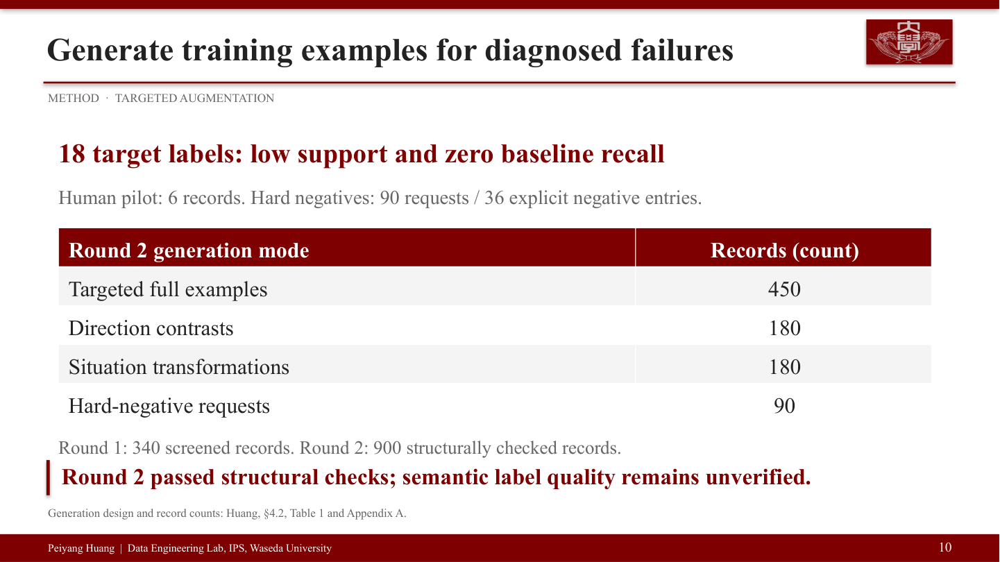

**画面阅读顺序（中）** 先说明 18 个目标，再读四种生成模式与数量；讲解时在表格之后补一条“文本、主体、标签、训练模型”的完整样本链。

**Reading order (EN)** Read the target selection and generation counts, then explain one complete text–actor–label training example.

### 本页讲解 / Slide explanation

**English explanation** The generator produces news-like text together with actor information and value annotations. I convert these records into article–actor training examples for DeBERTa-v3-base with LoRA and a 108-output classification head. The generator itself is not the model being trained in this study. The point is to create additional supervision for specified failures. Because generated labels can be wrong, their usefulness is an experimental question. The current slide reports generation modes and checks, but a concrete example is needed to explain what actually enters training.

**中文讲解** 生成器产出新闻式文本，同时提供主体信息和价值标注。我把记录转换为文章—主体训练样本，用于带 LoRA 和 108 输出分类头的 DeBERTa-v3-base。这里训练的并不是生成器本身，而是通过这些记录为指定失败提供额外监督。生成标签可能错误，所以是否有用是实验问题。当前画面列了模式和检查，还需要具体样本来解释究竟什么进入训练。

### 本页优化：一条完整样本 / A complete illustrative training example

**示例身份 / Example status:** 以下是为讲解编写的虚构结构示例，不是从 340/900 条记录中抽出的真实训练条目，也不代表已经通过人工审核。所选 `0:2` 属于记录中的 18 个目标之一。/ This fictional example illustrates the training structure. It is not a retrieved record from either generation round or a human-verified training item. The directed label `0:2` is one of the recorded targets.

| 字段 / Field | 内容 / Content |
| --- | --- |
| 新闻式文本 / News-like text | “Riverton City Council ordered every public library to remove copies of a local newspaper because it criticized the mayor. Library staff carried out the order the next morning.” |
| 中文理解 / Chinese meaning | “里弗顿市议会因为一家地方报纸批评市长，要求所有公共图书馆移除该报纸；工作人员第二天执行了命令。” |
| 目标主体 / Target actor | Riverton City Council / 里弗顿市议会 |
| 请求的价值与方向 / Requested value and direction | `Have freedom of thought`，细价值 ID `2`，`contradictory`，方向 `0` |
| 标签依据 / Label rationale | 因批评市长而限制报纸在公共图书馆传播，构成该示例中的思想自由限制 / The restriction responds to criticism and limits access to that expression |
| 已知正标签 / Known positive target | `0:2`，也就是“思想自由—违背”这个有向类别成立 / The contradictory directed class is present |
| 显式负标签 / Explicit negatives | 此示例不指定 / None specified in this illustration |
| 标注范围 / Supervision scope | `target_only`；其余 107 个有向条目未作完整核验 / The other 107 directed entries remain unspecified |

**English explanation of the training step:** “The encoder receives the news text and target actor. The annotation becomes a binary target for the directed class, while the supervision mask records which entries are known. Direction 0 means contradictory, but the training target for this present class is 1. The value name and requested direction are supervision metadata; they should not be inserted into the classifier input as the answer. Under masking, the other unspecified entries do not contribute to loss.”

**训练步骤中文说明：**“编码器读入新闻文本和目标主体。标注转换成该有向类别的二元训练目标，监督 mask 记录哪些条目已知。方向 0 表示 contradictory，但这个类别确实存在，所以对应训练目标是 1。价值名和请求方向属于监督元数据，不应作为答案直接塞进分类器输入。采用 masking 时，其余未注明条目不参与损失。”

**完整链路 / Complete chain:** 指定目标与生成模式 / specify target and generation mode → 生成文本、主体与标注 / generate text, actors and annotations → 按实际完成程度做结构或语义检查 / apply the recorded checks → 转换为输入、标签向量和 mask / build inputs, label vectors and masks → 训练 DeBERTa-v3-base＋LoRA / train the local encoder → 在保留的真实新闻数据上评价 / evaluate on held-out real-news data。

最后一步中的开发数据参与过系统选择，因此评价仍需披露选择偏差；不能仅因它是真实新闻就称为完全独立。/ Development data also influenced system choices, so using real news alone does not make that assessment fully independent.

**建议页内放法 / Suggested slide placement:** 将四行数量表压缩到左侧，在右侧放“2 句文本＋actor＋value/direction＋Trains DeBERTa-v3-base + LoRA”的小卡片；完整字段和质量限定留在备注及本稿。保留 25 页总数，不为样本另加页。

### 本页问答 / Questions for this slide

关键词：18 directed targets；340 / 900 records；direction contrast；hard negatives；structural / semantic validation。

### P10-Q01【必练】18 个目标是怎么选的？

**Q (EN)** How were the 18 augmentation targets defined?

**问（中）** 18 个增强目标如何确定？

**A (EN)** They are directed labels with at most 130 official training positives, at least three development positives, and zero recall from the official-only seed-42 encoder at threshold 0.30. The fixed list contains 14 contradictory and four aligned labels across 12 coarse categories. It focuses on observed failures under one baseline configuration, so it should not be described as a universal list of the hardest values.

**答（中）** 它们是官方训练正例不超过 130、开发集正例至少三个，并且仅官方数据训练的 seed-42 编码器在阈值 0.30 下召回为零的有向标签。固定列表包含 14 个 contradictory、4 个 aligned，覆盖 12 个粗类别。它针对特定基线配置的失败，不能称为普遍最难的价值列表。

### P10-Q02【质疑】这些规则能自动复现恰好 18 个吗？

**Q (EN)** Can someone reproduce the exact target selection from the stated criteria alone?

**问（中）** 只靠这些条件，能否重新筛出完全相同的 18 个？

**A (EN)** Not completely from the preserved archive. The final target list is available, but the final reduction from a larger candidate set of 39 to 18 is not fully documented. I should disclose that gap instead of presenting the three criteria as a complete deterministic selection algorithm. Future comparisons should freeze and record the selection rule before evaluation.

**答（中）** 仅靠保存档案还不能完整复现。最终列表存在，但从较大候选集合 39 个缩减到 18 个的最终过程没有完整记录。因此应披露缺口，不能把三个条件说成完整的确定性筛选算法。后续比较应在评价前固定并记录选择规则。

### P10-Q03【追问】340、900、1240 分别是什么？

**Q (EN)** What do the numbers 340, 900, and 1,240 represent?

**问（中）** 340、900、1240 分别代表什么？

**A (EN)** Round one contributes 340 records after automated semantic screening. Round two contributes 900 structurally checked records: 450 targeted full examples, 180 direction contrasts, 180 situation transformations, and 90 hard-negative requests. Combining the rounds gives 1,240 generated records. These are generated article records, not 1,240 independent human-verified examples or necessarily 1,240 actor training units.

**答（中）** 第一轮经自动语义筛查后提供 340 条记录。第二轮提供 900 条通过结构检查的记录：450 条定向完整示例、180 条方向对比、180 条情境变换、90 条困难负例请求。两轮合并为 1240 条生成文章记录，不能说成 1240 条独立人工验证样本，也不能直接等同于 1240 个主体训练单元。

### P10-Q04【追问】方向对比、情境变换和 hard negative 分别训练什么？

**Q (EN)** What are the intended functions of the different generation modes?

**问（中）** 不同生成模式分别想解决什么？

**A (EN)** Direction contrasts aim to distinguish support from violation for the same value. Situation transformations vary the event context so recognition depends less on one scenario. Hard negatives aim to separate a related topic from sufficient evidence for a target label. These are design intentions. I have not separately ablated every generation mode, so I cannot assign a measured gain to each one.

**答（中）** 方向对比旨在区分同一价值的支持与违背；情境变换通过改变事件背景，减少对某一种场景的依赖；困难负例旨在区分“话题相关”和“有足够证据标注目标”。这些是设计目的，还没有逐种模式消融，所以不能分别报出它们的贡献。

### P10-Q05【质疑】90 条 hard-negative 请求为什么只有 36 条显式负标注？

**Q (EN)** Why do 90 hard-negative requests not equal 90 verified negative examples?

**问（中）** 为什么 90 条困难负例请求不等于 90 条验证过的负例？

**A (EN)** A generation request describes what the generator is asked to produce. The training loss uses the annotations actually stored in the resulting record. Only 36 second-round records carry explicit known-negative entries. I therefore cannot treat all 90 requests as verified negative supervision. This difference matters especially under masking, where unspecified entries do not contribute to the loss.

**答（中）** 生成请求描述的是要求模型产出什么，而损失函数使用的是结果记录中实际保存的标注。第二轮只有 36 条记录带有显式已知负标签，所以不能把全部 90 条请求当成验证过的负监督。在 masking 下，这一区别尤其重要，因为未注明条目不参与损失。

### P10-Q06【质疑】合成数据质量到底有多少证据？

**Q (EN)** How do you know the generated labels are correct?

**问（中）** 你凭什么认为生成标签正确？

**A (EN)** Current evidence is limited. Round one had automated semantic screening, whereas round two passed structural checks only. A six-record human pilot cannot estimate overall label correctness. Structural validity checks IDs and fields; it does not verify actor attribution, factual coherence, or direction. A stratified independent audit by generation mode and direction is needed before making a dataset-wide quality claim.

**答（中）** 当前证据有限。第一轮进行了自动语义筛查，第二轮只有结构检查。六条记录的人工试评不能估计整体标签正确率。结构合法只能验证字段、ID 等，不能证明主体归属、事实连贯或方向正确。需要按生成模式和方向分层开展独立审核，才能作全数据质量声明。

### P10-Q07【质疑】用开发集挑目标是否造成泄漏？

**Q (EN)** Does selecting targets using development errors bias your evaluation?

**问（中）** 用开发集错误选择增强目标，是否使评价有偏？

**A (EN)** Yes, it makes target-level development results selection-dependent. Using development data for design is common, but the same data is no longer an untouched assessment set. This is different from training directly on test labels, which I do not have. A frozen selection split and a separate assessment split are needed to estimate how well the targeting procedure generalizes.

**答（中）** 会让目标标签的开发集结果依赖选择过程。用开发集做设计很常见，但该集合就不再是未接触的评估集。这与直接用测试标签训练不同，我没有测试 gold。要估计目标选择程序能否泛化，需要固定选择集，并使用独立评价集。

### P10-Q08【质疑】生成器、样本数量和数据重复如何解释？

**Q (EN)** Why this generator and 50 records per target, and did you rule out duplication?

**问（中）** 为什么选这个生成器、每个目标 50 条？排除数据重复了吗？

**A (EN)** The records identify a Pro preview generator, and round two allocates 50 requests per target as a balanced generation budget. Neither the model nor that count is established as optimal. I also should not claim that all semantic near-duplicates or pretrained-model contamination were eliminated without an audit. A stronger protocol would record generator versions and screen generated text against training, selection, and assessment articles before use.

**答（中）** 记录标识使用 Pro preview 生成器，第二轮给每个目标分配 50 条请求，以形成均衡生成预算；没有证明模型或数量最优。未经审核，也不能声称排除了全部语义近重复或预训练污染。更完整的协议应记录生成器版本，并在使用前将生成文本与训练、选择及评价文章做重复检查。

### P10-Q09【必练】到底生成什么？训练的是哪个模型？

**Q (EN)** Do you generate news text, labels, or both, and which model receives the training?

**问（中）** 生成的是新闻文本、标签还是两者？这些数据具体训练哪个模型？

**A (EN)** Both: the records contain news-like text, actor information and value annotations, with a declared supervision scope. I convert them into article–actor inputs and 108-label targets, including masks when labels are partial. The trained model is DeBERTa-v3-base with LoRA and a classification head. The external language model generates the records; this experiment does not fine-tune that generator. Fusion later uses encoder scores, but its historical checkpoint linkage must be treated separately.

**答（中）** 两者都有：记录包含新闻式文本、主体信息和价值标注，并注明监督范围。它们被转换为文章—主体输入及 108 标签目标，部分标注时还包含 mask。实际训练的是带 LoRA 和分类头的 DeBERTa-v3-base。外部语言模型负责生成记录，这个实验并未微调生成器。融合随后使用编码器分数，但历史检查点的关联需要另作说明。

### P10-Q10【质疑】AI 自己会判断错，为什么还能用它生成训练标签？

**Q (EN)** If the language model makes value judgments incorrectly, why use it to generate labeled training examples?

**问（中）** 如果语言模型会判断错价值，为什么还能让它生成带标签训练数据？

**A (EN)** I treat those labels as potentially noisy supervision, not as an oracle. Conditional generation lets me request examples for specified missing classes and inspect whether the text supports the requested actor and direction. That creates a testable training intervention, not a guarantee of correctness. It is justified only by quality checks and gains on real-news evaluation against matched alternatives. The current 900 records lack semantic screening, so their benefit is provisional and their label noise remains an explicit limitation.

**答（中）** 我把这些标签视为可能含噪声的监督来源，而不是绝对标准。条件生成允许针对缺失类别请求样本，并检查文本是否支持指定主体与方向，从而形成可检验的训练干预，而非正确性保证。合理性要由质量检查，以及真实新闻上相对匹配替代方案的效果来支持。当前 900 条缺少语义筛查，因此收益结论仍有条件，标签噪声也是明确局限。

依据：论文 §4.2、附录 A。精确目标列表见文末速查；生成预算不等于有效监督数量。

<a id="p11"></a>
## 第 11 页｜An unspecified label is not a verified negative

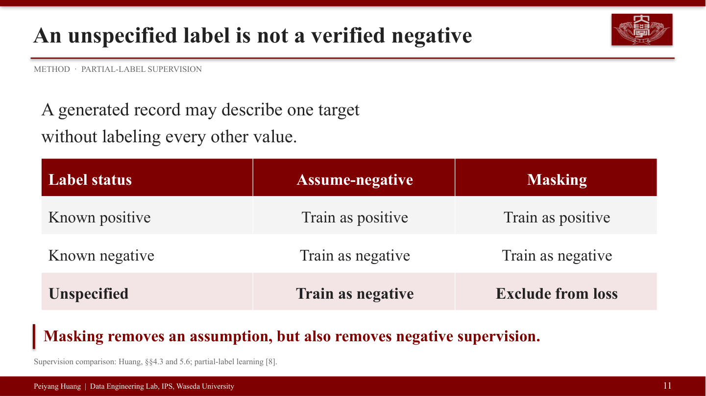

**画面阅读顺序（中）** 表格前两行在两种条件中相同，第三行才是干预点；底部句子说明去掉错误假设也会减少负监督。

**Reading order (EN)** The first two rows are unchanged across conditions. The third row is the intervention, and the footer states its trade-off.

### 本页讲解 / Slide explanation

**English explanation** A generated record may label only the requested value. A missing annotation can therefore mean unknown rather than absent. Both training conditions supervise known positives and known negatives. They differ on unspecified entries: assume-negative treats them as zero, while masking excludes them from loss. This handles missing annotations, but does not correct a wrongly supplied positive or negative. Synthetic-label quality and supervision scope are separate issues, and the later results show that masking does not consistently improve performance.

**中文讲解** 生成记录可能只标注被要求的价值，因此标注缺失可能表示未知，而非不存在。两种训练条件都监督已知正例和已知负例，区别只在未注明项：assume-negative 当作零，masking 排除出损失。这处理的是缺失标注，不能修正已经给错的正负标签。合成标签质量与监督范围是两个问题，后续结果也显示 masking 并非稳定提高性能。

### 本页优化：把 AI 标签质量与缺失标注分开 / Separate incorrect labels from missing annotations

| 情况 / Case | Masking 能否处理 / Does masking address it? | 应有的验证 / Required check |
| --- | --- | --- |
| 生成器未注明其他可能成立的价值 / Other values were left unspecified | 可以避免把未知项直接训练为负 / It can avoid supervising unknown entries as negatives | 比较监督协议与标签覆盖 / Compare supervision and annotation coverage |
| 生成器给定了错误主体、价值或方向 / A supplied actor, value or direction is wrong | 不能；`m=1` 的错误标签仍进入损失 / No; a wrong supervised target still enters the loss | 检查文本、主体归属和方向；独立语义审核 / Verify text, attribution and direction independently |
| 新闻式文本本身不连贯或过度模板化 / The generated text is incoherent or repetitive | 不能 / No | 语义质量、重复度与真实新闻迁移检查 / Check semantic quality, duplication and transfer to real news |

**建议加入表格下的一句 / Suggested sentence below the table:** “Masking handles unspecified entries; label correctness requires a separate audit.” / “Masking 处理未注明项，标签是否正确需要单独审核。”

### 本页问答 / Questions for this slide

关键词：known positive / known negative / unknown；masked BCE；positive weighting；negative subsampling。

### P11-Q01【必练】为什么未标注不等于负例？

**Q (EN)** Why should an unspecified synthetic label not automatically be treated as negative?

**问（中）** 为什么合成数据中没有注明的标签不应自动视为负例？

**A (EN)** A targeted generation prompt may annotate only selected values. Another value can still be present without being listed. Treating every unspecified entry as zero teaches the model that those values are absent, even though that was not verified. Masking removes such entries from the loss. It addresses an annotation assumption, but whether it improves predictions depends on the remaining supervision and must be measured.

**答（中）** 定向生成提示可能只标注指定价值，其他价值即使存在也未列出。如果把全部未注明条目设为零，就会让模型学习“这些价值不存在”，但这一点并未验证。Masking 将这类条目排除出损失，解决的是标注假设；是否提高预测表现，还取决于剩余监督，必须通过实验判断。

### P11-Q02【追问】能给一个 mask 的具体例子吗？

**Q (EN)** Can you demonstrate masking with a small example?

**问（中）** 能用一个小例子说明 mask 如何工作吗？

**A (EN)** Consider three directed labels. The first is known positive, the second known negative, and the third unknown. Their supervision mask is [1, 1, 0]. The first two contribute positive and negative loss, while the third contributes nothing. Under assume-negative supervision, the third instead receives target zero and mask one. This mask applies to label supervision; it is not an attention mask or a masked word in the input.

**答（中）** 假设三个有向标签分别为已知正、已知负、未知，监督 mask 就是 [1, 1, 0]。前两个分别贡献正类与负类损失，第三个不参与。Assume-negative 则把第三个设为目标零、mask 一。这里掩码作用于标签监督，不是注意力掩码，也不是把输入中的词遮住。

### P11-Q03【追问】损失函数具体是什么？

**Q (EN)** What is the masked binary cross-entropy objective?

**问（中）** 带掩码的二元交叉熵目标具体是什么？

**A (EN)** For each supervised entry, a positive target contributes minus its positive weight times log p, and a negative target contributes minus log one minus p. I multiply by the supervision mask and divide by the number of supervised entries across the minibatch. Unknown entries contribute neither loss nor denominator. The objective trains independent binary labels, which matches the multi-label output.

**答（中）** 对每个参与监督的条目，正目标贡献负的“正类权重乘 log p”，负目标贡献负的“log(1−p)”。乘以监督掩码后求和，再除以整个 minibatch 中参与监督的条目数。未知条目既不贡献损失，也不进入分母。这个目标训练独立二元标签，与多标签输出对应。

公式备查，不必逐符号朗读：

```text
L = Σ[u,l] m[u,l] × {−w+[l] y[u,l] log p[u,l]
                     −(1−y[u,l]) log(1−p[u,l])}
    / Σ[u,l] m[u,l]
```

`u` 是 batch 中的文章—主体单元，`l` 是有向标签，`m=1` 才参与监督。分母按已知条目数归一化，不是按正类权重总和归一化。

### P11-Q04【追问】正类权重怎么计算？它和 masking 是一回事吗？

**Q (EN)** How are class weights calculated, and how do they differ from masking?

**问（中）** 类别权重如何计算？与 masking 有什么区别？

**A (EN)** For each label, the positive weight is the square root of supervised negatives divided by supervised positives, with the positive count floored at one and the result clipped to [1, 10]. Masking decides whether an entry is supervised; weighting decides how much a known positive contributes. Negative subsampling changes which negatives are retained. Because weights use supervised counts, changing the mask can also change the weights.

**答（中）** 每个标签的正权重为“参与监督的负例数除以正例数”的平方根，正例分母至少为一，结果截断到 [1, 10]。Masking 决定条目是否参与监督；weighting 决定已知正例的贡献大小；负采样决定保留哪些负例。因为权重按已监督计数计算，所以改变 mask 也可能改变权重。

```text
w+[l] = clip(sqrt(n−[l] / max(n+[l], 1)), 1, 10)
```

### P11-Q05【质疑】masking 更符合逻辑，为什么结果可能更差？

**Q (EN)** If masking avoids false negatives, why can it hurt performance?

**问（中）** Masking 避免错误负监督，为什么反而可能降低性能？

**A (EN)** Removing unknown entries also removes negative training pressure. With sparse positive annotations, that can change score scales and make the fixed prediction threshold less suitable. Recomputed class weights can further change the balance. These are plausible explanations for the observed sensitivity, not verified mechanisms. I need controlled weight settings, score-distribution analysis, and threshold evaluation on separate selection data to distinguish them.

**答（中）** 去掉未知条目也会去掉大量负向训练约束。在正标注稀疏时，分数分布可能改变，使固定预测阈值不再合适；重算类别权重也可能进一步改变平衡。这些是解释敏感性的合理假设，并非已验证机制。需要固定权重的对照、分数分布分析，以及独立选择数据上的阈值评价来区分。

### P11-Q06【质疑】为什么官方数据和 full synthetic 就能把未注明项设成负？

**Q (EN)** Why do you fully supervise official and full-scope synthetic records?

**问（中）** 为什么官方记录和 full-scope 合成记录采用完整监督？

**A (EN)** The implemented protocol treats those records as providing a full target vector, so unlisted labels receive zero. That is an operational supervision assumption, not proof that the annotations are exhaustive. The main experiment tests how explicitly partial synthetic records are handled. If full-scope records also omit valid labels, their assumed negatives can still be noisy and should be included in the label audit.

**答（中）** 实现协议把这些记录当成提供完整目标向量，因此未列出的标签设为零。这是一项操作性监督假设，不是标注确实穷尽的证明。主要实验测试如何处理明确标为部分范围的合成记录。如果 full-scope 记录也漏掉有效标签，其假定负例仍有噪声，应纳入标签审核。

### P11-Q07【追问】为什么分类阈值是 0.30，而不是 0.5？

**Q (EN)** Why use a global prediction threshold of 0.30?

**问（中）** 为什么使用全局预测阈值 0.30？

**A (EN)** It is the common operating point used in the repeated encoder study. A threshold of 0.5 is not automatically optimal for imbalanced multi-label F1, especially with weighted training. However, I have not established that 0.30 is optimal either. Keeping it fixed makes the reported conditions comparable, while a separate selection split is needed for a fair threshold-tuning study.

**答（中）** 它是重复编码器实验统一采用的工作点。不平衡多标签 F1，尤其配合加权训练，并不保证 0.5 最优；同样也没有证明 0.30 最优。固定阈值让报告条件具有可比性，公平的阈值调优仍需要独立选择集。

### P11-Q08【质疑】masking 是否让错误的 AI 标签也变得安全可靠？

**Q (EN)** Does masking solve the problem of incorrect AI-generated labels?

**问（中）** Masking 是否解决了 AI 生成标签本身错误的问题？

**A (EN)** No. Masking only excludes unspecified entries. If the generator explicitly supplies a wrong label, that entry remains supervised and the model can learn the error. I therefore need to separate annotation scope from annotation correctness. The former is what the mask controls; the latter requires semantic checking, independent auditing and evaluation. A better supervision rule cannot substitute for examining whether the supplied labels are supported by the text.

**答（中）** 不能。Masking 只排除未注明条目。若生成器明确给出错误标签，该条目仍参与监督，模型就可能学到错误。因此必须区分标注范围与标注正确性：前者由 mask 控制，后者需要语义检查、独立审核与评价。更好的监督规则不能代替检查给定标签是否有文本依据。

依据：论文 §4.3、§5.4–5.6。注意：0.30 是独立编码器预测阈值；融合阈值 θ 是另一套机制，见第 23 页。

<a id="p12"></a>
## 第 12 页｜Revise eligible labels, then check direction

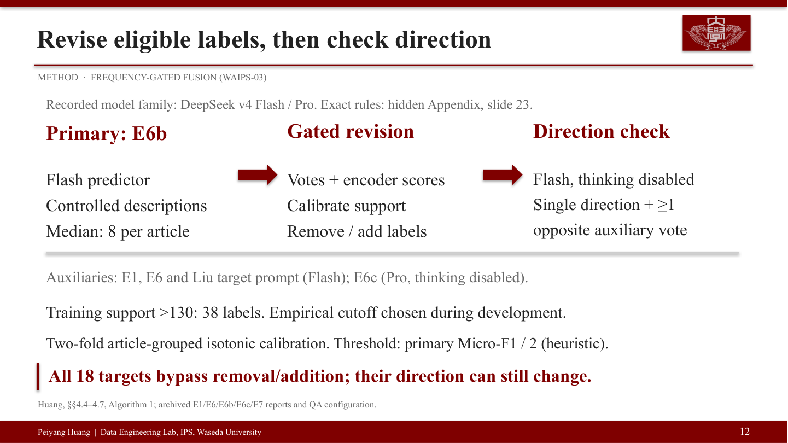

**画面阅读顺序（中）** 沿三块从左到右读：主预测、门控修订、方向检查；随后解释下方的频次条件、校准与阈值。

**Reading order (EN)** Follow the three blocks from primary prediction through gated revision to direction checking, then explain the rules below.

### 本页讲解 / Slide explanation

**English explanation** The primary system first proposes labels. Auxiliary votes and encoder scores provide support for keeping or adding candidates. Calibration means learning how raw support relates to observed correctness in development data. For an illustrative score group, 80 matches among 100 candidates would suggest 0.8 empirical correctness, not certainty for each candidate. Removal targets unsupported predictions, addition targets omissions, and QA addresses disputed directions. Their effects must be checked through precision, recall and DRR rather than assumed from the module names.

**中文讲解** 主系统先提出标签，辅助投票和编码器分数为保留或补充候选提供支持。校准是利用开发数据学习原始支持度与观察正确性的关系。举一个说明性例子：某分数组的 100 个候选中 80 个匹配参考，经验正确率为 0.8，但每个候选仍不确定。删除针对缺乏支持的预测，补充针对遗漏，QA 针对方向分歧。作用需要通过精确率、召回率和 DRR 检验，不能由模块名字直接认定。

### 本页优化：先解释校准，再讲算法名 / Explain calibration before naming the algorithm

**建议放在 “Calibrate support” 旁的短说明 / Suggested caption:** “Map support scores to observed correctness on development candidates.” / “把支持分数映射到开发候选上的观察正确性。”

**English bridge:** “Two agreeing models give two votes, not a correctness probability. Calibration uses labeled candidates to learn what different support levels mean. The isotonic algorithm and cross-fitting rules are in the technical appendix.”

**中文衔接：**“两个模型同意，只是获得两票，不等于某个正确概率。校准通过带参考标注的候选，学习不同支持度意味着什么。具体单调算法和交叉拟合规则放在技术附录解释。”

### 本页问答 / Questions for this slide

关键词：E6b primary；four auxiliaries；frequency gate；isotonic calibration；selective direction QA。

### P12-Q01【必练】完整推理流程是什么？

**Q (EN)** Can you walk through WAIPS-03 from article input to final output?

**问（中）** 能从文章输入开始，说明 WAIPS-03 的完整流程吗？

**A (EN)** E6b generates a primary prediction from controlled event descriptions. Four auxiliary systems provide additional candidates and votes, and the historical encoder provides label scores. For eligible frequent labels, calibrated support guides removal and addition. A separate Flash call then checks disputed single-direction values. Finally, the system exports directed predictions and their coarse projection. Development gold trains the calibrators offline; test inference does not read test gold.

**答（中）** E6b 先根据控制粒度的事件描述生成主预测；四个辅助系统提供候选与投票，历史编码器提供标签分数。对符合频次条件的标签，依据校准支持度进行删除与补充，再用独立 Flash 调用复核存在争议的单方向价值。最后导出有向预测及粗类别投影。开发集 gold 离线拟合校准器，测试推理不读取测试 gold。

### P12-Q02【追问】主模型和四个辅助成员分别是谁？

**Q (EN)** Which predictions are primary, and which models vote as auxiliaries?

**问（中）** 主预测和辅助投票分别来自哪些模型？

**A (EN)** E6b is the primary Flash predictor using controlled descriptions, with a development median of eight descriptions per article. E1, E6, and the frozen Liu target prompt are Flash-based auxiliaries. E6c uses the same E6b descriptions with a Pro predictor and thinking disabled. These are the recorded configurations. Their diversity does not imply statistically independent errors.

**答（中）** 主预测是基于控制粒度描述的 E6b Flash，开发集每篇描述数中位数为八。E1、E6 和固定 Liu target prompt 是 Flash 辅助成员；E6c 使用相同 E6b 描述，但预测器换为关闭 thinking 的 Pro。这些是档案中的配置；配置不同不意味着错误在统计上独立。

### P12-Q03【质疑】为什么只有高频标签能增删？

**Q (EN)** Why gate removal and addition by training frequency?

**问（中）** 为什么用训练频次限制删除和补充？

**A (EN)** Low-support labels provide limited evidence for reliable development-based revision. The gate conservatively preserves their primary predictions. The empirical cutoff is greater than 130 training positives, covering 38 directed labels. This protects existing rare predictions but also prevents recovering missing rare labels through addition. It is a trade-off, not a general theorem that frequent-label revision is always better.

**答（中）** 低支持标签为基于开发集的可靠修订提供的证据有限，因此门控保守地保留其主预测。经验阈值是训练正例超过 130，共覆盖 38 个有向标签。这保护了已有稀有预测，却也阻止补充阶段找回缺失的稀有标签，是取舍而非普遍正确的定理。

### P12-Q04【追问】什么时候触发方向 QA？会看到当前预测方向吗？

**Q (EN)** When is direction QA triggered, and what information does it receive?

**问（中）** 方向 QA 何时触发？它会接收到哪些信息？

**A (EN)** It is triggered when fusion contains only one direction for a value and at least one auxiliary supports the opposite direction. The question contains the article, actor, and value definition, but not the proposed direction. Flash is asked to choose aligned or contradictory. Values already predicted in both directions are skipped. Omitting the proposed answer reduces direct anchoring, but it does not establish that the new judgment is correct.

**答（中）** 当融合结果对某个价值只有一个方向，且至少一个辅助成员支持相反方向时触发。问题包含文章、主体和价值定义，不展示待复核的预测方向，要求 Flash 在 aligned 与 contradictory 中选择。已有双方向预测则跳过。不展示原答案能减少直接诱导，但不能保证新判断正确。

### P12-Q05【质疑】所有模型都同意，是否就不用担心错？

**Q (EN)** Can all members agree on a wrong direction?

**问（中）** 是否可能所有成员一致，却方向全错？

**A (EN)** Yes. They share the article and taxonomy, and several use the same model family. Common framing or attribution errors can survive unanimous agreement and will not trigger the current disagreement rule. The rule reduces the number of checks; it is not a complete error detector. A future audit should include agreed cases as well as disputed ones.

**答（中）** 可能。成员使用同一文章和分类体系，其中多个属于同一模型家族。共同的叙述理解或主体归属错误可能在一致意见中保留下来，也不会触发当前分歧规则。该规则减少检查数量，不是完备的错误检测器；后续审核应同时抽查一致与分歧案例。

### P12-Q06【质疑】生成的 descriptions 是否是可靠原文证据？

**Q (EN)** Are the generated descriptions guaranteed to preserve the original evidence?

**问（中）** 生成的事件描述是否保证保留原文证据？

**A (EN)** No. They are generated summaries rather than guaranteed verbatim spans. They may omit qualifications, merge actors, or alter causal relationships. The segmentation prompt does not use the value taxonomy, but that alone does not guarantee factual fidelity. I need evidence-linked auditing to test whether a correct final label is supported by a faithful intermediate description.

**答（中）** 不保证。它们是生成摘要，不是保证逐字对应的原文片段，可能丢失限定语、合并主体或改变因果关系。切分提示不使用价值分类体系，但这本身不能保证事实忠实。需要证据关联审核，检验最终正确标签是否依赖忠实的中间描述。

### P12-Q07【追问】WAIPS-02 与这个方法究竟有什么不同？

**Q (EN)** How does the simpler WAIPS-02 system work?

**问（中）** 更简单的 WAIPS-02 如何工作？

**A (EN)** WAIPS-02 uses three Pro prompt outputs and keeps exact directed labels supported by at least two. A separate full-article Flash prediction supplies cached direction choices for the retained values. It has no encoder-supported calibrated removal-and-addition stage. Its direction lookup stores one direction per actor–value key; if Flash returns both, the last entry is used. That historical order sensitivity is a limitation, not a desirable task rule.

**答（中）** WAIPS-02 对三个 Pro 提示输出进行精确有向标签投票，至少两个支持才保留；另一次完整文章 Flash 预测为保留的价值提供缓存方向选择。它没有编码器支持的校准增删阶段。方向查找表每个主体—价值只存一个方向，Flash 若输出两个则采用最后条目；这种历史实现的顺序敏感性是局限，不是理想任务规则。

### P12-Q08【必练】先不讲公式，校准这一步到底在做什么？

**Q (EN)** Before the formulas, what does calibration actually do in your pipeline?

**问（中）** 先不讲公式，校准在流程里到底做什么？

**A (EN)** Votes and encoder scores give a candidate a support score, but the scale does not directly tell us how often such candidates are correct. Calibration uses development labels to learn that relationship. It provides an estimated correctness level used by the revision threshold. It does not verify the news, repair actor evidence, or guarantee any single prediction. The maps are fitted separately from the articles they score during development cross-fitting.

**答（中）** 投票和编码器分数给候选一个支持度，但这个刻度不能直接告诉我们类似候选有多常正确。校准利用开发标签学习这项关系，为修订阈值提供估计正确性。它不核实新闻事实、不修复主体证据，也不保证每条预测正确。开发集交叉拟合时，映射使用与被评分文章分开的文章拟合。

依据：论文 §4.4–4.7。模型名指保存运行记录中的标识，不代表对当前 API 可用性或性能作出新的判断。

<a id="p13"></a>
## 第 13 页｜Keep data splits and evaluation measures distinct

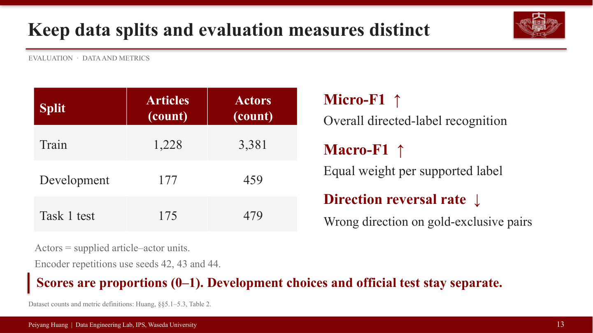

**画面阅读顺序（中）** 左边表格先定义文章与主体单元，右边依次解释 Micro、Macro、DRR，最后区分数据划分和重复运行。

**Reading order (EN)** Use the left table to define evaluation units, then explain Micro, Macro and DRR on the right and the split/run notes below.

### 本页讲解 / Slide explanation

**English explanation** Micro-F1 pools exact directed-label matches and balances false positives against missed reference labels. Macro-F1 gives equal weight to each supported label, while DRR counts the specified direction-reversal error. For G0 versus G4, false positives fall from 1,442 to 1,272 and false negatives from 938 to 888, so the observed final gain includes both fewer unmatched predictions and fewer misses. This decomposition comes from the saved outputs, not from F1 alone. Seed variation and bootstrap uncertainty describe different sources of variation.

**中文讲解** Micro-F1 汇总精确有向标签匹配，平衡假阳性与参考标签遗漏；Macro-F1 给每个有参考支持的标签相同权重；DRR 则统计特定方向反转错误。G0 到 G4 的假阳性从 1442 降到 1272，假阴性从 938 降到 888，所以最终观察增益同时包含更少未匹配预测和更少遗漏。这来自保存输出的分解，不是单凭 F1 推断。种子波动与 bootstrap 描述的也是不同不确定性。

### 本页优化：用计数回答“少误报还是少漏检” / Explain the gain with error counts

| 保存阶段 / Saved stage | TP 正确匹配 / Matches | FP 未匹配预测 / Unmatched predictions | FN 漏掉参考 / Missed gold | Precision | Recall | Micro-F1 |
| --- | ---: | ---: | ---: | ---: | ---: | ---: |
| G0 主预测 / Primary | 1,452 | 1,442 | 938 | 0.5017 | 0.6075 | 0.5496 |
| G1 删除后 / Removal | 1,346 | 1,064 | 1,044 | 0.5585 | 0.5632 | 0.5608 |
| G3 再补充 / Addition | 1,495 | 1,279 | 895 | 0.5389 | 0.6255 | 0.5790 |
| G4 再查方向 / Direction QA | 1,502 | 1,272 | 888 | 0.5415 | 0.6285 | 0.5817 |

**English takeaway:** “The final comparison has 170 fewer false positives and 50 fewer false negatives. Individual stages differ: removal reduces false positives but increases misses, and addition reverses part of that trade-off. F1 alone cannot reveal this decomposition.”

**中文结论：**“最终比较少了 170 个假阳性、50 个假阴性；但各阶段不同，删除减少假阳性同时增加遗漏，补充再改变这项取舍。仅 F1 本身无法给出这个分解。”

计数根据保存 metrics 中 `target18` 与 `nontarget90` 的 TP/FP/FN 相加核对：[G0](../../RH_test/E7_calibrated_jury_fusion/runs/20260725_004522_G0_passthrough/metrics.json)、[G1](../../RH_test/E7_calibrated_jury_fusion/runs/20260725_004522_G1_veto/metrics.json)、[G3](../../RH_test/E7_calibrated_jury_fusion/runs/20260725_004522_G3_veto_add/metrics.json)、[G4](../../RH_test/E7_calibrated_jury_fusion/runs/20260725_004522_G4_dirqa/metrics.json)。FP/FN 均相对于基准 gold，不等于独立判断新闻事实真假。

### 本页问答 / Questions for this slide

关键词：supplied actors；Micro-F1；gold-supported Macro-F1；DRR；ROC-AUC；sample SD；percentage points。

### P13-Q01【必练】数据量是多少？“Actors”是什么意思？

**Q (EN)** What are the dataset sizes, and what does the actor count mean?

**问（中）** 数据规模是多少？Actors 计数是什么意思？

**A (EN)** Training contains 1,228 articles and 3,381 supplied article–actor units. Development has 177 articles and 459 units; Task 1 test has 175 articles and 479 units. An actor in two articles forms two evaluation units. Training and development have 16,905 and 2,390 unique directed gold tuples. Test gold is not locally available, so I report organizer-provided test scores.

**答（中）** 训练集有 1228 篇文章、3381 个给定文章—主体单元；开发集 177 篇、459 个；Task 1 测试集 175 篇、479 个。同一主体出现在两篇文章中，形成两个评价单元。训练与开发分别有 16905 和 2390 个唯一有向 gold 元组。测试 gold 本地不可用，所以报告主办方提供的测试成绩。

### P13-Q02【质疑】为什么编码器用 456 个开发主体，而不是 459？

**Q (EN)** Why do the encoder analyses use 456 development units instead of 459?

**问（中）** 为什么编码器分析使用 456 个开发单元，而非 459 个？

**A (EN)** The historical encoder loader constructs units from actors with positive gold annotations: 3,335 in training and 456 in development. The event base supplies 3,381 and 459 respectively. The excluded actors have no positive article-level gold, but predictions on them could still be false positives. Therefore, encoder and prompt results do not have identical coverage, and future comparisons should evaluate all supplied actors consistently.

**答（中）** 历史编码器 loader 从有正 gold 标注的主体构造样本，所以训练是 3335、开发是 456，而事件输入分别提供 3381 和 459 个。被排除的主体没有文章级正 gold，但在它们上面预测仍可能产生假阳性。因此编码器与提示结果的覆盖范围并不完全相同，后续对照应统一评价全部给定主体。

### P13-Q03【追问】Micro-F1 怎么算？为什么不报 accuracy？

**Q (EN)** How is Micro-F1 computed, and why not use ordinary accuracy?

**问（中）** Micro-F1 如何计算？为什么不用普通 accuracy？

**A (EN)** I pool exact directed-tuple true positives, false positives, and false negatives across evaluation units, then compute 2TP divided by 2TP+FP+FN. For example, TP=3, FP=1, and FN=2 gives F1=6/9. Ordinary per-label accuracy can be dominated by the many absent labels. Exact-set accuracy would instead require the entire label set to match and answers a different, stricter question.

**答（中）** 我跨评价单元汇总精确有向元组的 TP、FP、FN，再计算 2TP/(2TP+FP+FN)。例如 TP=3、FP=1、FN=2，F1=6/9。普通逐标签准确率容易被大量不存在的标签主导；整集合准确率则要求全部标签集合完全匹配，回答的是另一种更严格的问题。

### P13-Q04【追问】Macro-F1 如何算？对稀有类别有什么意义？

**Q (EN)** How is Macro-F1 defined in this benchmark?

**问（中）** 本基准怎样定义 Macro-F1？

**A (EN)** It averages per-label F1 over labels with at least one gold positive in the evaluated split. Development has 93 supported directed labels. Each included label receives equal weight, so rare classes matter more than under Micro-F1. It is not the harmonic mean of macro precision and macro recall. Predictions for gold-absent labels still harm Micro-F1, although they have no separate term in this Macro-F1.

**答（中）** 它对当前评价划分中至少有一个 gold 正例的标签，逐类计算 F1 后取平均。开发集有 93 个受支持的有向标签，每个纳入标签权重相同，因此稀有类别比在 Micro-F1 中更有影响。它不是 macro precision 与 macro recall 的调和平均。对 gold 中不存在的类别乱预测仍会损害 Micro-F1，但不会单独进入这种 Macro-F1。

### P13-Q05【必练】DRR 分母到底是什么？为什么漏预测不算方向反转？

**Q (EN)** What exactly does direction reversal rate measure?

**问（中）** 方向反转率 DRR 精确测量什么？

**A (EN)** DRR uses gold article–actor–value pairs that have exactly one gold direction. A reversal occurs if the prediction includes the opposite direction for that same value. Development has 2,222 eligible pairs; 84 pairs with both gold directions are excluded. Missing predictions remain in the denominator but do not count as reversals. Therefore, DRR measures a specific error type, not overall direction accuracy or successful value recovery.

**答（中）** DRR 只针对 gold 中恰好有一个方向的“文章—主体—价值”组合。如果预测包含同一价值的相反方向，就计一次反转。开发集有 2222 个符合条件的组合，另外 84 个双 gold 方向组合被排除。漏预测仍在分母中，却不计反转。因此 DRR 测量特定错误，不是总体方向准确率，也不表示成功找回价值。

### P13-Q06【追问】把两个方向都预测出来，能否规避 DRR？

**Q (EN)** Can predicting both directions avoid a reversal penalty?

**问（中）** 两个方向都预测，能否避免方向反转惩罚？

**A (EN)** No. If gold contains only aligned and I predict both aligned and contradictory, I get one correct directed tuple and one false positive, and DRR still counts a reversal. If I predict only contradictory, I create a false positive and miss the aligned gold tuple. Only when gold itself contains both directions is that actor–value pair excluded from DRR.

**答（中）** 不能。若 gold 只有 aligned，而我两个方向都预测，会有一个正确元组、一个假阳性，并且 DRR 仍计反转。如果只预测 contradictory，则既产生假阳性，也漏掉 aligned gold。只有 gold 本身含两个方向时，该主体—价值组合才被 DRR 排除。

### P13-Q07【追问】AUC 是什么？为什么可以 AUC 很高而 F1 为零？

**Q (EN)** What does target ROC-AUC measure, and how can it disagree with F1?

**问（中）** 目标 ROC-AUC 测量什么？为什么可能与 F1 不一致？

**A (EN)** I average per-label ROC-AUC over the 18 targets. It measures how often positives receive higher scores than negatives, giving half credit to ties. Consider a hypothetical positive scored 0.2 and a negative scored 0.1: ranking is perfect, but a 0.30 threshold predicts neither, so recall is zero. AUC therefore does not establish a usable threshold. Precision–recall curves would add useful evidence for rare labels.

**答（中）** 我对 18 个目标分别计算 ROC-AUC 后平均。它衡量正例分数高于负例的程度，同分按一半计。假设一个正例得 0.2、负例得 0.1，排序完美，但阈值 0.30 时两个都不预测，召回就是零。因此 AUC 不能证明存在可直接使用的阈值；对稀有标签，PR 曲线也能提供有用补充。

### P13-Q08【追问】三随机种子的标准差和 95% 区间有什么区别？

**Q (EN)** Are the reported standard deviations and confidence intervals measuring the same uncertainty?

**问（中）** 报告的标准差和置信区间是否测量同一种不确定性？

**A (EN)** No. The sample standard deviation across seeds describes variation among three encoder training runs. The paired bootstrap interval resamples articles while holding the fusion predictions fixed. It measures dataset-sampling uncertainty under that procedure, not retraining or API variation. Three seeds are a limited stability check, and the saved prompt results should not be described as three-seed averages.

**答（中）** 不是。三个种子的样本标准差描述三次编码器训练间的波动。配对 bootstrap 区间固定融合预测，对文章重采样，描述该程序下的数据抽样不确定性，不包含重新训练或 API 波动。三个种子只是有限稳定性检查，保存的提示结果不能说成三种子均值。

### P13-Q09【追问】3.21 pp 和提高 3.21% 是一回事吗？

**Q (EN)** What is the difference between percentage-point and relative improvement?

**问（中）** 百分点提升和相对百分比提升有什么区别？

**A (EN)** Moving from 0.5496 to 0.5817 is an absolute gain of 0.0321, or 3.21 percentage points on the percentage scale. The relative increase is approximately 0.0321 divided by 0.5496, or 5.84 percent. I use percentage points in the slides to avoid confusing these quantities. An F1 of 0.5817 is also not a statement that 58.17 percent of all individual decisions are correct.

**答（中）** 从 0.5496 到 0.5817，绝对差是 0.0321，换成百分数刻度就是 3.21 个百分点。相对提升约为 0.0321/0.5496，即 5.84%。PPT 使用百分点避免混淆。另外，F1=0.5817 也不等于所有单独判断中有 58.17% 正确。

### P13-Q10【质疑】WAIPS-03 是否对 479 个测试主体全部产生非空预测？

**Q (EN)** Does WAIPS-03 produce nonempty predictions for all 479 supplied test actors?

**问（中）** WAIPS-03 是否为全部 479 个给定测试主体产生非空预测？

**A (EN)** No. The submission covers all 175 articles but has nonempty predictions for 470 actor units, with 2,764 directed tuples and 2,136 coarse tuples. Missing predictions are evaluated as empty sets, not removed from the evaluation. The minimum-one rule only prevents deletion from emptying an already nonempty primary set; it does not guarantee a prediction for every supplied actor. Coverage must therefore be reported separately from format validity.

**答（中）** 没有。提交覆盖全部 175 篇文章，但只有 470 个主体单元具有非空预测，共 2764 个有向元组、2136 个粗类别元组。缺失预测按空集合评价，不会从评价中排除。保底一个规则只防止把原本非空的主集合删空，不保证每个给定主体都有预测。因此覆盖情况必须与格式合法性分别报告。

### P13-Q11【追问】E1 的未匹配和遗漏数字分别意味着什么？与 G0 是同一组预测吗？

**Q (EN)** What do E1’s 1,129 unmatched predictions and 1,062 missed labels mean, and are these the fusion starting point?

**问（中）** E1 的 1129 个未匹配预测和 1062 个遗漏标签是什么意思？它们是否来自融合的起点？

**A (EN)** E1 predicts 2,457 directed tuples: 1,328 match gold and 1,129 do not. Gold contains 2,390 tuples, so 1,062 are missed. These are false positives and false negatives under exact article–actor–value–direction matching. A wrong direction can create both, so their sum is not a count of independently mistaken articles. These counts come from one saved E1 development run. Fusion starts from E6b/G0, whose counts are in the table above; the two systems must not be mixed.

**答（中）** E1 预测 2457 个有向元组，其中 1328 个匹配 gold，1129 个不匹配。Gold 共 2390 个，因此漏掉 1062 个。这是在文章—主体—价值—方向精确匹配下的假阳性和假阴性。一次方向错误可能同时造成二者，不能把两者之和说成独立出错文章数。这些数字来自一次保存的 E1 开发运行；融合起点则是上表的 E6b/G0，不能混用两组计数。

依据：[E1 归档报告 §2](../../RH_test/E1_fewshot_repair/reports/E1_REPORT.md)。这是指标备答，不是第 3 页当前画面的内容。

依据：论文 §5.2–5.3、附录 A；[本地官方任务说明](../论文/NTCIR_FEHU_TaskOverview%20%281%29.pdf)。

<a id="p14"></a>
## 第 14 页｜Representation and model configuration differ

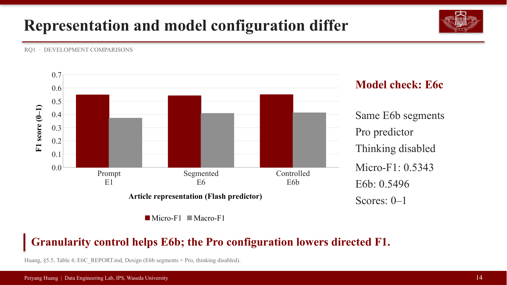

**画面阅读顺序（中）** 先看左图 E1、E6、E6b 的同一模型比较，再看右侧 E6c 的模型配置变化。

**Reading order (EN)** Read the E1/E6/E6b representation comparison before the separate E6c model-configuration comparison.

### 本页讲解 / Slide explanation

**English explanation** E1 uses the article directly, E6 uses generated event descriptions, and E6b changes the segmentation instruction while retaining the Flash predictor. E6b improves the saved directed F1 relative to E6, but the improvement does not prove that actor attribution alone became better. The right side changes a different factor: E6c reuses E6b descriptions with a Pro predictor and thinking disabled. That result should be interpreted as a model-configuration comparison, with repeated calls still needed to assess stability.

**中文讲解** E1 直接使用文章，E6 使用生成事件描述，E6b 修改切分指令并保留 Flash 预测器。E6b 相比 E6 提高了保存结果中的有向 F1，但不能据此证明仅主体归属得到改善。右侧改变的是另一因素：E6c 复用 E6b 描述，使用关闭 thinking 的 Pro 预测器，因此应解释为模型配置比较，稳定性仍需要重复调用验证。

### 本页问答 / Questions for this slide

关键词：E1；E6；E6b；E6c；segmentation granularity；confounding；saved runs。

### P14-Q01【必练】这几个实验分别改变了什么？

**Q (EN)** What changes across E1, E6, E6b, and E6c?

**问（中）** E1、E6、E6b、E6c 各自改变了什么？

**A (EN)** E1 predicts from the article directly. E6 predicts from generated event descriptions. E6b changes the segmentation instruction to reduce fragmentation while retaining the Flash predictor. E6c reuses E6b’s descriptions but changes the predictor to Pro with thinking disabled. Therefore, E6 versus E6b mainly tests the granularity instruction, whereas E6b versus E6c changes model configuration, not the segment format.

**答（中）** E1 直接基于文章预测；E6 基于生成事件描述预测；E6b 修改切分指令以减少碎片化，保留 Flash 预测器；E6c 复用 E6b 描述，但预测器换成关闭 thinking 的 Pro。因此 E6 对 E6b 主要比较粒度指令，E6b 对 E6c 改变的是模型配置，不是片段格式。

### P14-Q02【追问】怎样理解这些分数，而不是只挑最好的说？

**Q (EN)** What do the representation results actually show?

**问（中）** 表示实验的结果究竟说明什么？

**A (EN)** E1 has Micro-F1 0.5480 and Macro-F1 0.3719. E6 changes these to 0.5412 and 0.4079: Micro falls while Macro rises. E6b reaches 0.5496 and 0.4124. This suggests useful trade-offs in these saved outputs, but E6b’s Micro advantage over E1 is only 0.16 percentage points. I should not call every representation change an overall improvement or assume that small differences will survive reruns.

**答（中）** E1 的 Micro-F1 为 0.5480、Macro-F1 为 0.3719；E6 变成 0.5412、0.4079，表现为 Micro 下降、Macro 上升；E6b 达到 0.5496、0.4124。保存结果显示有意义的取舍，但 E6b 比 E1 的 Micro 只高 0.16 个百分点，不能把每次表示修改都称为全面提升，也不能假定小差异能在重跑中保持。

### P14-Q03【追问】为什么八个描述比十二个合理？

**Q (EN)** Why might fewer segments help, and is eight an optimized number?

**问（中）** 为什么更少片段可能有帮助？八个是否是优化出的最佳数量？

**A (EN)** Related sentences can contain an action, its actor, and a consequence. Splitting them too aggressively may remove the context needed for attribution or direction. E6b asks for roughly six to nine descriptions and has a median of eight, compared with E6’s median of twelve. These are observed distributions, not fixed segment counts. I have not established an optimal count or directly measured the proposed context-preservation mechanism.

**答（中）** 相邻句子可能分别交代行为、主体和后果，过度切分会失去判断归属与方向所需的上下文。E6b 要求大约六至九条描述，实际中位数八；E6 的中位数十二。这是观察到的分布，不是每篇固定数量。我尚未证明最佳数量，也没有直接验证“保留上下文”的机制。

### P14-Q04【质疑】Pro 为什么比 Flash 差？能说大模型不如小模型吗？

**Q (EN)** Why does E6c perform worse on directed labels despite using Pro?

**问（中）** E6c 使用 Pro，为何有向标签表现反而较差？

**A (EN)** E6c’s Task 1b Micro-F1 is 0.5343, below E6b’s 0.5496, and its DRR rises to 0.0657. Yet coarse Task 1a Micro-F1 rises from 0.6621 to 0.6774. The configuration appears to recover coarse values differently while making more directed errors. One saved comparison cannot establish a general model-size effect, especially because model configuration and reasoning mode are involved.

**答（中）** E6c 的 Task 1b Micro-F1 为 0.5343，低于 E6b 的 0.5496，DRR 升至 0.0657；但粗粒度 Task 1a Micro-F1 从 0.6621 升到 0.6774。该配置似乎改变了粗价值恢复，同时产生更多有向错误。一次保存结果无法证明模型规模的普遍效应，尤其还涉及模型配置与推理模式。

### P14-Q05【质疑】是否证明了主体归属改善？实验能重复吗？

**Q (EN)** Do these F1 results prove better actor attribution or stable improvements?

**问（中）** 这些 F1 结果是否证明主体归属改善，或提升稳定可重复？

**A (EN)** No. F1 combines several error types and does not isolate attribution quality. These are saved prompt runs, not repeated API measurements with uncertainty estimates. Low temperature does not by itself guarantee identical responses. I would add actor-linked evidence judgments and repeated calls with preserved model identifiers, prompts, and raw responses to test those stronger claims.

**答（中）** 不能。F1 混合多种错误，不能隔离主体归属质量；这里是保存的提示运行，不是具有不确定性估计的 API 重复测量。低温度本身也不保证输出完全一致。应补充与主体关联的证据评价，并保存模型标识、提示和原始响应进行重复调用，检验更强的主张。

依据：论文 §5.5。E1 使用两个完整训练示例；其提示修订取消了早期的示例标签与输出数量限制。它不是零样本基线。

<a id="p15"></a>
## 第 15 页｜Ranking improves; target prediction remains weak

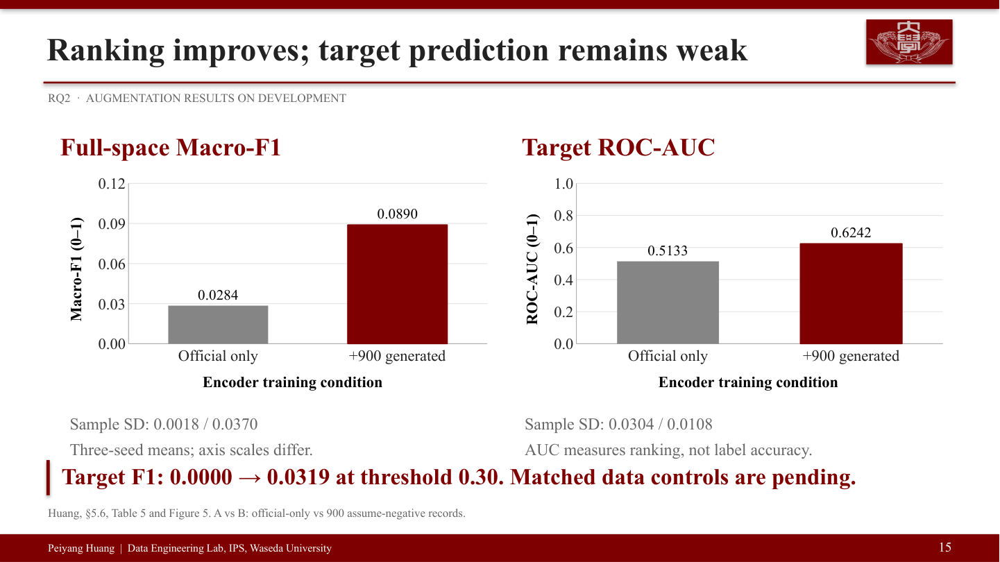

**画面阅读顺序（中）** 先分别读两张图的指标和轴范围，再读底部目标 F1 与缺少匹配对照的限定。

**Reading order (EN)** Read each chart’s metric and axis separately, then the target-F1 result and control limitation at the bottom.

### 本页讲解 / Slide explanation

**English explanation** Adding 900 generated records improves mean full-space Macro-F1 and target AUC across the three encoder seeds. AUC asks whether positives tend to rank above negatives. It does not say that the chosen output labels are already reliable. Target F1 at threshold 0.30 is only 0.0319, and DRR worsens in the full results. The evidence supports a conditional training benefit, while equal-sized generic generation and oversampling are needed to establish the value of diagnosis-guided targeting.

**中文讲解** 加入 900 条生成记录后，三个编码器种子的全空间平均 Macro-F1 和目标 AUC 均改善。AUC 衡量正例是否倾向于排在负例前面，不能说明实际选出的标签已经可靠。阈值 0.30 下目标 F1 仅为 0.0319，完整结果中的 DRR 还变差了。因此证据支持有条件的训练收益，诊断选择的额外价值仍要通过等量通用生成与过采样验证。

### 本页问答 / Questions for this slide

关键词：A vs B；three-seed mean；ranking vs decisions；target F1；augmentation attribution。

### P15-Q01【必练】数据增强到底改善了什么？

**Q (EN)** What improvement can you defend from the A-versus-B comparison?

**问（中）** A 与 B 的比较，能够支持怎样的增强结论？

**A (EN)** Adding the 900 generated records under assume-negative supervision raises mean full-space Macro-F1 from 0.0284 to 0.0890 and mean target AUC from 0.5133 to 0.6242. Both measures improve in all three seeds. The defensible claim is improvement under this tested training protocol. It does not yet establish that diagnosis-guided generation is better than other ways of adding an equal amount of data.

**答（中）** 在 assume-negative 监督下加入 900 条生成记录，使全标签空间平均 Macro-F1 从 0.0284 升至 0.0890，目标平均 AUC 从 0.5133 升至 0.6242；两项在三个种子中均改善。能够支持的是当前训练协议下的改善，尚不能证明诊断驱动生成优于其他等量增加数据的方式。

### P15-Q02【质疑】AUC 0.6242 是否代表目标预测已经可用？

**Q (EN)** Is target recognition successful when AUC reaches 0.6242?

**问（中）** AUC 达到 0.6242，是否意味着目标识别已经成功？

**A (EN)** No. At the shared 0.30 threshold, mean target F1 increases from zero to only 0.0319. The scores rank positives better, but the selected predictions are still weak. I therefore distinguish improved ranking from reliable target recovery. I would inspect precision–recall curves and score calibration on selection data before proposing a usable operating point.

**答（中）** 不能。在统一 0.30 阈值下，目标平均 F1 仅从零升到 0.0319。分数对正例的排序有所改善，但选出的预测仍很弱。因此要区分排序改善与可靠找回目标。我会在选择数据上检查 PR 曲线和分数校准，再提出可用工作点。

### P15-Q03【质疑】为什么只展示 Macro 和 AUC？其他指标有没有恶化？

**Q (EN)** Did augmentation also worsen any important metric?

**问（中）** 增强是否也使重要指标变差？

**A (EN)** Yes. Mean Micro-F1 rises only from 0.3008 to 0.3109, while mean DRR increases from 0.1580 to 0.2823. The slide focuses on label coverage and ranking, but these direction errors must also be disclosed. The result is not a uniformly better classifier. It motivates separating label recovery from direction control and evaluating their trade-off explicitly.

**答（中）** 有。平均 Micro-F1 仅从 0.3008 升到 0.3109，而平均 DRR 从 0.1580 升至 0.2823。这页重点展示标签覆盖与排序，但也必须披露方向错误增加。结果并非各方面都更好的分类器，这支持把标签恢复与方向控制分开研究，并明确评价取舍。

### P15-Q04【追问】为何 Macro-F1 仍这么低？是否只学到了少数标签？

**Q (EN)** What does the low absolute Macro-F1 tell you?

**问（中）** Macro-F1 的绝对值仍很低，说明什么？

**A (EN)** It indicates weak performance when supported classes receive equal weight, even though common labels can produce a much higher Micro-F1. Class imbalance, limited supervised examples, truncation, and annotation difficulty are plausible contributors. I should verify these through per-label errors rather than select one explanation. The increase is a useful diagnostic result, but it does not make the encoder a strong standalone solution.

**答（中）** 它表明给受支持类别同等权重时，整体表现仍弱，尽管常见标签可以让 Micro-F1 高得多。不平衡、监督样本有限、截断和标注难度都可能相关，应通过逐标签错误验证，而不能任挑一个原因。提升具有诊断意义，但并未使编码器成为强大的独立解决方案。

### P15-Q05【质疑】也许只是增加训练步数或重复样本产生效果？

**Q (EN)** Could the gain come from more data or training exposure rather than targeted content?

**问（中）** 增益会不会来自更多数据或训练暴露，而非定向内容？

**A (EN)** Yes, that remains possible. Adding records changes both the examples seen and potentially the number of optimizer updates per epoch. Equal-sized targeted generation, generic generation, and oversampling should be compared with the same supervision protocol and a declared training-budget policy. Without those controls, I can attribute the result to the tested augmented condition, not specifically to the targeting mechanism.

**答（中）** 有可能，这还未排除。增加记录既改变所见样本，也可能改变每个 epoch 的优化更新次数。应在同样监督协议和明确训练预算规则下，比较等量定向生成、通用生成与过采样。没有这些对照，只能归因于测试的增强条件，不能专门归因于目标选择机制。

依据：论文 Table 5。图中两组纵轴范围不同，不应比较柱子的视觉高度来判断两个指标谁改善更多。

<a id="p16"></a>
## 第 16 页｜Masking is sensitive to data and random seed

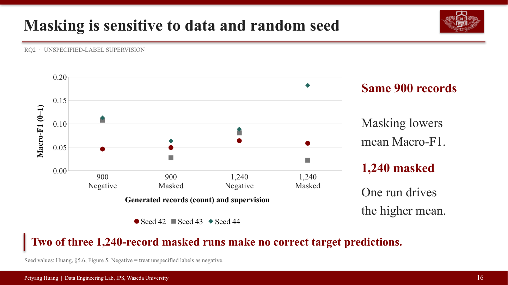

**画面阅读顺序（中）** 左图按数据量与监督方式分组，每个点是一个种子；右侧两条解释分别对应 900 和 1240 条条件。

**Reading order (EN)** Read each point as one seed within a data/supervision condition, then connect the two notes to their corresponding groups.

### 本页讲解 / Slide explanation

**English explanation** The dots show why a mean alone is insufficient. With the same 900 records, masking lowers the average Macro-F1. With 1,240 records, the masked condition has one strong run and two much weaker runs, including two without correct target predictions. A higher average in that pair does not establish a stable improvement. The experiment answers whether the implemented masking protocol helped under these conditions, while the reasons for its instability still need controlled investigation.

**中文讲解** 这些点说明为什么不能只看均值。同样 900 条记录下，masking 降低平均 Macro-F1；1240 条条件下，masked 有一次高分和两次明显较弱运行，其中两次没有正确目标预测。这一组较高的平均值不等于稳定提升。实验回答的是这些条件下实现的 masking 协议是否有效，其不稳定原因还需要控制研究。

### 本页问答 / Questions for this slide

关键词：B / C / Fp / Gp；sample variability；negative supervision；negative subsampling。

### P16-Q01【必练】这页最主要的结论是什么？

**Q (EN)** What is the main conclusion of the masking comparison?

**问（中）** Masking 对照最主要的结论是什么？

**A (EN)** Masking is not consistently beneficial in these runs. With the same 900 records, mean Macro-F1 falls from 0.0890 to 0.0470 and target AUC from 0.6242 to 0.5770. With 1,240 records, the masked mean is higher than the assume-negative mean, but variation is much larger. The effect depends on the data composition and seed, so I cannot recommend masking as an unconditional improvement.

**答（中）** 在这些运行中，masking 并非稳定有效。同样 900 条记录下，平均 Macro-F1 从 0.0890 降至 0.0470，目标 AUC 从 0.6242 降到 0.5770。1240 条记录下，masked 均值较高，但波动大得多。因此效果依赖数据组成和种子，不能把 masking 当成无条件改善。

### P16-Q02【质疑】1240 条数据中 masked 的均值更高，为什么不直接选它？

**Q (EN)** Why not select the masked 1,240-record condition based on its higher mean?

**问（中）** 为什么不根据较高均值，直接选择 1240 条的 masked 条件？

**A (EN)** Its Macro-F1 values are 0.0587, 0.0224, and 0.1822, giving a mean of 0.0878 with sample standard deviation 0.0838. One run drives much of the mean, and two runs produce no correct target predictions. The assume-negative condition has mean 0.0779 with much smaller standard deviation 0.0126. I need to report both expected performance and instability rather than hide the weak runs.

**答（中）** 它的三个 Macro-F1 是 0.0587、0.0224、0.1822，均值 0.0878，样本标准差 0.0838。均值很大程度由一次高分推动，而且两次没有正确目标预测。Assume-negative 的均值是 0.0779，标准差仅 0.0126。应同时报告平均表现与不稳定性，不能隐藏低分运行。

### P16-Q03【追问】900 和 1240 的比较能证明什么？

**Q (EN)** Is the 900-versus-1,240 comparison a pure data-size experiment?

**问（中）** 900 与 1240 的比较是否是纯粹的数据量实验？

**A (EN)** No. The extra 340 records come from a different generation round with a different screening history, so quantity and composition change together. The same-size B-versus-C and Fp-versus-Gp comparisons more directly examine supervision choices. Even there, weights are recomputed from supervised entries, so the result is the effect of the implemented supervision protocol, not necessarily masking in isolation.

**答（中）** 不是。新增 340 条来自另一轮生成，筛查历史也不同，因此数量和组成同时变化。同规模的 B/C、Fp/Gp 更直接比较监督选择；但即便如此，权重也按监督条目重算，所以测得的是实现监督协议的效果，不一定是单独 masking 的效果。

### P16-Q04【追问】减少负例能否解决低召回？

**Q (EN)** What happened when you subsampled negative supervision?

**问（中）** 对负监督进行采样后发生了什么？

**A (EN)** Recall rose sharply, but precision remained very low. N1 reaches mean target recall 0.9381 with precision 0.0179 and F1 0.0351, alongside about 7,255 false positives per run. N3 has recall 0.5929, precision 0.0284, and F1 0.0537. These results show that high recall alone can mainly reflect excessive output, rather than accurate discrimination.

**答（中）** 召回显著上升，但精确率仍很低。N1 的目标平均召回为 0.9381、精确率 0.0179、F1 0.0351，每次运行平均约 7255 个假阳性。N3 的召回 0.5929、精确率 0.0284、F1 0.0537。这说明高召回可能主要来自大量输出，并不代表准确区分。

### P16-Q05【质疑】你怎么排查这种不稳定，而不是不断换种子？

**Q (EN)** How would you investigate instability systematically?

**问（中）** 如何系统排查不稳定，而不是不停换随机种子？

**A (EN)** I would preserve the same seed set, inspect training curves and selected checkpoints, compare score distributions and target prediction counts, and audit the supervision masks and weights. Then I would change one factor at a time under a fixed selection protocol. Adding seeds can characterize variability, but choosing a favorable seed is not a solution and would bias the reported result.

**答（中）** 我会保留同一种子集合，检查训练曲线与所选检查点，对比分数分布和目标预测数量，并审核监督 mask 与权重，再在固定选择协议下逐项改变因素。增加种子能描述波动，但挑选有利种子不是解决办法，还会使报告结果有偏。

编码器条件备查 / Encoder-condition reference：下表均为三个种子的均值，`±` 后是样本标准差；最后一列是目标标签上的平均 F1，不是全空间 Micro-F1。

| 条件 / Condition | 生成数据与监督 / Added data and supervision | Full-space Macro-F1 | Target ROC-AUC | Target F1 at 0.30 |
| --- | --- | ---: | ---: | ---: |
| A | 仅官方数据 / Official only | 0.0284 ± 0.0018 | 0.5133 ± 0.0304 | 0.0000 |
| B | 900，assume-negative | 0.0890 ± 0.0370 | 0.6242 ± 0.0108 | 0.0319 |
| C | 900，masked | 0.0470 ± 0.0180 | 0.5770 ± 0.0282 | 0.0081 |
| Fp | 1,240，masked | 0.0878 ± 0.0838 | 0.6318 ± 0.1065 | 0.0447 |
| Gp | 1,240，assume-negative | 0.0779 ± 0.0126 | 0.5981 ± 0.0210 | 0.0260 |

依据：论文 §5.6、Tables 5–6。N1/N3 是备用追问内容，不必主动逐项报数。

<a id="p17"></a>
## 第 17 页｜Removal and addition provide most of the gain

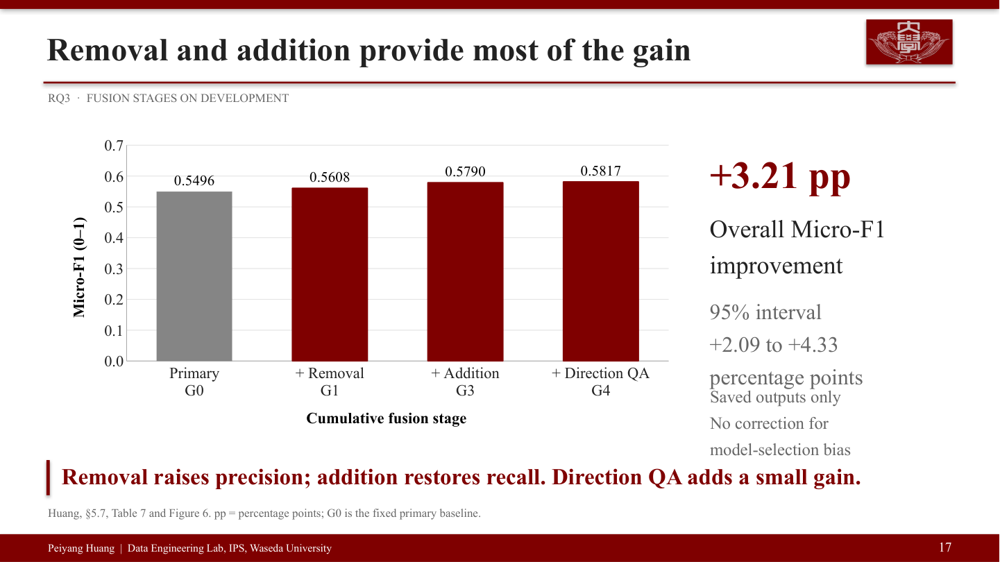

**画面阅读顺序（中）** 左图按 G0、G1、G3、G4 读累积阶段，右侧读整体差值与区间，底部总结各阶段作用。

**Reading order (EN)** Read the cumulative stages on the left, then the overall difference and interval on the right.

### 本页讲解 / Slide explanation

**English explanation** The sequence starts from the same primary predictions. Removal improves precision while losing some recall. Addition recovers more labels, with some false positives, and QA contributes a smaller net direction benefit. The final Micro-F1 gain is 3.21 percentage points. The interval summarizes article-sampling variation for these saved outputs, not uncertainty from retraining or system selection. The stage increments depend on their order, so they should not be treated as independent causal effects.

**中文讲解** 这个序列从相同主预测出发。删除提高精确率，但损失部分召回；补充找回更多标签，也带来部分假阳性；QA 再提供较小的方向净收益。最终 Micro-F1 提高 3.21 个百分点。区间描述保存输出在文章重采样下的变化，不包括重新训练或系统选择不确定性。阶段增量依赖顺序，不能当作独立因果效应。

### 本页问答 / Questions for this slide

关键词：G0 / G1 / G3 / G4；precision–recall trade-off；paired article bootstrap；fixed outputs。

### P17-Q01【必练】每个阶段带来了什么变化？

**Q (EN)** What changes at each fusion stage?

**问（中）** 每个融合阶段带来了什么变化？

**A (EN)** G0 starts at Micro-F1 0.5496. Removal raises it to 0.5608, mainly by increasing precision while reducing recall. Addition raises it to 0.5790 by recovering more gold labels, with some precision loss. Direction QA gives a smaller final increase to 0.5817. The overall gain is 3.21 percentage points, and most of it appears before the direction-check stage.

**答（中）** G0 的 Micro-F1 为 0.5496；删除后升至 0.5608，主要表现为精确率提高、召回降低；补充后升至 0.5790，找回更多 gold，同时有一定精确率损失；方向 QA 再小幅升到 0.5817。总增益为 3.21 个百分点，大部分在方向复核前已经出现。

### P17-Q02【追问】具体删了多少、加了多少？有没有误删和误加？

**Q (EN)** How much do the prediction sets change, and are the edits always correct?

**问（中）** 预测集合改变多少？每次修改都正确吗？

**A (EN)** Removal reduces the directed tuple count from 2,894 to 2,410, a decrease of 484. Addition brings it to 2,774, adding 364 tuples. Precision rises from 0.5017 to 0.5585 after removal, while recall falls from 0.6075 to 0.5632. Addition restores recall to 0.6255 but lowers precision to 0.5389. The edits therefore include both beneficial and harmful decisions; the result is a net trade-off.

**答（中）** 删除使有向元组从 2894 减至 2410，共减少 484；补充后达到 2774，加入 364 个。删除后精确率从 0.5017 升到 0.5585，但召回从 0.6075 降到 0.5632；补充把召回恢复到 0.6255，精确率降为 0.5389。所以修改既包含有益也包含有害决策，结果是净取舍。

### P17-Q03【追问】95% 区间如何得到？为什么按文章重采样？

**Q (EN)** How was the reported interval obtained, and why bootstrap articles?

**问（中）** 报告的区间怎样得到？为什么对文章做 bootstrap？

**A (EN)** The analysis uses 10,000 paired article-level resamples. Each resample uses the same sampled articles for G0 and G4 and keeps all actors from one article together, then recomputes their Micro-F1 difference. This preserves within-article dependence and pairing. The reported 95% interval for the overall difference is 0.0209 to 0.0433, or 2.09 to 4.33 percentage points.

**答（中）** 分析使用一万次按文章进行的配对重采样。每次对 G0 和 G4 使用相同的抽样文章，把同一文章的全部主体放在一起，再重新计算两者 Micro-F1 差值，从而保留文章内依赖和配对关系。整体差值的 95% 区间为 0.0209–0.0433，即 2.09–4.33 个百分点。

### P17-Q04【质疑】区间不含零，是否已经证明方法普遍有效？

**Q (EN)** Does a confidence interval above zero settle the validity of the method?

**问（中）** 区间全在零以上，是否就证明方法有效且可以泛化？

**A (EN)** It supports a positive difference under this resampling analysis of the fixed outputs. It does not include variation from retraining, new API responses, annotation uncertainty, or the earlier process of selecting systems using development results. It also applies to G4 versus G0 as a whole, not separately to each component. I should report the interval with those limits rather than turn it into a universal guarantee.

**答（中）** 它支持固定输出在该重采样分析下存在正差异，但不包含重新训练、新 API 响应、标注不确定性或之前根据开发结果选择系统的影响。它针对 G4 与 G0 整体，不分别证明每个组件。因此应带着这些边界报告区间，不能当成普遍保证。

### P17-Q05【质疑】方向 QA 贡献到底多大？是否显著？

**Q (EN)** How large is the direction-QA contribution, and is that increment significant?

**问（中）** 方向 QA 的贡献有多大？这个增量显著吗？

**A (EN)** It raises Micro-F1 from 0.5790 to 0.5817, an increase of 0.27 percentage points, and reduces DRR from 0.0450 to 0.0419. The reported overall confidence interval cannot establish significance for this smaller increment. I have not reported a dedicated interval for G4 minus G3. It is appropriate to describe a small observed net benefit in the saved run.

**答（中）** 它把 Micro-F1 从 0.5790 提到 0.5817，增量为 0.27 个百分点，DRR 从 0.0450 降至 0.0419。整体置信区间不能证明这个较小增量的显著性，目前没有报告 G4−G3 的专门区间。合适的说法是：保存运行中观察到小幅净收益。

### P17-Q06【质疑】阶段增量是否就是各模块独立贡献？G2 去哪里了？

**Q (EN)** Are the sequential gains independent component effects, and why is G2 absent from the chain?

**问（中）** 连续增益是否等于独立模块贡献？链条为什么没有 G2？

**A (EN)** These are conditional stage differences: addition is evaluated after removal, and QA after both. Interactions and stage order can affect the gains, so they are not independent causal contributions. G2 is a diagnostic removal-only branch without the Liu target-prompt juror, not an intermediate stage between G1 and G3. G5 is another removal-only branch without the frequency gate.

**答（中）** 这些是有条件的阶段差异：补充在删除之后评价，QA 在两者之后评价。交互和执行顺序可能影响增量，因此不是相互独立的因果贡献。G2 是去掉 Liu 目标提示成员的删除分支，不是 G1 到 G3 之间的连续阶段；G5 则是去掉频次门控的另一个删除分支。

依据：论文 §5.7、Table 7；统计设计背景：[Dror et al., ACL 2018](https://aclanthology.org/P18-1128/)。

<a id="p18"></a>
## 第 18 页｜The frequency gate protects label balance

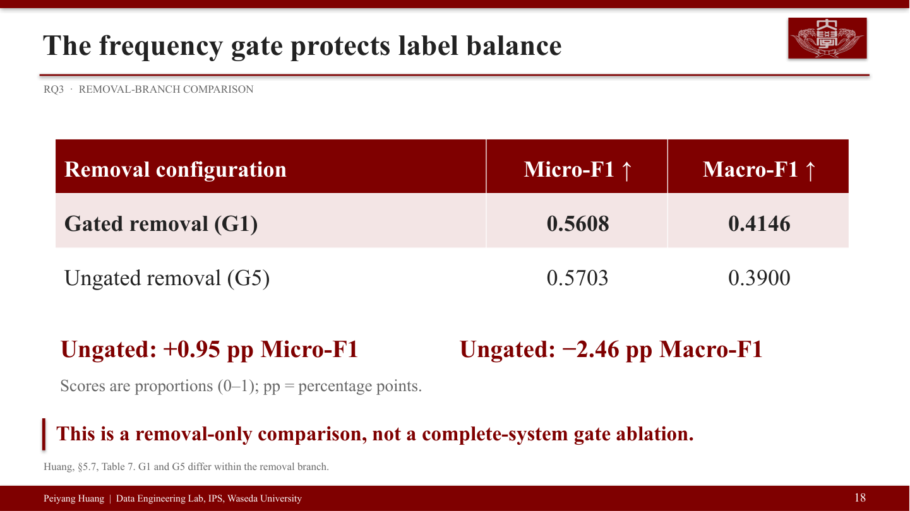

**画面阅读顺序（中）** 先对比表格两行，再读一升一降的百分点变化，最后强调只比较删除分支。

**Reading order (EN)** Compare the two rows, the opposite Micro/Macro changes, and the removal-only scope note.

### 本页讲解 / Slide explanation

**English explanation** The ungated removal branch scores higher on Micro-F1 but lower on Macro-F1. The gate preserves low-support primary predictions, which can protect class balance at this operating point. It also preserves rare errors and prevents rare additions. The table therefore supports a trade-off, not a universal improvement from gating. Since it compares removal branches only, a complete-system gate ablation is still needed before making claims about the final G4 system.

**中文讲解** 无门控删除的 Micro-F1 更高，但 Macro-F1 更低。门控保留低支持主预测，在当前工作点可能保护类别平衡，但也会保留稀有错误并阻止稀有补充。因此表格支持的是取舍，而非门控普遍有效。这里只比较删除分支，对最终 G4 系统作更强结论，还需要完整系统的门控消融。

### 本页问答 / Questions for this slide

关键词：G1 vs G5；Micro / Macro trade-off；rare-label pass-through；partial ablation。

### P18-Q01【必练】无门控 Micro 更高，为什么还使用门控？

**Q (EN)** Why retain the gate when ungated removal has better Micro-F1?

**问（中）** 无门控删除的 Micro-F1 更高，为什么仍保留门控？

**A (EN)** The observed trade-off is between aggregate performance and class balance. Ungated removal raises Micro-F1 from 0.5608 to 0.5703 but lowers Macro-F1 from 0.4146 to 0.3900. I retained the gate to protect less-supported primary labels. However, official ranking uses Micro-F1, so I must acknowledge that this removal-only result favors the ungated branch on the primary metric. The preferred choice depends on the stated objective and a complete-system comparison.

**答（中）** 观察到的是总体表现与类别平衡之间的取舍。无门控把 Micro-F1 从 0.5608 提到 0.5703，但 Macro-F1 从 0.4146 降到 0.3900。保留门控是为了保护支持较少的主预测标签。不过官方按 Micro-F1 排名，必须承认这个删除分支对照在主指标上支持无门控。最终选择需要明确目标，并比较完整系统。

### P18-Q02【质疑】凭什么阈值是 130？有没有试 100、150？

**Q (EN)** What justifies the cutoff of 130?

**问（中）** 130 的依据是什么？

**A (EN)** It is an empirical cutoff chosen during development, not a theoretically derived boundary. It includes 38 directed labels. I have not presented an independent sensitivity study proving that 130 is optimal. A future study should define a small cutoff grid on selection data and evaluate the chosen rule on held-out assessment data, including the Micro–Macro trade-off.

**答（中）** 它是开发过程中选择的经验阈值，不是理论推导边界，覆盖 38 个有向标签。当前没有独立敏感性实验来证明 130 最优。后续应在选择数据上预定义少量候选阈值，在独立评价数据上检验所选规则，并同时报告 Micro 与 Macro 的取舍。

### P18-Q03【质疑】你增强的是稀有标签，融合却不允许修改它们，是否自相矛盾？

**Q (EN)** If all augmentation targets bypass revision, how can fusion validate the augmentation goal?

**问（中）** 所有增强目标都绕过增删，融合如何验证增强目标？

**A (EN)** It cannot validate that goal directly. All 18 targets fall outside the gate, so removal and addition preserve their primary predictions. Their target Micro-F1 stays at 0.3145 until QA changes it to 0.3264. The shared encoder could still affect other labels, but that indirect contribution is unisolated. This is a substantive reason to keep the training and fusion claims separate.

**答（中）** 融合不能直接验证该目标。18 个增强目标全部在门外，所以增删保留其主预测；目标 Micro-F1 一直是 0.3145，直到 QA 才变成 0.3264。共享编码器可能影响其他标签，但这种间接贡献未被隔离。这正是必须分开陈述训练与融合结论的重要原因。

### P18-Q04【追问】门控是不是保证了稀有标签更好？

**Q (EN)** Does passing rare labels through guarantee good rare-label performance?

**问（中）** 放行稀有标签是否保证了稀有类别表现好？

**A (EN)** No. It preserves both correct and incorrect rare primary predictions. It also cannot add a rare value missed by the primary system. “Protect” here means protect against removal by this revision rule, not guarantee correctness or recover all rare labels. A dedicated rare-label analysis is needed to evaluate that broader objective.

**答（中）** 不保证。它会同时保留正确和错误的稀有主预测，也无法补充主系统漏掉的稀有价值。这里的“保护”仅指免受该修订规则删除，不是保证正确或恢复所有稀有标签。更广泛的稀有识别目标需要专门分析。

### P18-Q05【质疑】G1/G5 和 G1/G2 是否足以证明门控、Liu 成员的完整贡献？

**Q (EN)** Do the removal-branch controls establish the gate’s and juror’s effects in the final system?

**问（中）** 删除分支对照能否确定门控和辅助成员在最终系统中的贡献？

**A (EN)** No. G1 versus G5 tests the gate only within removal. G1 versus G2 tests the frozen target-prompt juror within that same branch; G2 has Micro-F1 0.5619 and Macro-F1 0.4135. Neither comparison includes all interactions with addition and QA. Complete-system ablations with matched calibration protocols are needed before making stronger component claims.

**答（中）** 不能。G1/G5 只在删除阶段测试门控；G1/G2 在同一分支测试固定目标提示成员，G2 的 Micro-F1 为 0.5619、Macro-F1 为 0.4135。这两种比较都没有包含补充与 QA 的全部交互。更强的组件结论需要完整系统消融，并使用匹配校准协议。

<a id="p19"></a>
## 第 19 页｜Official test results show strengths and limits

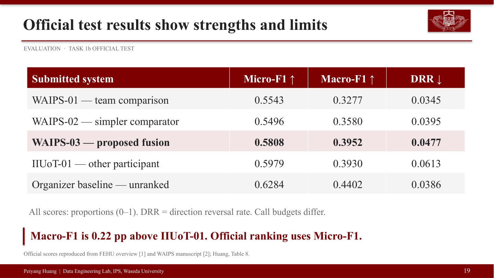

**画面阅读顺序（中）** 按表格看参赛系统，再单独说明最后一行 organizer 的模型与训练背景，最后交代排名指标。

**Reading order (EN)** Read the participant rows, explain the organizer’s method separately, then state the ranking metric.

### 本页讲解 / Slide explanation

**English explanation** WAIPS-03 has the highest numerical participant Macro-F1 in this table, but IIUoT has higher Micro-F1, the official ranking metric. The organizer is an unranked reference using LoRA-adapted Llama-3.1-8B-Instruct, a 4,096-token context, and article-plus-subevent training. It scores higher on both F1 measures. That sets a stronger reference for future tests. My current research value is the controlled investigation of augmentation, supervision and prediction revision, not an established advantage over this baseline. Whether those findings transfer to a stronger model remains to be tested.

**中文讲解** WAIPS-03 在这张表的参赛提交中 Macro-F1 数值最高，但 IIUoT 的 Micro-F1 更高，而官方正是按 Micro 排名。Organizer 是非排名参考，使用 LoRA 适配的 Llama-3.1-8B-Instruct、4096 tokens 上下文，以及文章加子事件训练；它两项 F1 都更高。这为后续测试设定了更强参照。目前研究价值在于控制检验增强、监督和预测修订，而不是已经优于该基线；这些发现能否迁移到更强模型仍待验证。

### 本页优化：说明更强参考系统及研究价值 / Explain the stronger reference and the research question

| Organizer 方法背景 / Method background | 记录中的设置 / Recorded setting |
| --- | --- |
| 模型 / Model | Llama-3.1-8B-Instruct |
| 适配 / Adaptation | LoRA，query/key/value/output projections |
| 可用上下文 / Context limit | 4,096 tokens |
| 训练监督 / Training supervision | Article＋subevent instances / 文章与子事件单元 |
| 训练与选择 / Training and selection | Six epochs; checkpoint selected by development Level-1 Micro-F1 / 六个 epoch，按开发细粒度 Micro-F1 选检查点 |
| 本次成绩 / Reported Task 1b scores | Micro-F1 0.6284；Macro-F1 0.4402；DRR 0.0386 |

**English insert:** “This stronger baseline matters. To establish research value, I need to show what targeted supervision and selective revision contribute under controlled conditions. The current experiments identify trade-offs and open questions; they do not show that my system outperforms the organizer or is cheaper. A stronger backbone provides a test of whether the findings extend beyond the present setup.”

**中文插入句：**“这个更强基线很重要。要建立研究价值，我需要在控制条件下说明定向监督和选择性修订贡献了什么。当前实验识别出取舍和未解决问题，没有证明优于 organizer，也没有证明成本更低。更强骨干可以检验这些发现能否超出当前设置。”

**讲解边界 / Comparison boundary:** 512 tokens 是本地 DeBERTa 编码器的上限，不能说成整个 WAIPS-03 提示系统的上下文上限。模型、训练数据范围、上下文和预算同时不同，不能把官方差距归因于其中一个因素。/ The 512-token limit describes the local encoder, not the complete WAIPS-03 prompting system; several factors differ in the official comparison.

**建议页内放法 / Suggested placement:** 在成绩表下加一行简短背景：“Organizer: Llama-3.1-8B + LoRA; 4,096 tokens; article + subevent training.” 具体贡献问题留给本页口头说明和第 22 页控制实验。

### 本页问答 / Questions for this slide

关键词：official ranking；WAIPS submissions；IIUoT；organizer baseline；budget matching；test uncertainty。

### P19-Q01【必练】官方结果究竟排在什么位置？

**Q (EN)** What can you claim from the official test results?

**问（中）** 从官方测试成绩，你究竟能声称什么？

**A (EN)** WAIPS-03 achieves Task 1b Micro-F1 0.5808 and Macro-F1 0.3952. Its Macro-F1 is numerically highest among the four participant submissions, 0.22 percentage points above IIUoT-01. However, IIUoT-01 has higher Micro-F1 at 0.5979, and Micro-F1 determines the official ranking. The unranked organizer baseline is higher on both F1 measures. I therefore should not claim overall first place or state-of-the-art performance.

**答（中）** WAIPS-03 的 Task 1b Micro-F1 为 0.5808、Macro-F1 为 0.3952。在四个参赛提交中，Macro 数值最高，比 IIUoT-01 高 0.22 个百分点。但 IIUoT-01 的 Micro 更高，为 0.5979，而官方排名使用 Micro-F1。不参与排名的主办方基线，两项 F1 都更高。因此不能声称整体第一或达到 SOTA。

### P19-Q02【质疑】只高 0.22 个百分点，能说明显优于对手吗？

**Q (EN)** Is the Macro-F1 advantage over IIUoT-01 statistically established?

**问（中）** 对 IIUoT-01 的 Macro 优势是否具有统计依据？

**A (EN)** No significance claim is established here. The table reports official point estimates, and the numerical difference is small. Local test gold is unavailable, so I cannot perform a paired test-label analysis from these scores alone. The accurate wording is “numerically higher Macro-F1 among the reported participant submissions,” not “significantly better than the competitor.”

**答（中）** 当前没有建立显著性结论。表格是官方点估计，数值差异较小。本地没有测试 gold，仅凭这些成绩不能进行配对测试标签分析。准确说法是“在报告的参赛提交中，Macro-F1 数值更高”，不是“显著优于对手”。

### P19-Q03【质疑】WAIPS-03 的 DRR 比另外两个队内方法差，怎么算进步？

**Q (EN)** Why is WAIPS-03’s higher DRR still consistent with improved F1?

**问（中）** WAIPS-03 的 DRR 更高，为什么 F1 还能更好？

**A (EN)** F1 evaluates the entire directed prediction set, while DRR isolates reversals on gold-exclusive values. WAIPS-03 has DRR 0.0477, worse than WAIPS-01’s 0.0345 and WAIPS-02’s 0.0395, but it recovers directed labels differently and has higher Micro- and Macro-F1 than those two. It is a different performance profile, not dominance on every metric. The lower development DRR after QA does not prove lower test DRR than other systems.

**答（中）** F1 评价完整有向预测集合，DRR 则只看 gold 单方向价值上的反转。WAIPS-03 的 DRR 为 0.0477，差于 WAIPS-01 的 0.0345 和 WAIPS-02 的 0.0395，但其标签恢复表现不同，两项 F1 都更高。这是性能特征不同，不是所有指标全面占优。开发集 QA 后 DRR 下降，也不能证明测试上低于其他系统。

### P19-Q04【质疑】主办方基线更强，为什么不直接用 Llama？

**Q (EN)** What explains the gap to the organizer baseline, and why not adopt it directly?

**问（中）** 如何解释与主办方基线的差距？为什么不直接采用它？

**A (EN)** The organizer uses a LoRA-adapted Llama-3.1-8B-Instruct model with 4,096-token context and both article- and subevent-level training. My encoder uses 512 tokens and a different backbone and training setup. The gap cannot be attributed to one factor from this comparison. Adapting a stronger backbone is a reasonable extension, but it should follow or accompany matched controls that answer the current research questions.

**答（中）** 主办方使用 LoRA 适配的 Llama-3.1-8B-Instruct，上下文 4096 tokens，并结合文章级与子事件级训练；我的编码器为 512 tokens，骨干和训练设置不同。仅凭此比较不能把差距归因于单一因素。采用更强骨干是合理扩展，但应与回答当前研究问题的匹配对照配合，而非代替它们。

### P19-Q05【质疑】你的融合用了更多调用，比较公平吗？

**Q (EN)** Are WAIPS-02 and WAIPS-03 compared under equal inference budgets?

**问（中）** WAIPS-02 与 WAIPS-03 是否使用相同推理预算？

**A (EN)** No. WAIPS-02 uses three Pro prediction passes and one Flash pass. E7 uses two segmentation passes, five prediction passes, and selective direction checks. Pass counts alone do not establish monetary or latency cost because model prices, token lengths, retries, and caching differ. The current table compares submitted systems, not aggregation algorithms under equal cost. A budget-matched comparison remains necessary.

**答（中）** 不是。WAIPS-02 使用三次 Pro 预测和一次 Flash 预测；E7 使用两次切分、五次预测，以及选择性方向检查。调用轮数本身不能直接换算金额或延迟，因为模型价格、token 长度、重试与缓存不同。当前表格比较提交系统，不是在等成本下比较聚合算法，仍需要预算匹配实验。

### P19-Q06【质疑】开发与测试 Micro 几乎一样，是否证明没有过拟合？

**Q (EN)** Does development Micro-F1 0.5817 versus test 0.5808 prove generalization?

**问（中）** 开发 Micro=0.5817、测试=0.5808，是否证明泛化良好且没有过拟合？

**A (EN)** It is encouraging that the aggregate scores are close on different articles, but closeness alone does not rule out selection bias, class-specific failures, or distribution differences. Macro-F1 falls from 0.4308 to 0.3952. I should report both measures and avoid inferring identical behavior from one similar aggregate number. Test results provide an external score check, not a complete explanation of generalization.

**答（中）** 不同文章上总体分数接近是积极信号，但仅凭接近不能排除选择偏差、特定类别失败或分布差异。Macro-F1 从 0.4308 降到了 0.3952，应同时报告，不能由一个相似总分推断系统行为一致。测试结果提供外部成绩验证，并不能完整解释泛化。

### P19-Q07【追问】两个 0.5496 是同一个结果吗？WAIPS-01 能作严格消融吗？

**Q (EN)** Are identical-looking scores from different systems interchangeable, and is WAIPS-01 an ablation?

**问（中）** 不同系统中相同的分数能否混用？WAIPS-01 是严格消融吗？

**A (EN)** No. E6b’s development Micro-F1 and WAIPS-02’s official test Micro-F1 both round to 0.5496, but they are different systems on different splits. WAIPS-01 is also a separately designed team system, not WAIPS-03 with one component removed. These comparisons establish system-level performance, while component attribution requires changing one defined factor within a matched setup.

**答（中）** 不能。E6b 开发集 Micro 与 WAIPS-02 官方测试 Micro 都四舍五入到 0.5496，但系统和划分不同。WAIPS-01 也是独立设计的团队系统，不是从 WAIPS-03 删除一个组件得到的版本。这些比较描述系统级表现；组件归因需要在匹配设置下改变一个明确因素。

### P19-Q08【质疑】既然 organizer 更高分，你的研究价值在哪里？

**Q (EN)** Why is your study worth pursuing when the organizer already has a higher-scoring method?

**问（中）** 既然主办方已经有更高分的方法，你的研究还有什么价值？

**A (EN)** A higher reference score means I cannot claim the strongest system. The research question is whether targeted supervision and selective revision produce useful, reproducible effects under controlled conditions. The current work exposes ranking-versus-decision and precision–recall trade-offs, but beating a weaker baseline alone is insufficient to establish a general contribution. I need the matched controls in slide 22, and eventually a stronger-backbone study, to determine whether the findings are robust, transferable or specific to this setup.

**答（中）** 更高参考分数意味着我不能声称系统最强。研究问题是：定向监督与选择性修订在控制条件下，是否产生有用、可复现的效果。当前工作揭示了排序与实际决策、精确率与召回率的取舍，但仅超过一个较弱基线不足以证明普遍贡献。需要第 22 页的匹配对照，以及后续更强骨干研究，确定发现是稳定可迁移，还是只适用于当前设置。

本页数字备查 / Official Task 1b score reference：

| System / 系统 | Micro-F1 ↑ | Macro-F1 ↑ | DRR ↓ |
| --- | ---: | ---: | ---: |
| WAIPS-01，团队比较 / Team comparison | 0.5543 | 0.3277 | 0.0345 |
| WAIPS-02，较简单系统 / Simpler comparator | 0.5496 | 0.3580 | 0.0395 |
| WAIPS-03，所提融合 / Proposed fusion | 0.5808 | 0.3952 | 0.0477 |
| IIUoT-01，其他参赛提交 / Other participant | 0.5979 | 0.3930 | 0.0613 |
| Organizer，非排名参考 / Unranked reference | 0.6284 | 0.4402 | 0.0386 |

成绩来源：[官方任务说明本地稿](../论文/NTCIR_FEHU_TaskOverview%20%281%29.pdf)、[WAIPS 本地稿](../论文/WAIPS%20at%20the%20NTCIR-19%20FEHU.pdf)、论文 Table 8。

<a id="p20"></a>
## 第 20 页｜Direction checks can fix or introduce an error

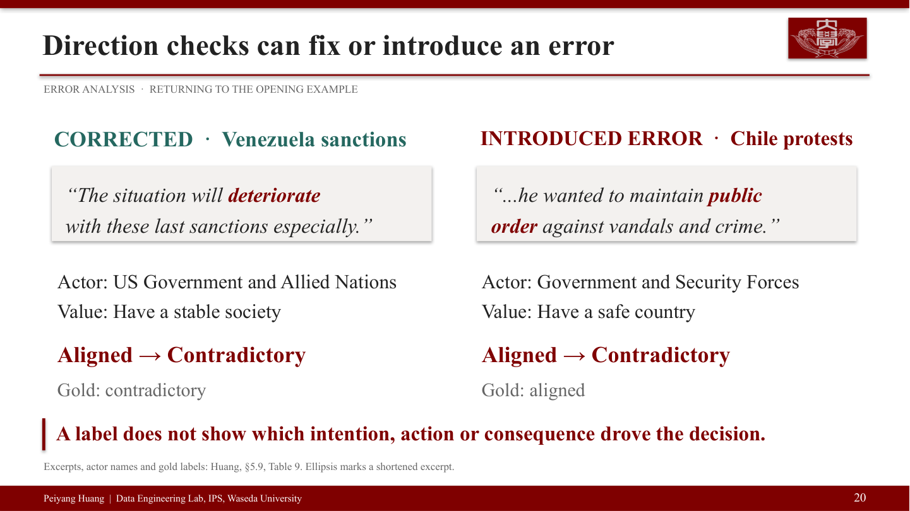

**画面阅读顺序（中）** 左侧看委内瑞拉改对案例，右侧看智利改错案例，再把引文、主体、价值和 gold 逐项对应。

**Reading order (EN)** Compare the corrected Venezuela case with the introduced Chile error, matching each quote to actor, value and gold.

### 本页讲解 / Slide explanation

**English explanation** Both examples flip aligned to contradictory, but their evaluation outcomes differ. Venezuela’s flip matches the released label, while Chile’s flip disagrees with it. The first quote is an attributed forecast, and the second reports a stated protective purpose. Neither should be presented as an independent measurement of consequences. The saved decisions do not reveal a verified rationale for the flips. This motivates evaluating the evidence that links a specific actor to a value and direction.

**中文讲解** 两个案例都从 aligned 翻转为 contradictory，评价结果却不同：委内瑞拉符合发布标签，智利与之不符。前者引文是被归属的预测，后者是声称的保护目的，不能把任一当作独立测量的后果。保存决策也没有经过验证的翻转理由。因此下一步需要评价将特定主体与价值、方向联系起来的证据。

### 本页问答 / Questions for this slide

关键词：Venezuela；Chile；case evidence；attributed forecast；corrected / introduced errors；gold ambiguity。

### P20-Q01【必练】这两个案例分别说明什么？

**Q (EN)** What do the Venezuela and Chile examples demonstrate?

**问（中）** 委内瑞拉和智利两个案例分别说明什么？

**A (EN)** In the Venezuela case, QA changes the US Government and Allied Nations’ “Have a stable society” direction from aligned to contradictory, matching gold. In Chile, it changes Government and Security Forces’ “Have a safe country” from aligned to contradictory, disagreeing with gold. The same procedure can correct or introduce an error. These examples illustrate the measured net result; they do not establish the error rate by themselves.

**答（中）** 委内瑞拉案例中，QA 把“美国政府及盟国”对“拥有一个稳定的社会”的方向从 aligned 改为 contradictory，与 gold 一致。智利案例中，它把“政府与安全部队”对“拥有一个安全的国家”的 aligned 改成 contradictory，与 gold 不一致。同一程序可能改对也可能改错；案例只是说明已测净结果，不能单独估计错误率。

### P20-Q02【质疑】委内瑞拉制裁真的造成不稳定了吗？你是在判断因果吗？

**Q (EN)** Does the Venezuela example establish that sanctions caused societal instability?

**问（中）** 委内瑞拉例子是否证明制裁导致社会不稳定？

**A (EN)** It does not establish causality. The article contains an interviewee’s forecast that further sanctions would worsen conditions, and also presents other viewpoints. The gold explanation interprets sanctions as undermining stability. My result is agreement with that annotation for the specified actor and value. I should identify the claim’s source and avoid presenting a quoted forecast or the gold explanation as independent causal evidence.

**答（中）** 它不能建立因果关系。文章包含受访者对进一步制裁会恶化状况的预测，也呈现其他观点。Gold explanation 将制裁解释为破坏稳定。本结果是在特定主体与价值上符合该标注；我应指出观点来源，不能把被引用的预测或 gold 解释当成独立因果证据。

### P20-Q03【质疑】如果智利的反向答案也合理，为什么称它错误？

**Q (EN)** If the Chile flip is defensible under another interpretation, why call it an error?

**问（中）** 如果按另一种解释，智利翻转也可能合理，为什么称为错误？

**A (EN)** It is an error relative to the released evaluation label, which assigns aligned for value 26 to this actor. That does not settle all reasonable interpretations of the article. The contrast between the stated protective purpose and reported force makes this a useful ambiguity case. I can report the benchmark mismatch while recommending evidence-based human review; I should not silently replace the gold label after seeing my model’s output.

**答（中）** 它相对于发布的评价标签是错误，因为该主体的价值 26 gold 为 aligned；这并不裁定文章所有合理解释。保护目的与武力报道之间的张力，使它成为有用的歧义案例。我可以报告基准不一致，并建议基于证据进行人工复核；不能看见模型输出后就自行替换 gold。

### P20-Q04【追问】46 次翻转就是纠正 46 个错误吗？

**Q (EN)** Do the 46 development flips represent 46 corrections?

**问（中）** 开发集 46 次翻转是否代表纠正了 46 个错误？

**A (EN)** No. Among 176 triggered checks, 46 changed direction, 123 kept it, and seven requests failed and retained the existing direction. A flip can correct an error, introduce one, or move between two gold-supported directions. The measured Micro-F1 and DRR changes describe the net effect. On test, 207 checks produced 77 flips, 125 unchanged decisions, and five failures, without local gold to classify their correctness.

**答（中）** 不是。176 次触发检查中，46 次改变方向、123 次保持、七次请求失败并保留原方向。翻转可能纠错、引入错误，也可能在两个 gold 支持方向之间切换。测得的 Micro-F1 和 DRR 变化描述净效果。测试集 207 次检查得到 77 次翻转、125 次不变、五次失败，但本地没有 gold 来分类其正确性。

### P20-Q05【追问】如果 gold 有两个方向，翻转会怎样？

**Q (EN)** What happens when a direction flip concerns a value with both gold directions?

**问（中）** 如果 gold 对某价值有两个方向，翻转会产生什么效果？

**A (EN)** Replacing one correct direction with the other can leave the number of true positives unchanged and still miss one gold tuple. That actor–value pair is excluded from DRR. The supplementary Paris example illustrates this situation. It is another reason why counting direction changes is not equivalent to counting corrected errors, and why current single-direction QA cannot recover both directions from a single predicted one.

**答（中）** 用另一个正确方向替换原正确方向，可能不改变 TP 数，并且仍漏掉一个 gold 元组；该主体—价值组合也不纳入 DRR。补充的巴黎案例说明了这种情况。因此方向变化数不等于纠错数，当前单方向 QA 也无法从一个方向的预测恢复出双方向。

### P20-Q06【质疑】你能解释模型为什么翻转吗？下一步怎么改？

**Q (EN)** Do you know why QA made these changes, and how would you improve it?

**问（中）** 你知道 QA 为什么这样改吗？下一步如何改进？

**A (EN)** The saved decisions do not provide a verified reasoning trace, so I can analyze the article but cannot claim to know the model’s internal reason. I would test a verifier that first identifies actor-linked evidence and distinguishes attributed intentions from actions and consequences, with an option to abstain when evidence is insufficient. Its benefit and cost would need evaluation before replacing the current forced-choice checker.

**答（中）** 保存决策没有经过验证的推理轨迹，因此可以分析文章，却不能声称知道模型内部为什么翻转。后续会测试一种先定位主体证据、区分被归属意图与行为后果、并在证据不足时允许保留判断的验证器。是否替代现有强制二选一检查器，需要先评价收益和成本。

本页原始案例：`0-4491-3-3` / actor `-0` / value `27`；`0-4716-3-1` / actor `-1` / value `26`。见[开发集文章](../../dataset/dev/dev_event_base.json)、[开发集 gold](../../dataset/gold_labels/dev/dev_human_values.json)及论文 §5.9。

<a id="p21"></a>
## 第 21 页｜What the current evidence can establish

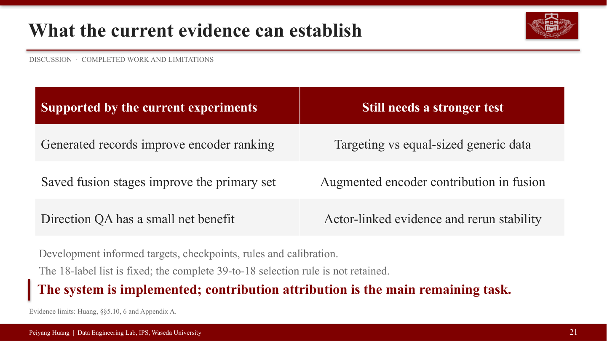

**画面阅读顺序（中）** 逐行对照左侧已支持结果与右侧仍需检验的问题，再读下方开发集选择和档案缺口。

**Reading order (EN)** Pair each supported finding on the left with its open question on the right, then read the selection and traceability notes.

### 本页讲解 / Slide explanation

**English explanation** The left column reports observed results: generated records improve encoder ranking, saved fusion stages improve the primary output, and QA has a small net benefit. The right column lists what those observations do not settle. Targeted generation needs equal-sized alternatives, encoder contribution needs a matched fusion ablation, and direction decisions need evidence auditing and reruns. Development-based choices and incomplete historical lineage limit the strength of causal and reproducibility claims.

**中文讲解** 左栏报告已观察结果：生成记录改善编码器排序，保存融合阶段改善主输出，QA 有小幅净收益。右栏列出这些观察尚未解决的问题：定向生成需要等量替代对照，编码器贡献需要匹配融合消融，方向决策需要证据审核与重跑。开发集参与选择和历史来源链不完整，限制了因果与可复现性主张的强度。

### 本页问答 / Questions for this slide

关键词：claim strength；selection bias；annotation quality；reproducibility；generalization。

### P21-Q01【必练】当前最大的局限是什么？

**Q (EN)** What is the most important limitation of the current study?

**问（中）** 当前研究最重要的局限是什么？

**A (EN)** The central limitation is attribution. I have evidence for ranking changes in repeated training and for improved saved fusion outputs, but not a matched experiment connecting the two. Targeted generation also lacks equal-sized generic and oversampling controls. Resolving those issues matters more for the thesis claim than adding another component that slightly raises the development score.

**答（中）** 核心局限是归因。重复训练显示排序变化，保存融合输出显示改善，但没有匹配实验把两者连接起来。定向生成也缺少等量通用生成与过采样对照。对论文主张而言，解决这些问题比再加一个略微提高开发分数的组件更重要。

### P21-Q02【质疑】做了 cross-fitting，为什么仍有 selection bias？

**Q (EN)** Why does cross-fitting not eliminate all development-set bias?

**问（中）** 为什么做了 cross-fitting 仍不能消除全部开发集偏差？

**A (EN)** Cross-fitting keeps an article’s gold out of the calibrator fitted to score that article. It does not undo earlier choices made using the development set, such as target selection, prompt design, checkpoint selection, or the frequency cutoff. Those decisions can still adapt to the same data. An independent assessment split or a properly nested procedure is needed for a cleaner estimate of the full selection process.

**答（中）** Cross-fitting 保证某篇文章的 gold 不用于拟合给这篇文章打分的校准器；但它无法撤销此前利用开发集做出的目标选择、提示设计、检查点选择或频次阈值选择。这些决策仍可能适应同一数据。要更干净地评价整个选择过程，需要独立评估集或正确嵌套的程序。

来源：[Cawley and Talbot，模型选择偏差](https://www.jmlr.org/papers/v11/cawley10a.html)；本研究的具体使用情况见论文 §5–6。

### P21-Q03【质疑】基准由 LLM 辅助标注，你又用 LLM 预测，会不会只是在复现标注偏好？

**Q (EN)** Could model-assisted gold favor similar model judgments rather than better understanding?

**问（中）** LLM 辅助 gold 会不会偏好相似模型判断，而不是真正更好的理解？

**A (EN)** That is a plausible concern, especially when annotation and prediction systems share model families or assumptions. The current scores measure agreement with the released gold; they do not independently prove human-level value understanding. A useful additional evaluation would use independent human judgments and evidence checks, sampling model agreements as well as disagreements. I have not quantified this potential bias in FEHU.

**答（中）** 这是合理担忧，尤其当标注与预测系统共享模型家族或解释假设时。当前成绩衡量与发布 gold 的一致程度，不能独立证明达到人类水平的价值理解。可补充独立人工判断与证据检查，同时抽样模型一致和不一致案例。目前我尚未量化 FEHU 中这类潜在偏差。

### P21-Q04【追问】别人要复现，必须拿到什么？

**Q (EN)** What artifacts are required to reproduce the reported results?

**问（中）** 别人复现这些结果，需要哪些材料？

**A (EN)** They need the corrected dataset version and IDs, prompts and model identifiers, generated records with annotation scope, training settings and checkpoints, encoder score exports, fold assignments, calibrators, decision rules, raw predictions, failure logs, and the evaluator. Some results can already be recomputed from saved outputs, while exact regeneration of historical API responses and the encoder-checkpoint linkage is less complete. I should distinguish score reproduction from full experimental regeneration.

**答（中）** 需要修正后的数据版本与 ID、提示和模型标识、带标注范围的生成记录、训练设置与检查点、编码器分数导出、折分、校准器、决策规则、原始预测、失败日志和评价器。部分成绩可由保存输出重算，但历史 API 响应的精确重生成与编码器检查点关联还不完整。应区分“重算分数”与“完整重做实验”。

### P21-Q05【追问】数据版本修正、隐私和泛化有哪些边界？

**Q (EN)** Which data-handling and generalization boundaries matter here?

**问（中）** 数据处理与泛化有哪些重要边界？

**A (EN)** The study uses the corrected actor-aligned release; the organizer reported an earlier actor-matching bug. Predictions must preserve released IDs. The experiments concern English news within a fixed taxonomy, so I cannot assume transfer to other languages, domains, or unrestricted personal-value profiling. If the system is extended to new data, source permissions, actor handling, and evidence review should be established for that application.

**答（中）** 本研究使用修正主体对齐后的发布版，主办方曾报告早期主体匹配错误；预测必须保留发布 ID。实验针对固定分类体系中的英文新闻，不能直接假定能迁移到其他语言、领域，或用于不受限定的个人价值画像。扩展到新数据时，应针对应用确定来源使用权限、主体处理和证据复核方式。

版本依据：官方仓库记载 2026-03-20 修正，提交 `af52dcb` 或后续版本；该修正是数据关联问题，与 aligned 价值方向不是同一个概念。

<a id="p22"></a>
## 第 22 页｜Eight-week plan to test the contributions

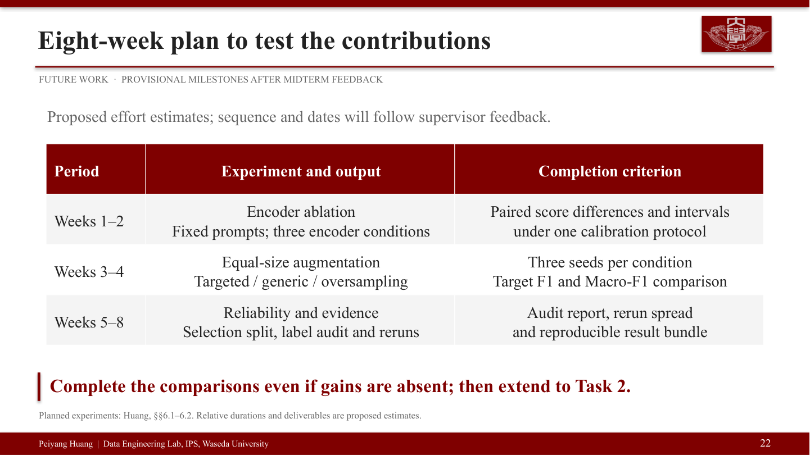

**画面阅读顺序（中）** 按三行阅读实验与完成标准；讲解时先说明划分和规则应提前冻结，再解释更强基线承担的验证作用。

**Reading order (EN)** Read the experiments and completion criteria, clarifying that protocol freezing precedes the comparisons.

### 本页讲解 / Slide explanation

**English explanation** Before any comparison, I need to freeze the selection and assessment protocol. I then compare encoder conditions with prompt outputs fixed, and compare equal-sized targeted, generic and oversampled training additions. Auditing and reruns assess label quality and stability. The stronger organizer model motivates a later matched 8B study: hold the backbone, context and budget fixed to test whether augmentation or additional subevent supervision helps. This separates the question of method contribution from simply changing model strength. The eight-week schedule remains provisional.

**中文讲解** 所有比较前都应先固定选择与评价协议。之后固定提示输出比较编码器条件，再比较等量定向生成、通用生成和过采样；通过审核与重跑评价标签质量和稳定性。更强 organizer 模型促使后续开展匹配的 8B 研究：固定骨干、上下文和预算，检验增强或额外子事件监督是否有帮助。这样才能区分方法贡献与单纯更换模型强度。八周安排仍是暂定估计。

### 本页优化：实验如何回答“已有更强方法，为什么还研究” / Test value beyond a stronger baseline

| 要隔离的贡献 / Contribution to isolate | 固定什么 / Hold fixed | 改变什么 / Change | 能得到的答案 / What the comparison answers |
| --- | --- | --- | --- |
| 编码器在当前融合中的增量 / Encoder contribution to current fusion | 同一主预测、辅助预测、折分与校准协议 / Prompt outputs, folds and calibration protocol | 无编码器、官方编码器、增强编码器 / No encoder, official-only, augmented | 分数是否在投票之外增加信息，增强是否改善这种信息 / Whether encoder scores add information and augmentation improves it |
| 诊断选择的增量 / Target-selection contribution | 同一骨干、标注范围、数量、预算规则与种子 / Backbone, annotation scope, volume, budget policy and seeds | 定向生成、通用生成、过采样 / Targeted, generic, oversampled additions | 是否超过单纯增加监督 / Whether targeting helps beyond extra supervision |
| 向更强骨干迁移 / Transfer to a stronger backbone | 同一 8B 模型、上下文、基础训练监督和预算 / Same 8B model, context, base supervision and budget | 加入何种等量增强 / Type of matched augmentation | 当前发现是否仍适用于更强模型 / Whether the finding survives with a stronger model |
| 子事件监督的增量 / Subevent-supervision contribution | 同一模型、上下文、选择协议和训练预算 / Model, context, selection protocol and budget | 文章训练 vs 文章＋子事件训练 / Article-only versus article-plus-subevent training | 更强参考系统中的额外监督是否有独立帮助 / Whether additional localized supervision contributes |

后两行是后续扩展设计，不能声称已完成或一定能在八周内全部执行。所有比较前先固定规则，重新划分已看过的数据也不能抹去历史选择偏差。/ The last two rows are proposed extensions, not completed or guaranteed eight-week deliverables. Historical development exposure must still be disclosed.

### 本页问答 / Questions for this slide

关键词：matched controls；frozen protocol；encoder ablation；equal-size augmentation；evidence audit；negative results。

### P22-Q01【必练】最先做什么实验？

**Q (EN)** What is the first experiment you will run, and why?

**问（中）** 下一步首先做什么实验？为什么？

**A (EN)** After freezing the selection and evaluation protocol, I would compare fusion with no encoder scores, official-only encoder scores, and augmented encoder scores. The primary and auxiliary predictions remain fixed. This directly tests whether the encoder adds useful information and whether augmented training improves that contribution. It addresses the largest attribution gap before adding more system complexity.

**答（中）** 在固定选择与评价协议后，首先比较无编码器分数、仅官方数据编码器分数、增强编码器分数三种融合条件，固定主预测与辅助预测。这直接检验编码器是否提供有用信息，以及增强训练是否改善该贡献，在增加系统复杂度前补上最大的归因缺口。

### P22-Q02【追问】“相同校准协议”是否意味着强行共用同一个校准器？

**Q (EN)** How would you keep the encoder ablation fair without reusing an inappropriate calibrator?

**问（中）** 怎样保证编码器消融公平，而不是使用不合适的共用校准器？

**A (EN)** I would keep candidate construction, folds, gate, decision constraints, and the calibration-fitting procedure identical, but fit each condition’s maps using its own scores on the same fitting data. Removing the encoder means removing its score terms, not silently replacing the complete pipeline. Reusing maps fitted to another score distribution would confound the comparison. Checkpoint identities and all exported scores should be retained.

**答（中）** 应固定候选构造、折分、门控、决策约束和校准拟合程序，但在相同拟合数据上，用各条件自己的分数拟合各自映射。去编码器意味着去除其分数项，而不是暗中换掉完整流程。沿用另一分数分布拟合的映射会混淆比较。应保留检查点身份与全部导出分数。

### P22-Q03【质疑】为什么第 5–8 周才安排 selection split？

**Q (EN)** Should the selection split be fixed before the first comparisons rather than in weeks five to eight?

**问（中）** 选择划分是否应该在最初实验前就固定，而非第五至八周？

**A (EN)** Yes. I would clarify that sequencing in the plan: the split and decision rules must be fixed before the first comparison; later weeks are for auditing and reruns. Also, repartitioning a development set already used for design does not make it historically untouched. A genuinely prospective assessment needs newly reserved data, while comparisons on previously inspected data should disclose that exposure.

**答（中）** 是的，我会澄清计划顺序：划分与决策规则应在第一次比较前固定，后面的周数用于审核与重跑。另外，已经用于设计的开发集重新切分，也不会变成历史上未接触的数据。真正前瞻的评估需要新保留的数据；使用已查看数据的比较应披露这种接触。

### P22-Q04【追问】如何设计定向生成、通用生成和过采样对照？

**Q (EN)** How would you isolate the benefit of targeted generation?

**问（中）** 怎样隔离定向生成本身的收益？

**A (EN)** I would compare equal-sized additions from targeted generation, generic generation, and oversampling official examples, with the same backbone, seed set, supervision rules, and declared training budget. I would inspect annotation scope and document length so these do not become hidden differences. Outcomes would include full-space Macro-F1, target F1, DRR, and uncertainty, not just whichever metric favors the targeted condition.

**答（中）** 比较等量的定向生成、通用生成与官方样本过采样，使用相同骨干、种子集合、监督规则和事先明确的训练预算，并检查标注范围与文本长度，避免成为隐藏差异。结果应包括全空间 Macro-F1、目标 F1、DRR 与不确定性，不能只挑对定向条件有利的指标。

### P22-Q05【追问】如何评价“证据支持”，而不只比较标签？

**Q (EN)** What would an actor-linked evidence evaluation measure?

**问（中）** 与主体关联的证据评价具体测量什么？

**A (EN)** For sampled predictions, I would ask reviewers whether the cited passage exists, whether the conduct belongs to the supplied actor, whether it supports the chosen value and direction, and whether it is an intention, action, or consequence. I would include correct, incorrect, agreed, and disputed predictions. This is a proposed evaluation design, not a completed evidence-quality result.

**答（中）** 对抽样预测，请审核者判断引用片段是否真实存在、行为是否属于给定主体、是否支持所选价值与方向，以及证据属于意图、行为还是后果。样本应包含正确、错误、一致和分歧预测。这是拟议评价设计，不是已经得到的证据质量结果。

### P22-Q06【质疑】如果新实验没有提升，论文怎么办？八周是否一定够？

**Q (EN)** What if the controls remove the apparent benefit, and is the eight-week plan guaranteed?

**问（中）** 如果控制实验消除了表面收益怎么办？八周是否一定足够？

**A (EN)** The aim is to test the contribution, not guarantee a positive outcome. A well-controlled result showing that generic data is sufficient or that the encoder is unnecessary would still answer the research questions and support a simpler system. Eight weeks is a provisional effort estimate subject to supervisor feedback and resources. I would prioritize the core comparisons and reproducible evidence before extending to Task 2 or a larger backbone.

**答（中）** 目标是验证贡献，不是保证正结果。若严谨对照发现通用数据已足够，或编码器没有必要，仍能回答研究问题，并支持更简单的系统。八周是受导师反馈与资源影响的暂定投入估计。应优先完成核心比较与可复现证据，再扩展 Task 2 或更大骨干。

### P22-Q07【追问】扩展到 Task 2 时，具体改变什么？

**Q (EN)** How would the Task 2 extension test a new question without changing Task 1’s input rules?

**问（中）** 扩展 Task 2 时，如何检验新问题而不改变 Task 1 输入规则？

**A (EN)** I would compare article-only and article-plus-subevent training using the same backbone, context limit, and training budget. All units from one article would share a fold. Task 1 inference would still receive article inputs only; Task 2 would use its supplied subevents. I would not assume that the union of subevent predictions equals article-level gold, because broader context can change which value judgments are supported.

**答（中）** 我会在相同骨干、上下文上限和训练预算下，比较仅文章训练与文章加子事件训练，同一文章的所有单元放在同一折。Task 1 推理仍只用文章输入，Task 2 才使用给定子事件。不能假定子事件预测的并集等于文章级 gold，因为更广背景可能改变哪些价值判断得到支持。

计划依据：论文 §6；本稿对“先固定协议、再做比较”的说明是顺序建议，不表示 PPT 已修改或实验已完成。

<a id="p23"></a>
## 第 23 页｜Fusion scores, calibration and decision rules

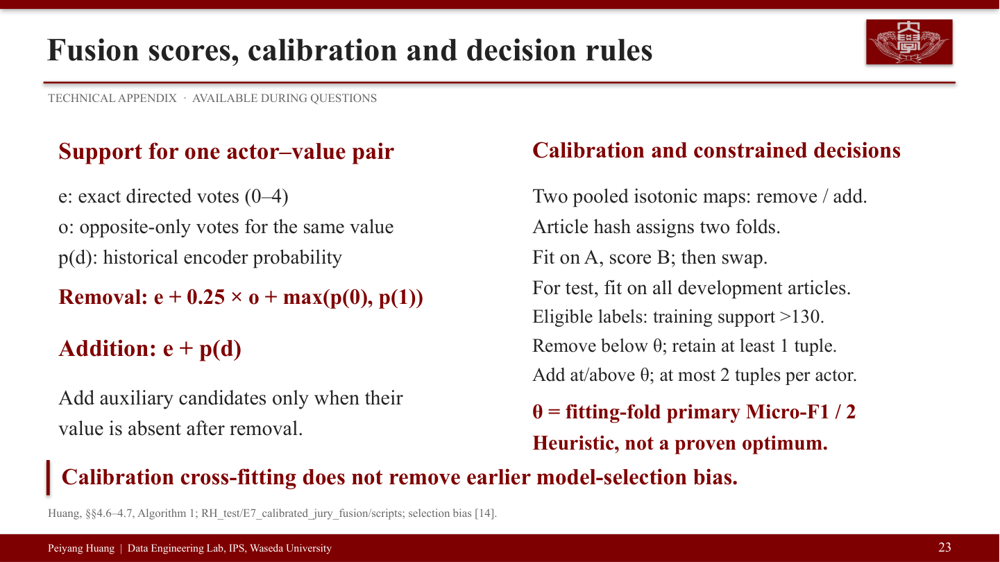

**画面阅读顺序（中）** 左栏先定义 e、o、p 并手算支持分数，再看右栏的拟合、阈值及数量约束。

**Reading order (EN)** Define and calculate the support scores on the left before following calibration and constraints on the right.

### 本页讲解 / Slide explanation

**English explanation** Exact votes support a directed tuple, while opposite-only votes support its value with a different direction. Removal and addition combine these votes with encoder scores differently. The raw scores can exceed one, so they are not probabilities. Two pooled isotonic maps estimate correctness from development candidates, using article-grouped cross-fitting. Decisions also depend on the frequency gate, minimum-one retention and maximum-two additions. Half the primary F1 is a heuristic threshold, and cross-fitting does not remove earlier selection bias.

**中文讲解** 精确投票支持有向元组，仅相反方向的投票支持相同价值但方向不同。删除和补充以不同方式组合这些票与编码器分数。原始分数可以大于一，因此不是概率。两个汇总单调映射利用开发候选估计正确性，并按文章交叉拟合；决策还受频次门控、至少保留一个与最多补两个的约束。主系统 F1 的一半是启发式阈值，交叉拟合也不能去除之前的选择偏差。

### 本页问答 / Questions for this slide

隐藏技术附页。关键词：exact votes；opposite-only votes；PAV；isotonic regression；cross-fitting；F1/2 heuristic；candidate distribution。

### P23-Q01【必练】e、o、p 分别是什么？

**Q (EN)** What do e, o, and p mean in the fusion formulas?

**问（中）** 融合公式里的 e、o、p 分别是什么意思？

**A (EN)** For a particular actor, value, and direction, e counts auxiliary members predicting that exact directed tuple, from zero to four. o counts members predicting the same value only in the opposite direction. A member predicting both directions contributes to e but not o for that candidate. p(d) is the historical encoder’s sigmoid score for the directed label. It is not assumed to be a perfectly calibrated probability.

**答（中）** 对特定主体、价值和方向，e 统计预测该精确有向元组的辅助成员数，范围零至四；o 统计只预测同一价值相反方向的成员数。某成员若两个方向都预测，对当前候选计入 e、不计入 o。p(d) 是历史编码器对该有向标签的 sigmoid 分数，不假定为完全校准的概率。

### P23-Q02【追问】删除和补充分数为什么不同？能手算一下吗？

**Q (EN)** Why are removal and addition scored differently? Can you give a numerical example?

**问（中）** 删除与补充分数为什么不同？可以手算一个例子吗？

**A (EN)** Removal gives partial credit to value support even when direction differs, because a later check may repair direction. Addition requires more specific support for a new directed tuple. For a hypothetical aligned candidate with e=2, o=1, p(0)=0.3, and p(1)=0.6, removal support is 2+0.25+0.6=2.85, while addition support is 2+0.6=2.6. These are raw support scores, not probabilities or final decisions.

**答（中）** 删除对方向不同但支持相同价值的成员给予部分支持，因为后续可能修正方向；补充一个新有向元组则更强调具体方向。假设 aligned 候选的 e=2、o=1、p(0)=0.3、p(1)=0.6，删除支持分数为 2+0.25+0.6=2.85，补充分数为 2+0.6=2.6。这些只是原始支持分数，不是概率，也不是最终决策。

```text
s_rm  = e + 0.25 × o + max(p(0), p(1))
s_add = e + p(d)
```

### P23-Q03【质疑】0.25 权重是不是随便选的？投票和概率能直接相加吗？

**Q (EN)** What justifies the coefficient 0.25 and adding votes to encoder scores?

**问（中）** 0.25 的依据是什么？投票数和编码器分数为何可以相加？

**A (EN)** This is an engineered support score, not a probabilistic derivation. The coefficient gives opposite-only support less influence than an exact vote, while the encoder contributes at most one score unit. Subsequent calibration learns an empirical correctness mapping. I have not proven that these relative weights are optimal. Calibration can help interpret the chosen score, but it cannot prove the score formula itself is best.

**答（中）** 这是工程设计的支持分数，不是概率推导。系数让仅相反方向的支持弱于精确投票，而编码器最多贡献一个分数单位；之后通过校准学习经验正确率映射。尚未证明这些相对权重最优。校准能帮助解释所选分数，不能证明打分公式本身最好。

### P23-Q04【必练】isotonic calibration 到底是什么？

**Q (EN)** What is isotonic calibration in plain language?

**问（中）** 用通俗语言解释，isotonic calibration 是什么？

**A (EN)** It learns a nondecreasing mapping from raw support to observed correctness using labeled development candidates. Higher raw support cannot receive a lower fitted value. The implementation uses pool-adjacent-violators: when neighboring score groups violate this ordering, it merges them and uses their weighted mean correctness. This gives a stepwise empirical estimate; it does not make every individual prediction correct.

**答（中）** 它利用带 gold 的开发候选，学习从原始支持分数到观察正确性的单调不减映射：更高支持不能得到更低拟合值。实现使用 PAV 算法，当相邻分数组违反顺序时合并，并使用加权平均正确率，从而得到阶梯式经验估计。它不能使每个单独预测都正确。

### P23-Q05【追问】校准能举例吗？为什么要两张映射表？

**Q (EN)** Can you illustrate the monotonic fit, and why use separate removal and addition maps?

**问（中）** 可以举例说明单调拟合吗？为什么删除与补充要分开校准？

**A (EN)** Suppose three increasing score groups of equal size have correctness rates 0.2, 0.8, and 0.6. A monotonic fit pools the last two into 0.7, giving 0.2, 0.7, and 0.7. This is an illustration, not a measured FEHU table. Removal and addition have different candidate populations and score formulas, so I fit two pooled maps. They pool across labels; they are not 108 separately estimated calibrators.

**答（中）** 假设三个按分数递增、样本数相同的组，正确率分别为 0.2、0.8、0.6。单调拟合会把后两组合并成 0.7，得到 0.2、0.7、0.7。这是说明例子，不是实测 FEHU 校准表。删除和补充的候选分布、分数公式不同，因此分别拟合两个跨标签汇总映射，而不是估计 108 个独立校准器。

### P23-Q06【追问】cross-fitting 怎么做？测试时怎么办？

**Q (EN)** How does the two-fold calibration work on development and test?

**问（中）** 两折校准在开发和测试时分别如何使用？

**A (EN)** A deterministic article-ID hash assigns two folds. I fit the maps on fold A and score fold B, then reverse the roles. All actors from one article stay together. The threshold for each scored fold is derived from primary Micro-F1 on its fitting fold. For test, the maps are fitted on all development articles and then applied without test gold. This controls calibration fitting leakage, not all prior selection bias.

**答（中）** 通过文章 ID 的确定性哈希分成两折；在 A 拟合、给 B 打分，再交换角色。同一文章的主体始终在一起。每个被评分折的阈值来自拟合折主系统的 Micro-F1。测试时用全部开发文章拟合映射，再在不使用测试 gold 的情况下应用。这控制了校准拟合泄漏，但不能消除先前全部选择偏差。

### P23-Q07【质疑】为什么阈值是 F1/2？是不是有定理保证最优？

**Q (EN)** Does the F1/2 threshold follow an optimality theorem for your system?

**问（中）** F1/2 阈值是否有适用于本系统的最优性定理？

**A (EN)** The cited result relates an F1-optimal threshold to half the optimal F1 under calibrated-probability conditions. My rule instead uses half the observed primary-system Micro-F1. The primary score is not the fused optimum, pooled calibration may be imperfect, and output constraints couple decisions. Therefore, this is a heuristic, not an application that inherits the theorem’s guarantee. The saved test threshold is approximately 0.27479.

**答（中）** 引用结果在校准概率条件下，将 F1 最优阈值与最优 F1 的一半联系起来。本系统却使用观察到的主系统 Micro-F1 的一半。主系统成绩不是融合最优值，汇总校准可能不完美，输出约束还会使决策相互关联。因此它是启发式，不能继承定理的最优保证；保存的测试阈值约为 0.27479。

来源：[Lipton et al., Thresholding Classifiers to Maximize F1 Score](https://arxiv.org/abs/1402.1892)。θ 比较的是经过相应映射后的分数，不能把原始 2.85 直接与 0.27479 比较。

### P23-Q08【追问】删除、保底一个和最多补两个，具体怎样执行？

**Q (EN)** How are the removal threshold and output-count constraints applied?

**问（中）** 删除阈值和输出数量约束具体如何执行？

**A (EN)** Eligible primary tuples below the calibrated threshold are considered from weakest to strongest, but deletion stops before emptying an originally nonempty set. Addition ranks eligible auxiliary candidates at or above its threshold and adds at most two directed tuples per actor. The minimum-one and maximum-two rules are heuristics. They can retain a false positive or block a valid addition, and neither is required by the benchmark.

**答（中）** 对校准分数低于阈值的合格主预测，从弱到强考虑删除，但不能把原本非空集合删空。补充对达到阈值的合格辅助候选排序，每个主体最多加入两个有向元组。保底一个和最多补两个都是启发式，可能保留假阳性或阻止有效补充，也都不是基准要求。

### P23-Q09【追问】“value absent after removal”具体指什么？能同时加入两方向吗？

**Q (EN)** What does “value absent after removal” mean, and can both directions be added?

**问（中）** “删除后不存在的价值”是什么意思？可以同时加入两个方向吗？

**A (EN)** The check concerns fine-value identity, not just the missing directed tuple. If either direction of a value survives removal, addition does not add the other direction. If neither survives, auxiliary candidates for that value may qualify. The candidate list is constructed before adding the top tuples, so both directions of one newly introduced value can occupy the two addition slots. Direction QA later skips that double-direction prediction.

**答（中）** 检查的是细价值身份，不只是某个有向元组缺失。只要该价值任一方向在删除后仍存在，补充阶段就不会加入另一个方向；若两个都不存在，该价值的辅助候选才可能入选。候选表在加入前一次构造，所以同一新增价值的两个方向可以占用两个名额。后续方向 QA 会跳过这种双方向预测。

### P23-Q10【质疑】如果所有提示都漏了某个价值，编码器能把它救回来吗？

**Q (EN)** Can the encoder introduce a value that every prompt system missed?

**问（中）** 如果所有提示系统都漏掉某个价值，编码器能否直接补回？

**A (EN)** Not in this candidate-generation design. Additions come from auxiliary predictions, and the encoder only scores those candidates. If the value is absent from both primary and auxiliaries, a high encoder score alone cannot introduce it. This places a candidate-coverage limit on fusion. Direction QA can change the direction of an existing value, but it cannot discover a completely missing value identity.

**答（中）** 在当前候选构造中不能。新增候选来自辅助预测，编码器只对候选提供分数。如果主预测和辅助预测都没有某价值，仅编码器分数高也不能引入它。因此融合受到候选覆盖上限限制。方向 QA 可以改变已有价值方向，却不能发现完全缺失的价值身份。

### P23-Q11【质疑】校准时与实际补充时的候选集合一致吗？

**Q (EN)** Is the addition calibrator trained on exactly the population where it is applied?

**问（中）** 补充校准器的拟合候选与实际应用候选是否完全一致？

**A (EN)** Not exactly. Calibration defines addition candidates relative to values absent from the original primary set. Actual addition is applied after removal, so it can also reconsider values removed from that set. This creates a candidate-population mismatch. It does not automatically invalidate every prediction, but it weakens the calibration interpretation and should be tested by aligning calibration candidate construction with the deployed decision stage.

**答（中）** 不完全一致。拟合时以“原始主预测中不存在的价值”定义补充候选；实际补充在删除之后执行，因此也可能重新考虑被删掉的价值。这造成候选群体不一致，不自动意味着每个预测无效，但会削弱校准解释。应让校准候选构造与实际决策阶段一致，并重新实验检验。

### P23-Q12【质疑】使用了校准方法，就能说分数已经校准良好吗？

**Q (EN)** Have you demonstrated that the fitted probabilities are well calibrated?

**问（中）** 你是否证明拟合后的分数具有良好校准性？

**A (EN)** No dedicated calibration-quality result is reported here. Applying a calibration algorithm is not the same as validating its quality. I would examine held-out reliability curves, Brier scores, and suitable calibration-error summaries, including frequency groups and candidate stages. F1 improvement alone does not establish calibration, and a monotonic mapping cannot recover missing actor evidence or remove all shared model biases.

**答（中）** 当前没有专门报告校准质量结果。采用校准算法不等于验证了校准质量。应检查保留数据上的可靠性曲线、Brier score 与合适的校准误差统计，并按频次组和候选阶段分析。F1 改善本身不能证明校准良好，单调映射也无法找回缺失的主体证据或消除全部共同模型偏差。

概念来源：[Guo et al., On Calibration of Modern Neural Networks](https://proceedings.mlr.press/v70/guo17a.html)。本系统使用 PAV isotonic，并非该论文重点讨论的 temperature scaling 实现。

### P23-Q13【追问】方向 QA 的输出限制和失败处理是什么？

**Q (EN)** What constraints and failure behavior does the direction checker have?

**问（中）** 方向检查器的输出约束及失败处理是什么？

**A (EN)** The recorded checker uses Flash with thinking disabled, temperature 0.1, a 300-token output limit, and up to three attempts. It chooses one of two directions and does not have an evidence-insufficient abstention class. Historical failed checks retain the incoming direction and are logged. Those retained cases remain part of the reported system outcome, so failures should be reported alongside successful checks rather than removed from evaluation.

**答（中）** 保存的检查器配置为关闭 thinking 的 Flash、温度 0.1、输出上限 300 tokens、最多尝试三次。它二选一，没有“证据不足、暂不判断”类别。历史运行对失败检查保留原方向并记录日志，这些保留案例仍属于报告的系统结果，因此应连同成功检查一起披露，不能从评价中删去。

### P23-Q14【质疑】为什么不用训练一个更复杂的融合网络？

**Q (EN)** Why use a hand-designed score and isotonic maps rather than a learned fusion model?

**问（中）** 为什么采用人工设计分数与单调映射，而不训练复杂融合模型？

**A (EN)** The current design makes the decision rules inspectable and limits the fitting problem on a development set of 177 articles. A learned fusion model could exploit richer interactions, but it would introduce more parameters and selection choices. I have not compared these alternatives. The present choice is a practical baseline whose components can be audited, not evidence that learned fusion would be inferior.

**答（中）** 当前设计便于检查决策规则，也在仅 177 篇开发文章上限制拟合问题的复杂度。学习式融合可以利用更多交互，但会增加参数与选择项。目前未比较这些替代方案，所以当前选择是可审核的实际基线，不是学习式融合更差的证据。

实现依据：论文 Algorithm 1；[融合脚本](../../RH_test/E7_calibrated_jury_fusion/scripts/run_fusion_e7.py)；[PAV 与折分实现](../../RH_test/E5_deberta_auxiliary_fusion/scripts/fusion_lib.py)。历史结果优先以保存输出、配置和 manifest 为准，不能把后来修改的源码自动当成历史运行状态。

<a id="p24"></a>
## 第 24 页｜References: task, methods and evaluation

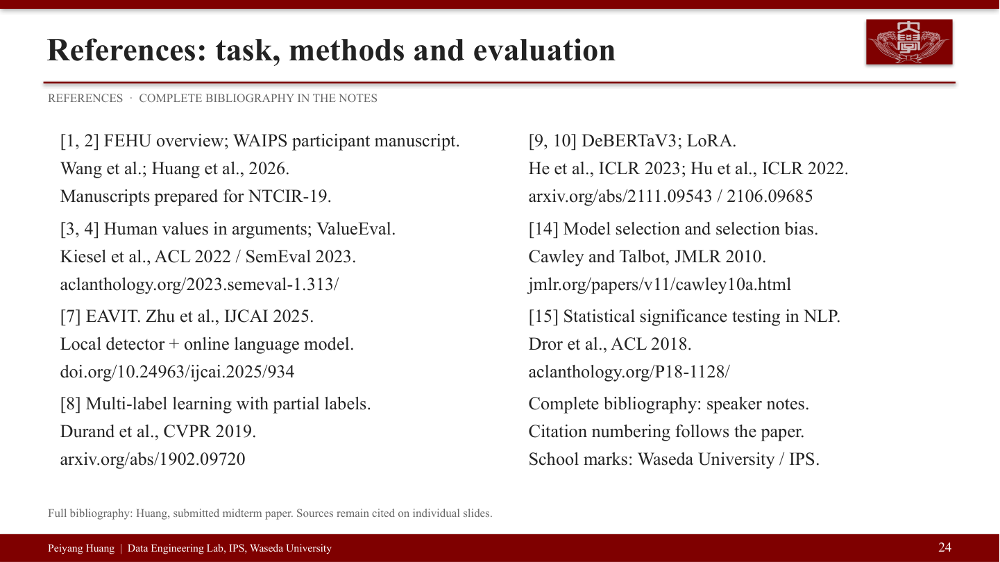

**画面阅读顺序（中）** 按任务与价值体系、模型与监督方法、评价方法三组理解引用，不逐条朗读。

**Reading order (EN)** Group the references by task foundations, model/supervision methods and evaluation principles.

### 本页讲解 / Slide explanation

**English explanation** The task papers define the evaluation and document the submissions. Earlier value-recognition work supplies the taxonomy background. EAVIT, partial-label learning, DeBERTaV3 and LoRA position the implementation choices. Calibration, F1 thresholding and statistical-evaluation papers clarify assumptions. These references support definitions and methodological context, while the experiments must establish the actual contribution. The FEHU overview and WAIPS source files are identified as manuscripts, so their publication status should not be overstated.

**中文讲解** 任务论文定义评价并记录提交，早期价值识别研究提供体系背景。EAVIT、部分标签学习、DeBERTaV3 和 LoRA 用于定位实现选择，校准、F1 阈值和统计评价论文用于说明假设。引用支持定义与方法背景，实际贡献仍须由实验建立。FEHU overview 与 WAIPS 来源文件标为稿件，不应夸大发表状态。

### 本页问答 / Questions for this slide

隐藏参考文献页。关键词：source attribution；manuscript status；methodological precedent；benchmark scope。

### P24-Q01【必练】最重要的几组文献各支撑什么？

**Q (EN)** Which references support the task, method, and evaluation choices?

**问（中）** 哪些文献分别支撑任务、方法与评价？

**A (EN)** The FEHU overview defines the task and official scores, while the team manuscript describes submissions. Kiesel and ValueEval provide the value-recognition background; NEVU describes the underlying news resource. EAVIT positions the local-model and LLM interaction. Partial-label work, DeBERTaV3, and LoRA ground the training components. Calibration, thresholding, model-selection, and significance papers frame the evaluation assumptions rather than prove my system’s gains.

**答（中）** FEHU overview 定义任务与官方成绩，团队稿说明提交系统。Kiesel 与 ValueEval 提供价值识别背景，NEVU 描述底层新闻资源；EAVIT 用于定位本地模型与 LLM 的交互。部分标签学习、DeBERTaV3、LoRA 支撑训练组件。校准、阈值、模型选择与显著性论文用于说明评价假设，不是证明本系统增益。

### P24-Q02【质疑】参考文献里 2026 年的稿子都已经发表了吗？

**Q (EN)** Are the FEHU overview and WAIPS paper already published conference papers?

**问（中）** FEHU overview 和 WAIPS 论文是否已经正式会议发表？

**A (EN)** The current materials identify them as manuscripts prepared for NTCIR-19. I should use that status and not imply acceptance or publication without a verified record. The official scores are reproduced from those retained materials. NEVU is separately cited as an arXiv preprint. The contribution of my midterm paper should be distinguished from the shared task’s dataset and from the joint participant manuscript.

**答（中）** 当前材料将它们标为为 NTCIR-19 准备的稿件，应沿用该状态，没有核实记录就不能暗示已录用或发表。官方成绩来自保留的这些材料；NEVU 单独按 arXiv 预印本引用。我的中期论文贡献，也应与任务数据集及团队参赛稿区分。

### P24-Q03【质疑】引用了论文，是不是就证明你的设计合理或新颖？

**Q (EN)** Does citing prior work validate your particular design choices or novelty?

**问（中）** 引用既有论文，是否就能证明具体设计合理或具有创新性？

**A (EN)** No. A citation establishes context, definitions, or a methodological precedent. It does not prove that my cutoff, score weight, supervision policy, or module combination is optimal. I need experiments for those claims and an accurate comparison of assumptions. In particular, the F1-threshold result cannot be used as a blanket proof for my constrained fusion rule.

**答（中）** 不能。引用能提供背景、定义或方法先例，不能证明我的阈值、打分权重、监督策略或模块组合最优。这些主张需要实验，以及对适用假设的准确比较。尤其不能把 F1 阈值结果当成本系统受约束融合规则的完整证明。

### P24-Q04【追问】NEVU 与 FEHU 是同一个数据规模吗？

**Q (EN)** How is the FEHU release related to NEVU?

**问（中）** FEHU 发布数据与 NEVU 有什么关系？

**A (EN)** FEHU uses a task-specific release drawn from the broader NEVU resource. The NEVU paper reports 2,865 English news articles and four semantic scopes, whereas my reported train, development, and Task 1 test counts belong to FEHU. I must not substitute NEVU’s full-resource counts, audit rates, or experimental results for statistics on the exact FEHU split used here.

**答（中）** FEHU 使用从更大 NEVU 资源中形成的任务发布版。NEVU 论文报告 2865 篇英文新闻和四种语义范围，而本研究报告的训练、开发、Task 1 测试规模属于 FEHU。不能用 NEVU 全资源数量、审核比例或实验成绩，替换实际 FEHU 划分的统计。

来源：[NEVU 论文](https://arxiv.org/abs/2603.17838)；本地官方任务说明 §3。

### P24-Q05【追问】为什么还引用较早的方法论文？

**Q (EN)** Why include older references such as the 2010 model-selection paper?

**问（中）** 为什么仍引用 2010 年模型选择等较早论文？

**A (EN)** Some references provide methodological principles rather than current competitive baselines. Selection bias, uncertainty estimation, and distinguishing known from missing labels remain relevant to this experiment design. Recent systems are needed for performance positioning, while foundational papers explain why an evaluation or inference claim needs particular assumptions. Publication year alone does not determine which role a reference can serve.

**答（中）** 有些文献提供方法原则，而不是当前竞争基线。选择偏差、不确定性估计、区分已知与缺失标签，仍直接关系到本实验设计。近期系统用于性能定位，基础论文用于说明评价或推断需要哪些假设。发表年份本身不能决定文献能发挥什么作用。

### 文献功能速查 / Reference roles

编号沿用 PPT/论文，表格用于查阅，不需要逐行背诵。

| 编号 | 来源 | 在答辩中的作用 / Role |
| --- | --- | --- |
| [1] | [FEHU overview，本地稿](../论文/NTCIR_FEHU_TaskOverview%20%281%29.pdf) | 任务、数据划分、指标、官方成绩 / Task and official evaluation |
| [2] | [WAIPS participant manuscript，本地稿](../论文/WAIPS%20at%20the%20NTCIR-19%20FEHU.pdf) | 团队系统与提交身份 / Team submissions |
| [3] | [Kiesel et al., ACL 2022](https://aclanthology.org/2022.acl-long.306/) | 价值识别与细粒度体系 / Value-recognition foundations |
| [4] | [ValueEval, SemEval 2023](https://aclanthology.org/2023.semeval-1.313/) | 论证领域价值任务 / Values behind arguments |
| [5] | [NEVU, 2026](https://arxiv.org/abs/2603.17838) | 底层新闻资源与标注流程 / News resource and annotation |
| [6] | [Feng et al., 2021](https://aclanthology.org/2021.findings-acl.84/) | NLP 数据增强背景 / Data-augmentation background |
| [7] | [EAVIT, IJCAI 2025](https://www.ijcai.org/proceedings/2025/934) | 本地检测器与在线 LLM 的信息流 / Local-detector–LLM design |
| [8] | [Durand et al., CVPR 2019](https://arxiv.org/abs/1902.09720) | 多标签不完整标注 / Incomplete multi-label annotations |
| [9] | [DeBERTaV3, ICLR 2023](https://arxiv.org/abs/2111.09543) | 编码器骨干 / Encoder backbone |
| [10] | [LoRA, ICLR 2022](https://arxiv.org/abs/2106.09685) | 低秩适配 / Low-rank adaptation |
| [11] | [Self-consistency, ICLR 2023](https://arxiv.org/abs/2203.11171) | 多输出聚合背景，不等同于当前投票 / Aggregation background |
| [12] | [Guo et al., ICML 2017](https://proceedings.mlr.press/v70/guo17a.html) | 正确率与置信度校准的区别 / Confidence calibration |
| [13] | [Lipton et al., 2014](https://arxiv.org/abs/1402.1892) | F1 阈值关系及条件 / F1-threshold assumptions |
| [14] | [Cawley and Talbot, JMLR 2010](https://www.jmlr.org/papers/v11/cawley10a.html) | 模型选择偏差 / Selection bias |
| [15] | [Dror et al., ACL 2018](https://aclanthology.org/P18-1128/) | 统计检验设计 / Statistical testing |
| [16] | [DeBERTa-v3-base model card](https://huggingface.co/microsoft/deberta-v3-base) | 模型配置与参数量 / Model configuration |

<a id="p25"></a>
## 第 25 页｜Conclusion: recover values and control the errors

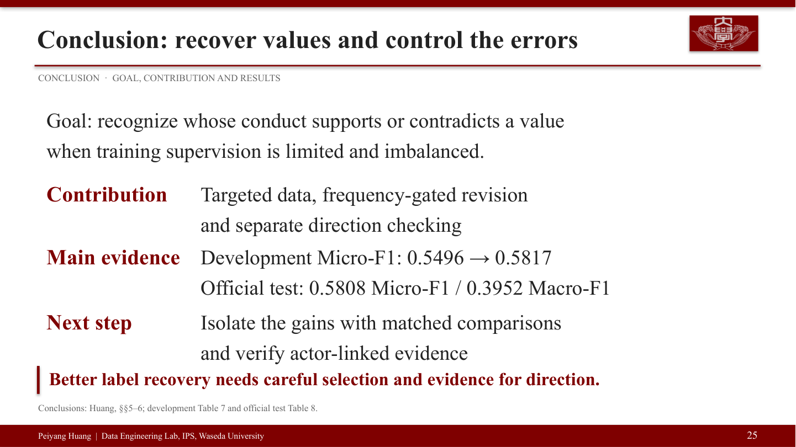

**画面阅读顺序（中）** 先回到研究目标，再用 RQ1、RQ2、RQ3 对应贡献和结果，最后逐项说明未完成验证。

**Reading order (EN)** Return to the goal, answer RQ1–RQ3 with the reported evidence, and finish with their remaining tests.

### 本页讲解 / Slide explanation

**English explanation** RQ1 shows that errors vary with label support, representation and direction, but their causes are not fully isolated. RQ2 finds that generated records improve ranking and Macro-F1 under the tested protocol, while target predictions remain weak and masking is unstable. Matched data controls are still needed. RQ3 finds a 3.21-point development Micro-F1 gain from the saved fusion stages, with most improvement before QA. Full component attribution, cost matching and rerun stability remain open. These answers define the current progress and the final thesis work more precisely than one overall score.

**中文讲解** RQ1 观察到错误随标签支持、表示与方向而变化，但尚未充分隔离原因。RQ2 发现当前协议下生成记录改善排序和 Macro-F1，但目标预测仍弱、masking 不稳定，仍需匹配数据对照。RQ3 在保存融合阶段观察到开发 Micro-F1 提高 3.21 个百分点，多数收益出现在 QA 前；完整组件归因、成本匹配和重跑稳定性仍未完成。这样逐项回答，比只报一个总分更准确地界定当前进展与最终论文工作。

### 本页优化：逐项回答 RQ / Answers and remaining work for each RQ

| RQ | 当前答案 / Current answer | 对应证据 / Evidence | 尚未完成 / Still open |
| --- | --- | --- | --- |
| RQ1：识别在哪里失败？/ Where does recognition fail? | 低支持标签、表示变化及方向判断有不同错误表现 / Errors differ across support, representation and direction | E1 未匹配／遗漏计数，频次分布，E6/E6b/E6c 比较，改对与改错案例 / Error counts, frequency, representation comparisons and cases | 不能证明频次是全部原因；主体归属与片段忠实性缺少独立测量 / Causal mechanisms and direct attribution/evidence evaluation |
| RQ2：生成数据与监督改变什么？/ What changes with generated data and supervision? | 900 assume-negative 条件改善 Macro-F1 与目标排序；目标决策仍弱，masking 效果不稳定 / Improved Macro-F1 and ranking, weak target decisions, unstable masking | Macro 0.0284→0.0890；AUC 0.5133→0.6242；目标 F1 0.0319；三种子波动 / Repeated encoder results | 等量通用生成／过采样、独立语义质量审核、阈值与权重机制 / Matched data controls, label audit, threshold and weighting analysis |
| RQ3：选择性融合怎样改变错误？/ How does selective fusion change errors? | 删除控制误报，补充减少遗漏，QA 小幅净改善；整体保存结果提高 / Different stage trade-offs with an overall saved-output gain | G0→G4：Micro 0.5496→0.5817；FP −170、FN −50；QA +0.27 pp / Saved-stage scores and counts | 增强编码器归因、完整门控消融、等预算比较、API 重跑与证据质量 / Full attribution, matched budgets, reruns and evidence quality |

**建议结论页英文三行 / Suggested three-row slide conclusion:**

- **RQ1:** “Errors vary with label support, representation and direction; mechanisms need further testing.”
- **RQ2:** “Generated records improve ranking; target decisions and masking stability remain weak.”
- **RQ3:** “Selective fusion improves saved outputs; matched ablations must isolate the gains.”

原有 Goal 可保留为页首一句，三行 RQ 答案替换中间泛化的 Contribution/Main evidence 叙述，下一步保留为末行，不新增 PPT 页。/ Keep a brief goal and next step, replacing the middle summary with RQ-linked findings rather than adding a slide.

### 本页问答 / Questions for this slide

关键词：claim boundary；main finding；individual contribution；next decisive experiment。

### P25-Q01【必练】用一分钟总结结论。

**Q (EN)** What should the committee remember from this study?

**问（中）** 委员会应记住这项研究的什么结论？

**A (EN)** For RQ1, the diagnosis shows different errors across label support, representations and directions, while causal mechanisms remain open. For RQ2, generated records improve ranking and Macro-F1 under the tested protocol, but target predictions remain weak, masking is unstable, and matched data controls are pending. For RQ3, saved fusion stages improve Micro-F1 from 0.5496 to 0.5817, with most gain before direction QA. Full component attribution and repeatability still need testing. Official test Micro-F1 is 0.5808, which supports reporting the submitted system’s result without claiming superiority over the stronger organizer reference.

**答（中）** 对 RQ1，诊断显示不同标签支持、表示和方向有不同错误表现，但因果机制仍待检验。对 RQ2，当前协议下生成记录改善排序与 Macro-F1，但目标预测仍弱、masking 不稳定，匹配数据对照未完成。对 RQ3，保存融合阶段把 Micro-F1 从 0.5496 提到 0.5817，多数收益在方向 QA 前出现，完整组件归因与重复性仍须验证。官方测试 Micro-F1 为 0.5808，可以据此报告提交系统的成绩，但不能声称优于更强 organizer 参考。

### P25-Q02【质疑】到底是系统贡献、实验贡献，还是理论贡献？

**Q (EN)** How would you characterize the contribution without overstating it?

**问（中）** 不夸大的前提下，你怎样界定贡献？

**A (EN)** It is primarily a system and empirical contribution. I implemented task-specific augmentation and selective fusion, studied supervision choices, and separated several error-control stages. I am not proposing a new foundation model or proving a new optimal decision rule. A stronger final thesis contribution will come from controlled evidence showing when these choices help, when they fail, and which simpler alternatives are sufficient.

**答（中）** 主要是系统与实证贡献：实现面向任务的增强和选择性融合，研究监督选择，分开分析若干错误控制阶段。我没有提出新基础模型，也没有证明新的最优决策规则。最终论文更强的贡献，应来自控制证据：哪些条件下有效、何时失败，以及哪些更简单的替代方案已经足够。

### P25-Q03【质疑】如果只能保留一个发现，你会选什么？

**Q (EN)** If you had to retain one scientific finding, what would it be?

**问（中）** 如果只能保留一个研究发现，你会选什么？

**A (EN)** I would retain the distinction between recovering labels and controlling their correctness. More supervision or more predictions does not automatically produce reliable directed labels: AUC can improve while target F1 stays weak, and removal and addition have opposite precision–recall effects. The current experiments make those trade-offs measurable. That is more informative than presenting one final score without its error behavior.

**答（中）** 我会保留“找回标签”和“控制正确性”之间的区别。更多监督或更多预测不会自动产生可靠有向标签：AUC 可以提升但目标 F1 仍很弱，删除与补充也会产生相反的精确率与召回率变化。当前实验使这些取舍可以测量，比只呈现一个最终分数而不解释错误行为更有信息。

### P25-Q04【追问】当场回答不了的问题，怎样合理回应？

**Q (EN)** How would you respond if asked for a result that you have not measured?

**问（中）** 如果教授追问一个尚未测量的结果，你应如何回答？

**A (EN)** I have not measured that comparison, so I cannot give a reliable numerical answer. The current evidence establishes the narrower result I have described. To test your question, I would hold the other components fixed, define the comparison and evaluation split in advance, and report the relevant score difference with uncertainty. I would rather make that boundary explicit than infer a result from an unrelated table.

**答（中）** 这个比较尚未测量，因此不能给出可靠数值。现有证据只支持我刚才说明的较窄结论。要检验您的问题，应固定其他组件，预先定义比较与评价划分，再报告相关分数差异及不确定性。我会明确这个边界，而不是从不相干的表格推断结果。

<a id="quick-reference"></a>
## 答辩前速查 / Quick reference

### A. 第一轮优先练习 / First rehearsal

先练每页【必练】，再用下面这些问题检验是否真正理解。它们是备考建议，不是对教授实际提问的预测。

| 优先问题 / Priority question | 位置 |
| --- | --- |
| Aligned with what, for whom, and based on which evidence? / 对谁、对什么价值、依据何种证据说 aligned？ | [P02-Q01–Q08](#p02) |
| Where does the value wheel come from, and what is FEHU? / 圆图来源、层级和 FEHU 分别是什么？ | [P03-Q01–Q10](#p03) |
| Can opposite sectors determine FEHU direction? / 圆图相对位置是否决定标签方向？ | [P03-Q05、Q14](#p03) |
| Why 108 labels, and when can both directions coexist? / 为什么 108 标签，何时双方向可以共存？ | [P03-Q09](#p03)、[P04-Q01、Q03–Q04](#p04) |
| Which test inputs are actually available? / 测试时哪些输入确实可用？ | [P04-Q05–Q07](#p04) |
| What is your own contribution? / 哪些是个人贡献？ | [P06-Q01–Q03](#p06) |
| Does augmentation cause the fusion gain? / 增强是否导致融合增益？ | [P09-Q01、Q07](#p09) |
| How were targets selected and generated labels checked? / 目标如何选择、生成标签如何验证？ | [P10-Q01–Q08](#p10) |
| What exactly is masked, and why might it hurt? / 掩码作用于什么，为什么可能变差？ | [P11-Q01–Q07](#p11) |
| Can you explain Micro, Macro, DRR, and AUC without confusing them? / 能否准确区分四种指标？ | [P13-Q03–Q09](#p13) |
| What does the confidence interval establish? / 置信区间证明到哪一步？ | [P17-Q03–Q05](#p17) |
| Why gate rare labels if rare-label recovery is your motivation? / 为什么研究稀有识别，却不让融合增删稀有标签？ | [P18-Q01–Q05](#p18) |
| Did you rank first, and was the comparison budget-matched? / 是否第一，比较是否等预算？ | [P19-Q01–Q07](#p19) |
| Why can direction QA turn a correct prediction into a wrong one? / 为什么 QA 会改错？ | [P20-Q01–Q06](#p20) |
| Which experiment would settle the main attribution question? / 哪个实验最能解决核心归因？ | [P22-Q01–Q04](#p22) |
| Is your fusion score a probability, and is F1/2 optimal? / 融合分数是否是概率，F1/2 是否最优？ | [P23-Q01–Q14](#p23) |

### B. 术语对照 / Technical vocabulary

| English | 中文及本研究中的含义 / Meaning here |
| --- | --- |
| FEHU | Fact-based Event-centric Human-value Understanding；NTCIR-19 的试点评测任务，当前工作重点为 Task 1b。 |
| Value taxonomy / value wheel | 价值分类体系／价值圆图；54 个细价值归入 20 个类别，外圈为更抽象的概念关系，见第 3 页。 |
| Motivational conflict | 价值目标之间的潜在张力；不同于一个行为与某个指定价值之间的 contradictory 方向。 |
| Human-value recognition | 人类价值识别；identify value labels expressed through the reported context。 |
| Actor-conditioned | 以主体为条件；predict for a supplied actor within an article。 |
| Actor attribution | 主体归属；connect the relevant evidence to the correct actor。 |
| Aligned | 支持／与指定价值一致；direction 1 relative to a specific value。 |
| Contradictory | 违背／与指定价值相悖；direction 0 relative to a specific value。 |
| Directed label / tuple | 有向标签／元组；fine value plus direction, attached to an article–actor unit。 |
| Multi-label | 多标签；several labels may be true simultaneously。 |
| Fine / coarse labels | 细／粗标签；54 Level-1 values versus 20 Level-2 categories。 |
| Projection | 投影；map fine to coarse, remove direction, deduplicate。 |
| Gold annotation | 评价参考标注；reference label, not unquestionable moral truth。 |
| Long-tail distribution | 长尾分布；many labels have low support while a few are frequent。 |
| Diagnosis-guided augmentation | 诊断驱动增强；generate examples targeting observed recognition failures。 |
| Hard negative | 困难负例；a plausible-looking candidate whose absence needs verification。 |
| Partial annotation | 部分标注；some target entries known, others unspecified。 |
| Assume-negative supervision | 假定负监督；treat unspecified entries as zero targets。 |
| Label mask | 标签掩码；decide which target entries contribute to training loss。 |
| BCE | Binary cross-entropy；二元交叉熵，逐有向标签计算。 |
| Positive class weight | 正类权重；scale the loss for supervised positive entries。 |
| Negative subsampling | 负例下采样；retain a subset of supervised negative entries。 |
| Encoder / classification head | 编码器／分类头；text representation followed by label logits。 |
| Logit / sigmoid | 未归一化分数／S 形函数；a logit maps to a score in (0,1)。 |
| LoRA | Low-Rank Adaptation；低秩适配，用少量新增参数更新模型行为。 |
| Primary / auxiliary / juror | 主预测／辅助成员／投票成员；juror is a model output source, not a human judge。 |
| FGHF | Frequency-Gated Heterogeneous Fusion；频次门控异构融合。 |
| Isotonic regression | 单调回归；fit a nondecreasing score-to-correctness map。 |
| PAV | Pool-adjacent-violators；合并违反单调性的相邻分数组。 |
| Calibration | 校准；relate score levels to empirical correctness likelihood。 |
| Cross-fitting | 交叉拟合；fit on one article fold and score another。 |
| Threshold / operating point | 阈值／工作点；convert a score into a prediction decision。 |
| Precision / recall | 精确率／召回率；fraction of predictions correct / fraction of gold recovered。 |
| Micro-F1 / Macro-F1 | 汇总计数 F1／逐支持标签平均 F1。 |
| DRR | Direction reversal rate；gold 单方向组合上的相反方向预测率。 |
| ROC-AUC | ROC 曲线下面积；positive-versus-negative score ranking。 |
| Sample SD | 样本标准差；spread of the three encoder-run scores。 |
| Paired bootstrap | 配对自助重采样；resample the same articles for both fixed systems。 |
| Ablation | 消融；remove or replace a specified component under controlled conditions。 |
| Selection bias | 选择偏差；evaluation affected by choosing designs on the same data。 |
| Evidence grounding | 证据支撑；check that the cited report supports the actor–value–direction relation。 |
| Percentage points, pp | 百分点；absolute difference after multiplying proportions by 100。 |

### C. 四套不同的“阈值／条件” / Four different thresholds or conditions

| 项目 / Item | 当前定义 / Current definition | 不能混淆成 / Do not confuse with |
| --- | --- | --- |
| 增强目标筛选 / Target selection | 训练支持 ≤130、开发正例 ≥3、seed-42 基线在 0.30 下召回零；最终 18 个列表另有记录缺口 | 不是只按频次就必然筛出 18 个 / Not a complete deterministic selection rule |
| 独立编码器预测 / Standalone encoder | sigmoid score ≥0.30 为正预测，作为实验公共工作点 | 不是融合 θ / Not the fusion threshold |
| 融合频次门控 / Fusion eligibility | 官方训练有向标签计数 >130；共 38 个 | 不是模型置信度 >130 / A count, not confidence |
| 融合决策阈值 / Fusion decision | θ = 拟合数据上的主系统 Micro-F1 / 2；测试保存值约 0.27479 | 比较校准后支持分数；不是定理保证的最优阈值 / Applied after calibration; heuristic |

### D. 关键数字与证据类型 / Key numbers and evidence types

| 结果 / Result | 数值 / Value | 应怎样表述 / Interpretation |
| --- | --- | --- |
| A → B，平均 Macro-F1 | 0.0284 → 0.0890 | 三个编码器种子的均值 / Mean over three training seeds |
| A → B，目标平均 AUC | 0.5133 → 0.6242 | 排序改善 / Better ranking |
| A → B，目标 F1 | 0.0000 → 0.0319 | 阈值 0.30 下仍弱 / Still weak at the fixed threshold |
| A → B，DRR | 0.1580 → 0.2823 | 方向反转恶化 / More reversals |
| G0 → G1 → G3 → G4，开发 Micro-F1 | 0.5496 → 0.5608 → 0.5790 → 0.5817 | 保存输出的累积阶段比较 / Cumulative saved-output comparison |
| G4 − G0 | +3.21 pp；95% interval +2.09 to +4.33 pp | 文章配对 bootstrap；未覆盖系统选择与重跑波动 / Conditional on fixed outputs |
| G4 − G3 | +0.27 pp | QA 小幅净收益；无单独报告的区间 / Small observed QA increment |
| G1 → G5，无门控删除 | Micro +0.95 pp；Macro −2.46 pp | 删除分支的取舍 / Removal-only trade-off |
| WAIPS-03 官方 Task 1b test | Micro 0.5808；Macro 0.3952；DRR 0.0477 | 主办方成绩，不是本地重算 / Organizer-provided scores |
| WAIPS-03 vs IIUoT-01 Macro | 0.3952 vs 0.3930 | 高 0.22 pp；未建立显著性 / Numerical difference only |
| Dev QA | 176 checks = 46 flips + 123 unchanged + 7 failures | 翻转数不等于纠错数 / Flips are not correction counts |
| Test QA | 207 checks = 77 flips + 125 unchanged + 5 failures | 无本地 gold 分类每次翻转 / No local correctness analysis |

固定 18 个目标采用 `direction:value` 记法，不是 `value:direction`：

```text
0:31, 0:48, 0:53, 0:16, 0:19, 0:20, 0:13,
0:37, 0:29, 0:2, 0:33, 0:32, 0:40, 0:28,
1:31, 1:10, 1:49, 1:4
```

其中 `0=contradictory`，`1=aligned`。模型向量索引使用 `k=2×value+direction`，因此列表字符串记法与向量索引不是同一种表示。

### E. 容易说过头的话及合理替换 / Claims to phrase precisely

| 避免的说法 / Avoid | 可以直接说的英文 / Defensible English | 中文含义 |
| --- | --- | --- |
| “This news is aligned.” | “The benchmark labels this actor’s reported conduct as aligned with this specific value.” | 特定主体、行为、价值及标注解释，不能笼统判断整篇新闻。 |
| “The government wanted safety, so its action must be aligned.” | “The annotation uses the reported protective purpose; that does not establish the actual outcome.” | 说明目的性依据，不把目的当结果。 |
| “All gold labels were manually verified.” | “The underlying resource uses model-assisted annotation with targeted human verification.” | 不声称全部人工核验。 |
| “An unlabeled value is contradictory.” | “An unspecified entry may be unknown; contradiction requires its own evidence.” | 未标注不等于违背。 |
| “We proved that augmentation caused the 3.21-point gain.” | “The saved fusion output gained 3.21 points; augmentation’s contribution remains to be isolated.” | 整体增益与增强归因分开。 |
| “Masking works better.” | “Masking’s effect depends on data composition and random seed in these experiments.” | 如实报告条件依赖。 |
| “AUC 0.6242 means 62.42% accuracy.” | “AUC measures positive–negative ranking; target F1 remains 0.0319 at threshold 0.30.” | 排序不等于准确率。 |
| “Our gate improves both metrics.” | “The removal-only gate comparison shows a Micro–Macro trade-off.” | 门控存在取舍。 |
| “F1/2 is the theoretically optimal threshold here.” | “Half the primary F1 is an operational heuristic in this constrained system.” | 不套用不满足条件的定理。 |
| “Calibration removes development bias.” | “Cross-fitting separates calibration fitting, but earlier development-based selection still matters.” | 校准拟合与系统选择是两层问题。 |
| “QA corrected 46 errors.” | “QA made 46 direction changes; the measured result is a small net improvement.” | 变化不等于纠错。 |
| “We ranked first overall.” | “We had the numerically highest participant Macro-F1; the official ranking uses Micro-F1.” | 区分辅助指标与主排名。 |
| “All components are independently validated.” | “Stage comparisons are available; complete matched component ablations are still needed.” | 阶段差异不等于独立因果贡献。 |
| “Our summaries are evidence-grounded because F1 improved.” | “Evidence fidelity requires its own evaluation.” | 标签分数不能代替证据质量评价。 |

### F. 索引与核验说明 / Evidence notes

本稿的问题来自对 PPT、论文、原始案例标注及关键实现的审查；它们不是导师已提出问题的转录。英文与中文答案表达同一结论，所有说明性数字例子均与实际结果区分。

The questions are preparation prompts derived from the reviewed slides, manuscript, original annotations, and key implementation details. They are not a transcript of actual committee questions. Proposed experiments and illustrative examples are distinguished from completed results.

主要本地依据：

- [当前 25 页 PDF](2026-09-29_12-40_Huang_Midterm_Defense_English_Background_Updated.pdf) 与 [双语主讲稿（当前目标 21 分钟）](2026-09-29_12-39_Huang_Midterm_Speaker_Script_EN_ZH_20min.md)：本稿提供逐页解释与问答，主讲时间安排仍以主讲稿为准。文内截图由当前 PDF 对应页渲染，保存在同目录的 `2026-09-29_13-02_qa_slide_previews/`，移动 Markdown 时应一起保留该文件夹。
- [中期论文源稿](../论文/Huang_FEHU_Midterm_Paper.tex)：方法、实验表格、局限与结果来源索引。
- [训练 gold](../../dataset/gold_labels/train/train_human_values.json)、[开发 gold](../../dataset/gold_labels/dev/dev_human_values.json)、[价值定义](../../dataset/hv_categories/human_value_taxonomy.json)：计数、案例及标签含义。
- [融合实现](../../RH_test/E7_calibrated_jury_fusion/scripts/run_fusion_e7.py)、[PAV 实现](../../RH_test/E5_deberta_auxiliary_fusion/scripts/fusion_lib.py)：规则细节；历史实验仍须结合相应保存配置与结果解释。
