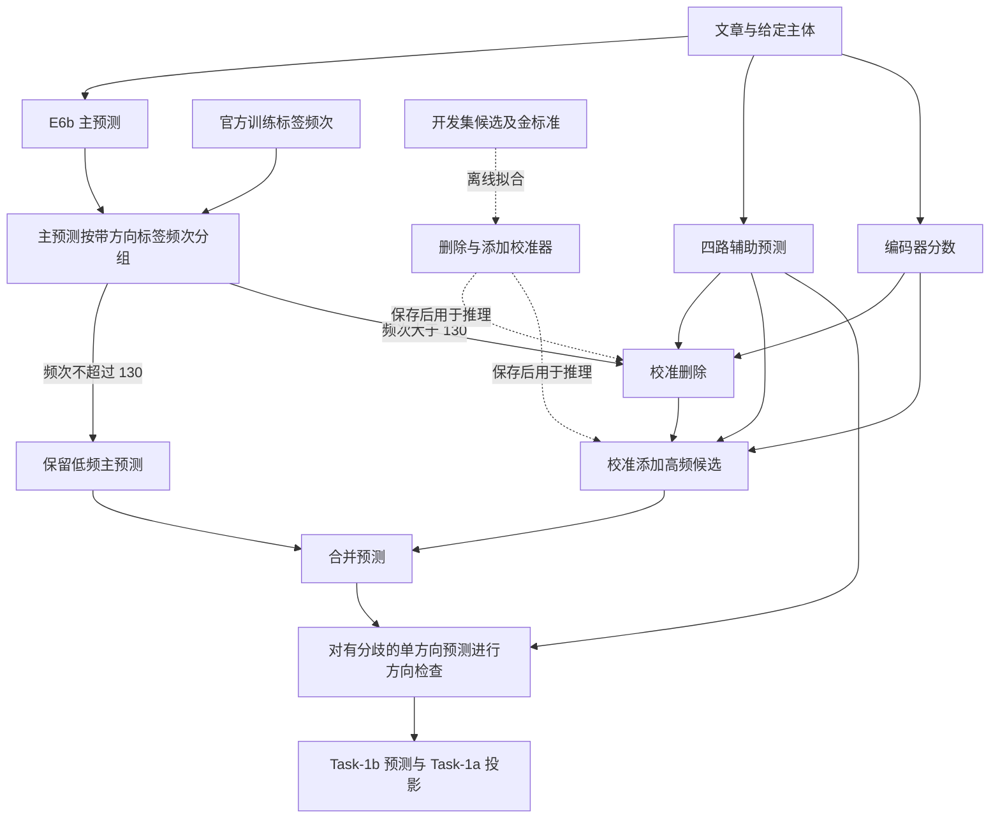

# FEHU 中期论文审阅建议

审阅日期：2026-09-15

## 1. 总体判断与审阅范围

**文章存在较明显的 AI 式行文，集中在摘要、贡献说明、实验总结和结论；方法细节与案例段落相对自然。最值得修改的是反复宣告贡献、过密的限定句，以及结论对实验波动的交代不足。**

这种判断针对读者感受到的写作风格，不能据此判定作者是否使用了 AI，也不对应任何“AI 生成概率”。规范语法、技术术语、三项研究问题和必要的局限说明，本身都不是问题。

论文有可保留的研究基础：任务和标签定义具体，官方测试结果有出处，增强实验包含三个种子，融合阶段保留了预测与操作记录，方向案例能够对应到真实文章。这些细节应成为叙述主体。若以中期研究论文标准审阅，我建议进行一次有重点的较大修改，优先修正贡献表述和实验呈现，再润色语言。

### 审阅对象与定位约定

- 全文阅读了 [中文 LaTeX 原稿](/Users/lloydhuang/Documents/GitHub/fehu-project/ntcir19_fehu-master/docs/论文/Huang_FEHU_Midterm_Paper_zh.tex)，共 772 行。
- 你指定的 [PDF](/Users/lloydhuang/Documents/GitHub/fehu-project/ntcir19_fehu-master/docs/论文/Huang_FEHU_Midterm_Paper.pdf) 是英文版，共 28 个物理页面。我完成了全篇版面巡检，并重点检查六幅图、十张表和算法。
- 补查了同目录中文 PDF 的关键图表页。中文 PDF 共 25 页，分页与英文版不同，不能混用页码。
- 对增强实验的 21 条逐次运行记录、G0/G1/G3/G4 预测、方向问答决策和 bootstrap 文件进行了只读核查；对照了本地任务概述的官方成绩表，并抽查了五项相关工作的原始来源。

下文 `L39` 等定位均指中文 `.tex` 行号；“英文 p.19”指 PDF 页脚的正文页码，对应阅读器第 22 页。审阅没有重新训练模型、调用推理 API 或重新评估官方测试集。

### 优先级

| 优先级 | 建议 | 原因 |
|---|---|---|
| P0：首先处理 | 区分增强的独立编码器收益与完整融合收益 | 当前缺少增强分数在融合中的直接对照，18 个增强目标又全部位于增删门控之外 |
| P0 | 摘要明确 `.0890` 属于 B 的“未列标签视为负例”条件 | 目前前文介绍掩码，后文紧接 B 的分数，容易使读者误认配置 |
| P0 | 表 5 补 Macro-F1 的种子差异，正文讨论 Fp 的不稳定性 | Fp 的 Macro-F1 为 `0.0878 ± 0.0838`，均值不能代表每次训练的表现 |
| P0 | 移动图 6 图例 | 中英文 PDF 中，图例均遮住前两个 Micro-F1 数据点 |
| P1：本轮修改 | 精简贡献重复、限定句和翻译腔 | 这是 AI 感最明显的来源 |
| P1 | 将方向检查、增删步骤改写为可解释的错误变化 | 现有记录已经能够给出纠错与误改数量，无须先做新实验 |
| P1 | 补齐诊断选择规则、校准候选定义和实验版本对应关系 | 这些细节决定方法能否复现、结论是否成立 |
| P2：后续实验 | 等预算增强对照、完整系统消融、独立评估与 Task 2 拓展 | 用于增强终稿的研究贡献，不能以待做实验替代当前结果 |

## 2. 比语言润色更重要的研究问题

### 2.1 增强实验与融合系统之间缺少直接的贡献验证

定位：L174、L241、L273-L285、L527、L569；英文 p.6、8、10、18-19。

文中选取的 18 个增强目标满足训练频次不超过 130；融合的删除和添加仅作用于频次大于 130 的标签。因此，按文中定义，增强目标集合与增删门控集合不相交。

这与保存结果一致：18 个目标上的 Micro-F1 在 E6b、G1、G3 中都是 `0.3145`，到方向检查后的 G4 才变为 `0.3264`。这些低频主预测在增删阶段被保留。

现有证据支持两项结果：加入生成记录改善了特定训练协议下的编码器指标；完整融合改善了系统指标。**“改善低频标签的编码器”对“融合系统提升”的具体贡献，仍需要单独检验。** 共享编码器可能同时改变高频标签分数，这条间接路径在目前的表格中没有被分离。

另一个对应问题是：融合使用历史 v2 概率文件，表 5 则是 A/B/C/Fp/Gp 等重复实验。附录已说明历史 v2 概率来源追溯不完整。应在方法正文明确二者的关系，避免读者默认完整系统使用了表 5 中某一确定检查点。

建议：

1. 现稿先分别陈述两条实证结果，删除“增强改善低频证据，因此提升完整融合”一类未经直接对照的推导。
2. 后续固定主预测、辅助预测和评价划分，比较：不使用编码器分数、使用仅官方数据编码器分数、使用增强编码器分数。各条件都按相同划分重新拟合校准器。
3. 同时报告高频 38 类、其余低频类和所选 18 类的变化。若收益主要来自高频分数，就据此调整贡献叙述。

### 2.2 摘要中的配置归属需要说清楚

定位：L39-L41、L471-L487；英文摘要、p.17。

摘要先介绍“通过部分标签掩码训练”的编码器，随后用 `Macro-F1 0.0284 → 0.0890` 和 `AUC 0.5133 → 0.6242` 作为增强结果。这两个终点对应 B；B 将未指定标签视为负例。相同 900 条记录采用掩码的 C，两个指标分别为 `0.0470` 和 `0.5770`。

这些数值与表格一致，但邻接叙述容易造成配置误解。建议写明“在将未标注项视为负例的 900 条增强条件下”，并另用一句话说明掩码在不同数据组合中的结果。

### 2.3 掩码收益和训练稳定性应成为主要发现

定位：L475-L508；英文 p.17，表 5、图 5。

表 5 为 Micro-F1 和 AUC 提供了标准差，却只给核心贡献指标 Macro-F1 的均值。我依据两份 `per_run_metrics.csv` 重新计算了以下结果。标准差采用样本标准差，基于 CSV 已保存的四位小数；下表不是新增训练结果。

| 条件 | Task-1b Macro-F1，均值 ± SD | 18 个目标的 Micro-F1，种子均值 | 固定阈值下目标 TP，种子 42 / 43 / 44 |
|---|---:|---:|---:|
| A：仅官方数据 | 0.0284 ± 0.0018 | 0.0000 | 0 / 0 / 0 |
| B：900 条，未列标签视为负例 | 0.0890 ± 0.0370 | 0.0319 | 0 / 2 / 12 |
| C：900 条，掩码 | 0.0470 ± 0.0180 | 0.0081 | 0 / 0 / 2 |
| Fp：340 + 900 条，掩码 | 0.0878 ± 0.0838 | 0.0447 | 0 / 0 / 37 |
| Gp：340 + 900 条，未列标签视为负例 | 0.0779 ± 0.0126 | 0.0260 | 0 / 1 / 7 |
| N3：Fp 加 1:3 负例下采样 | 0.1074 ± 0.0663 | 0.0537 | 84 / 61 / 104 |
| N1：Fp 加 1:1 负例下采样 | 0.0424 ± 0.0040 | 0.0351 | 122 / 132 / 140 |

需要在正文明确三个观察：

- B 相对 A 的目标 AUC 与全标签 Macro-F1，在三个种子中都提高。增强在这一协议下的收益有实际支持。
- C 的目标 AUC 在三个种子中都低于 B。只说“C 降低 DRR、保持相近 Micro-F1”，遗漏了掩码对主要目标指标的不利结果。
- Fp 的 Macro-F1 为 `0.0587 / 0.0224 / 0.1822`；目标 TP 为 `0 / 0 / 37`。Fp 相对 Gp 的 Macro-F1 在两个种子下降，在一个种子上升。较高均值和较强不稳定性需要一起报告。

建议将结论改为：

> 900 条增强记录提高了目标标签的平均排序能力，但固定阈值下的目标识别仍较弱。掩码的效果随数据组成变化：在仅加入第二轮记录时，掩码降低目标 AUC；合并两轮记录后，掩码配置取得较高均值，同时呈现较大的种子差异。

还应区分“预测过更多类别”与“正确识别更多类别”。原始记录中的 `distinct_pred_classes` 可以说明输出覆盖扩大，`targets_with_tp` 才直接反映目标类别是否出现正确命中。Macro-F1 上升本身不能完整回答类别覆盖问题。

### 2.4 “诊断引导”相对普通增强的增益尚未分离

定位：L174-L199、L492、L527。

A 与 B/C 是有价值的有无增强对照，支持加入这些生成记录的效果。若强调“诊断引导”是方法优势，还需要等规模的普通生成或非诊断目标选择对照；若强调“新语义样本”优于重复监督，还需要官方样本过采样对照。

当前目标选择说明也不够完整：“训练计数不超过 130、开发集至少三个正例”是可复现条件，“结合基线诊断”“存在可观察困难”仍缺少实际判据。应补充基线版本、难度指标、排序或筛选规则，以及最终 18 类的来源。若其中有人工选择，就明确记录人工选择依据。

第二轮只经过结构检查，第一轮有模型语义筛查，六样本人工试点不足以估计全部生成数据的质量。建议分模式抽样检查目标标签、主体归属、方向及漏标情况，报告实际审核数量和通过率。文中指出第二轮 900 条记录中仅 36 条带显式已知负例；90 条“困难负例”是生成模式的记录数。建议保留这一区分，并统计训练真正使用的正、负、未知条目数量。

式（3）按批次受监督条目数归一化。当部分记录只有很少监督条目时，它们在总损失中的相对权重也会变化。这可以作为解释掩码结果的机制假设，先检查监督条目与损失贡献，再考虑每样本归一化的对照。不要直接将某一种机制写成已经证实的原因。

### 2.5 校准交叉拟合解决了局部问题，评估边界还需集中说明

定位：L125-L127、L285-L287、L383、L571；英文 p.4、10、13、19。

按文章分组的两折校准是合理设计，配对 bootstrap 也保留了文章内主体的依赖关系。这两点应保留。

但开发集还参与了目标选择、早停、提示选择和融合规则选择。仅对校准器交叉拟合，不能消除整个研究流程的选择偏差。因此，`G4 − E6b = 0.0321，95% 区间 [0.0209, 0.0433]` 应解释为固定预测文件上的文章重采样比较。它不包含重新训练、重新生成或重新选择系统产生的波动。这与模型选择偏差的已有讨论相符。[Cawley 与 Talbot，2010](https://www.jmlr.org/papers/v11/cawley10a.html)

另有两个值得检验的具体点：

- 添加校准样本按“原始主集合中没有该价值观”构造，应用时却按“删除后的集合中没有该价值观”筛选。文中诚实报告了这一差别和 11 次方向替换。建议统计这类新候选的数量与正确率，核查校准映射是否适用于它们。
- `F1/2` 的理论结果涉及校准概率和最优 F1；当前使用主系统观测 F1 的一半作为阈值。文中将其称为启发式是准确的，可压缩反复解释，但应保留条件，并补同一验证协议下的阈值敏感性分析。[Lipton 等，2014](https://arxiv.org/abs/1402.1892)

若要强调“校准改善了概率可信度”，建议增加折外可靠性图和 Brier 分数，并分别呈现删除、添加候选。F1 的提高不能直接代替校准质量证据。可靠性图比较预测概率与实际正确率，能说明高支持分数是否对应较高命中率。[Guo 等，2017](https://proceedings.mlr.press/v70/guo17a.html)

### 2.6 方向检查已有更有解释力的结果可报告

定位：L335、L553、L598-L619；英文 p.12、19-21。

原文报告开发集检查 176 项，其中 46 项翻转。将保存的翻转决策与开发金标准逐项匹配，可以进一步得到：

| 46 次翻转的结果 | 数量 | 对精确带方向 TP 的净影响 |
|---|---:|---:|
| 原方向未命中，翻转后命中 | 14 | +14 |
| 原方向命中，翻转后未命中 | 7 | -7 |
| 翻转前后均未命中 | 20 | 0 |
| 两个方向均有金标准支持 | 5 | 0 |
| 合计 | 46 | +7 |

这些计数也与 G3 到 G4 的集合变化吻合：TP 从 1,495 增至 1,502，FP 从 1,279 降至 1,272，FN 从 895 降至 888。该核查使用官方标签匹配定义，不代表对新闻内容进行了新的人工裁决。

这组结果比“进行 46 次方向修正”更准确。20 次翻转前后都未命中，提示方向检查还会花在金标准不支持的价值观上；7 次正确改错则说明方向判断需要同时考虑收益与误改。

建议保留当前成功案例与双方向案例，再补一个正确改错案例。现有记录中 `0-4716-3-1`、主体 `0-4716-3-1-1`、价值观 26 的 `1 → 0` 可作为候选，正式写入前核对文章证据。不要将金标准解释直接当作新闻原句。

### 2.7 其他需要补齐的研究表述

| 问题 | 当前已有内容 | 建议 |
|---|---|---|
| 独立编码器的公平比较 | 统一阈值 0.30，按开发 Micro-F1 早停 | 保留共同协议；解释为何论文强调 Macro-F1，却用 Micro-F1 选择检查点；后续在内部划分检查阈值和早停敏感性 |
| 行为主体覆盖 | 清楚披露编码器 456 个有标签主体、提示系统 459 个给定主体 | 表 4 按系统类别分组；能补齐时统一到 459 个主体，并明确无金标准正例主体的 FP 计分 |
| 完整系统消融 | G2/G5 正确说明为 G1 的删除分支对照 | 表 7 标题改为“分阶段比较及删除分支对照”；后续补完整 G4 去编码器、去门控等实验 |
| 模型版本与复现 | 有配置和历史产物索引 | 在正文给出简短运行映射：配置名、数据版本、检查点、概率文件、预测文件；冒烟环境不能直接充当全部正式实验环境 |
| 成本 | 测试逻辑请求数：WAIPS-02 为 700，E7 为 1,432 | 这约为 2.05 倍请求量，但请求长度不同；成本比较另报实际输入/输出 token、重试、延迟，区分已缓存输出和从头运行 |
| 官方比较 | 明确参赛最高 Macro 与组织者更高分数 | 保留。补充官方主排名依据为 Micro-F1，避免“Macro 第一”被读成任务总冠军 |

相关工作中，EAVIT 应得到更具体的比较：它用本地检测器缩减需要交给在线模型处理的价值观定义上下文；本文以提示系统为主预测，再用辅助预测和编码器分数修订集合。可以围绕信息流、主体条件、方向标签和监督形式比较，减少“贡献在于任务化设计”这样的概括。[EAVIT 原文](https://www.ijcai.org/proceedings/2025/0934.pdf)

## 3. AI 感具体来自哪些句子

### 3.1 重复的是论证动作，不只是几个词

从摘要到结论的中文源码中，包括标题和图表说明，字面出现“保留”45 次、“贡献”22 次、“相互关联”4 次。这里的计数只用于定位重复习惯：“保留预测”等算法用语有明确含义，不能机械删除。

最明显的段落模式是：先概括方法，再宣告贡献，列一组已经出现的数值，最后以“这些结果确立……”收尾。L41、L88、L492、L527、L622、L627-L629 多次承担了同一功能。

建议让不同位置承担不同任务：摘要报告结果；引言说明研究问题和贡献；实验节解释证据；结论保留主要发现与尚未解决的问题。实验段落读完表格后，应多回答“为什么有这个差异、代价是什么”，少重复“这构成贡献”。

### 3.2 代表性句子的修改示例

以下示例包含两类修改：语言简化，以及根据本次核查收窄结论。后一类已经明确写入条件，不能只替换几个连接词后保留过强主张。

| 定位 | 原句或片段 | 读起来生硬的原因 | 建议表达 |
|---|---|---|---|
| L39 | “两种推理方法分别控制由此产生的权衡” | 没有说明具体控制哪个决策 | “WAIPS-02 通过多数投票筛选标签，再由 Flash 预测调整方向；WAIPS-03 使用校准分数增删标签，并检查方向分歧。” |
| L41 | “确立了增强对本地识别器的独立贡献” | 从数值跳到评价，且配置未点明 | “在 B 条件下，三个种子的 Macro-F1 和目标 AUC 均高于仅官方数据条件。” |
| L86 | “本研究形成三项相互关联的贡献” | 与 L62 的方法总览重复 | 在贡献小节直接列清增强实验、投票方法、融合方法各自新增了什么，合并前一段重复介绍 |
| L106 | “贡献在于这一任务化设计，以及实验中已经展现的……” | 用自我评价替代与相关工作的技术比较 | “本文的生成目标同时指定行为主体、价值观和方向；融合阶段使用编码器分数修订提示系统的主预测。” |
| L176 | “要求具有开发集支持度使诊断易于解释” | 抽象名词替代实际筛选过程 | “仅选择开发集中至少有三个正例的标签，因此目标结果只代表这一筛选子集。” |
| L218 | “若将其写成整个二元交叉熵的乘数，就会描述成另一种损失” | 像编辑备注，打断方法叙述 | “正例权重仅作用于损失中的正例项。”零计数处理另给准确公式或实现说明 |
| L276 | “这些选择体现出一种保守的不对称性” | 用抽象评价总结已经写清的公式 | “删除接受同一价值观的跨方向支持；添加采用候选方向的精确支持。” |
| L285 | “两个合并标签拟合的保序回归……” | 中文修饰关系不清楚 | “删除和添加各拟合一个保序回归模型。每个模型合并不同标签的候选样本进行拟合。” |
| L287 | “并非在测试集上估计第二个开发分数” | 引入读者尚未提出、也不自然的说法 | “测试推理使用在完整开发集上拟合并保存的校准器。” |
| L335 | “测试集对应计数为 207、77、125 和五” | 读者必须回看前句逐项配对 | “测试集检查 207 项，其中 77 项翻转、125 项不变，5 次请求失败后保留原方向。” |
| L365 | “实际数据问题不是记录过多，而是在……” | 反驳没有提出的假设 | “训练数据的主要困难是标签分布不均，且可用的独立文章较少。” |
| L527 | “这是 DRA-FEHU 已完成的研究贡献” | 不增加证据，重复结论 | 删除这句，接着讨论目标 AUC 的提高为何尚未稳定转化为固定阈值下的正确预测 |
| L592 | “恰当主张是具有特定宏平均优势的、有竞争力的参赛表现” | 像写给作者的审稿指令 | “WAIPS-03 的 Task-1b Macro-F1 在参赛提交中最高；其 Micro-F1 低于 IIUoT-01，两个 F1 均低于组织者基线。” |
| L629 | “这些结果共同构成已完成的定向监督与选择性系统设计贡献” | 结尾再次宣告研究成立 | “后续需要检验增强编码器对融合增益的具体贡献，并改善掩码训练的稳定性。” |

### 3.3 限定句应保留，但集中放置

目前多次出现“不能证明”“而非”“并不意味着”“不是”。其中一些非常必要，例如 Task 1 的输入边界、`F1/2` 的适用条件、测试集不含本地金标准、DRR 不等于方向准确率。

建议把共同限制集中到实验设置或一个“结果解释与局限”小节；图注保留读图必需的信息。公式后那些假想错误写法、每段末尾的泛化警告和反复声明个人贡献归属，可以合并。

例如官方结果段只需直接写三件事：WAIPS-03 在哪个指标领先、在哪些指标落后、比较对象的设置有何不同。无需随后再解释“应该怎样声称这项结果”。

### 3.4 中文术语和句间衔接

| 当前表达 | 建议 | 使用边界 |
|---|---|---|
| 行为主体条件化的人类价值观识别 | 面向给定行为主体的价值观识别 | 首次说明 actor-conditioned 的含义；后文可用“主体条件识别”或“针对主体的识别”，选定一种即可 |
| 提示评审成员 | 四路辅助预测／辅助预测成员 | 多路提示输出不等于多个独立模型，避免称“四个独立模型” |
| 保留的实验／保留的结果／保留的流程 | 本次实验／保存的预测文件／提交系统 | 按实际所指选词，涉及历史版本时再用“历史运行” |
| 金标准支持 Macro-F1 | 首次写“仅对金标准含正例的标签计算的 Macro-F1” | 定义后统一使用公式符号或简称，不必每次展开 |
| 定向增强、定向提示、带方向标签 | 分别写“针对目标标签的增强”“目标标签提示”“带方向标签” | 区分 targeted 与 directed，防止读者把“选目标”误解为“判断方向” |
| 经验证的 Task-1b 集合 | Task-1b 预测集合，或“通过格式校验的预测集合” | 格式验证不代表语义预测已被证明正确 |

句间衔接应靠具体信息推进。以 L508 为例，建议形成“B/C 的受控比较 → Fp/Gp 的变化 → 种子差异 → 能得到的结论”的顺序。连续使用“这些结果”“这一设计”“这一区分”只会让指代越来越远。

英文版也有相同问题。例如英文 p.18 的 `This is a completed contribution of DRA-FEHU.` 可以删去；英文 p.17 的结果段应补上 C 相对 B 的 AUC 降低，以及 Fp 的波动。英文 `retained` 在说明具体归档文件时有用，连续修饰方法、实验、结果时则显得像审计记录。

## 4. 文章结构与段落改写

### 4.1 用实验发现组织主线

建议保留现有六节大结构，调整各节承担的任务：

| 位置 | 建议保留 | 建议压缩或补充 |
|---|---|---|
| 摘要 | 任务、主要方法、编码器与系统结果 | 点明 B 的监督条件；删除“确立贡献”；用一句话报告掩码不稳定性 |
| 引言 | 主体与方向混淆的具体问题、早期失败观察 | 将 L62、L86、L88 的重复介绍合并；个人贡献及合著关系集中说明一次 |
| 相关工作 | FEHU/NEVU、增强、部分标签、融合与校准 | 补 EAVIT 信息流对比；减少每小节结尾对本文贡献的评价 |
| 问题定义 | 文章与主体单位、双方向合法性、层级映射 | 研究问题采用中性问法，避免预设“增强如何改善”已经成立 |
| 方法 | 目标选择、掩码、主预测、增删和方向检查 | 用统一运行名称；历史路径与实现备注放附录，影响结果的行为留正文 |
| 实验与讨论 | 三种子、阶段比较、官方测试、案例 | 补方差、目标命中、TP/FP/FN 和翻转结果；合并 5.10 与结果局限 |
| 结论与后续工作 | 主要发现、可检验的下一步 | 删除又一轮完整数字复述；先补贡献验证和稳定性，再扩展 Task 2 |

RQ2 可以改为：“在相同训练协议下，目标增强如何改变标签排序和阈值化预测？掩码的作用是否随生成数据组成而变化？”这样既容纳正结果，也容纳 C 低于 B 的结果。

标题可考虑：**《新闻中面向行为主体的价值观识别：诊断引导增强与频次门控融合》**。现标题的技术含义基本清楚，问题主要是“面向……条件化……”的修饰堆叠，不必为缩短标题删掉任务对象。

### 4.2 摘要改写示例

下面的版本保留主要方法与结果，并修正配置归属。属于建议稿，未替换原文。

> 新闻中的价值观识别需要同时确定行为主体、相关价值观及其一致或相悖方向。本文在 NTCIR-19 FEHU Task 1 上研究两类问题：低频标签的监督不足，以及增加标签覆盖时出现的误报和方向错误。DRA-FEHU 根据基线诊断，为 18 个稀有或困难的带方向标签生成训练记录，并比较完整与部分标签监督。推理阶段，WAIPS-02 结合提示多数投票和方向仲裁；WAIPS-03 利用自主分段预测、辅助预测与编码器分数，对高频标签进行校准增删，并检查方向分歧。
>
> 在三个训练种子的平均结果中，加入 900 条记录并将未列标签视为负例，使编码器的带方向 Macro-F1 从 0.0284 提高至 0.0890，目标标签平均 ROC-AUC 从 0.5133 提高至 0.6242。掩码的效果随数据组成变化，合并两轮数据后的较高均值伴随明显的种子差异。完整融合使开发集 Task-1b Micro-F1 从 0.5496 提高至 0.5817；官方测试集上的 Micro-F1 和 Macro-F1 分别为 0.5808 和 0.3952。后者为参赛提交中的最高值，低于组织者基线的 0.4402。现有结果支持继续研究目标增强与选择性推理；增强分数对融合收益的具体贡献，以及训练稳定性，仍需进一步检验。后续工作将考察子事件监督和行为主体关联证据。

### 4.3 RQ2 结果段改写示例

> 在相同的 900 条增强记录上，未列标签视为负例的 B 配置取得 0.0890 的平均 Macro-F1 和 0.6242 的目标 AUC。掩码配置 C 的两个指标分别为 0.0470 和 0.5770，DRR 则从 0.2823 降至 0.2196。合并两轮数据后，Fp 的平均 Macro-F1 高于 Gp，但三个种子的结果为 0.0587、0.0224 和 0.1822。前两个种子没有正确命中任何目标标签，第三个种子命中 37 个目标正例。增强改善了标签评分，稳定地将这些分数转化为正确预测仍是后续问题。

这段按比较条件推进，也明确保留了反向结果。它比连续写“展示了”“确立了”“提供依据”更容易让审稿人判断证据。

## 5. 六幅图的逐图建议

### 5.1 图 1：决策分解

定位：L64-L81，`fig:decisions`；英文 p.2／物理第 5 页。

三个并列问题有助于解释任务，但目前更接近概念提纲，读者看不出 DRA、投票、频次门控和方向检查分别如何实现这些功能。输入直接流向三框，也容易被读成实际的并行三分支架构。

建议在框内注明它是分析视角，或压缩为一个小面板，与图 3 的实际流程结合。用一致的颜色或编号连接“补全、筛选、方向”与后续方法组件。英文框内 `contradictory` 已被断词，缩短文字或重新设置换行即可改善。

### 5.2 图 2：DRA-FEHU 训练

定位：L223-L239，`fig:dra`；英文 p.8／物理第 11 页。

当前训练数据、编码器和两类输出的关系清楚。最值得补充的是掩码本身：这是方法特点，却被压在“108 个目标 + 监督掩码”一句话中。

建议用一个小型标签矩阵表示“已知正例、已知负例、未知项”，旁边列出对应掩码 `1、1、0`，并说明未知项不进入损失。把独立评估分支标为“阈值 0.30”，辅助分数分支标注历史 v2 的对应关系。训练阶段和推理阶段用分区标题区分，不需要更多装饰框。

### 5.3 图 3：FGHF 实际流程，建议优先重画

定位：L289-L304，`fig:fghf`；英文 p.11／物理第 14 页。

现图把门控、校准、删除、添加集中在一个宽框，隐藏了最重要的决策边界。开发标签仅在图注中出现，“经验证的 Task-1b 集合”也容易被理解为语义正确性已经验证。

建议画清三件事：离线校准与测试推理的边界；高频标签接受增删、低频主预测直接保留的分支；方向检查可以继续作用于有分歧的单方向预测。

下面是信息结构示意，可据此重画 TikZ。它省略算法细节，低频直通仅指主预测中的标签。

正式图旁注明删除至少保留一个标签、添加至多两个带方向元组；“两个元组”不能改写为“两个不同价值观”。如果用虚线表示离线拟合，图注只需解释线型和数据来源，其他局限放正文。

### 5.4 图 4：训练标签长尾分布

定位：L367-L379，`fig:frequency`；英文 p.13／物理第 16 页。

对数轴适合当前数量级跨度，零频标签未画出的说明也正确。主要不足是只有长尾形状，尚未直接连接到增强选择和融合门控。

建议：

- 用浅色底标出前 38 个可增删标签，在第 38 与第 39 位之间画分界线。
- 在曲线上用不同形状标出 18 个增强目标，图注注明这些目标位于门控之外。
- 将三个零频标签单独列为“零频：3 类”的小注或附属面板；不要不加说明地把 0 改成 1 放到对数轴。
- 保留排序编号作为横轴；目标的具体编号、名称、频次在附表列出，避免在曲线上挤入 18 个文字标签。

这些修改能让图直接回答“增强了哪些标签、融合修改哪些标签”，而不仅说明类别不均衡。

### 5.5 图 5：三个种子的目标 AUC

定位：L494-L506，`fig:seedauc`；英文 p.17／物理第 20 页。

现图保留了每个种子的散点，并用颜色和形状共同区分，这是应保留的优点。问题是 A/B/C/Fp/Gp 需要回看正文，而且图只突出 AUC，主要贡献指标 Macro-F1 的剧烈波动没有对应展示。

建议改为相邻两个面板：左侧目标平均 ROC-AUC，右侧全标签 Macro-F1。两个面板均显示三次训练的原始点和均值；用简短条件名或两层标签说明数据量与监督形式。可以用很淡的线连接同一种子在成对条件中的值，但不能画成学习曲线。

Fp 的 Macro-F1 三点 `0.0587、0.0224、0.1822` 应全部可见。不要只画均值柱形图，也不建议用只有三个点的箱线图或小提琴图。若画误差线，明确是 SD；三个种子的 SD 不是置信区间。

AUC 图的截取纵轴已经明示，不必一概强制改成 0 到 1；更重要的是各比较面板采用一致刻度，并保留 0.5 参考线。

### 5.6 图 6：分阶段融合，存在确定的遮挡问题

定位：L555-L565，`fig:stages`；英文 p.19／物理第 22 页；中文正文 p.16／物理第 19 页。

**图例位于绘图区左上角，遮住了主预测与删除阶段的两个 Micro-F1 点。** 中文图例更宽，同样存在遮挡。这是本轮应直接修正的版面问题。

最小修复是在 `legend style` 中将图例移到图外上方，例如使用 `at={(0.5,1.04)}, anchor=south, legend columns=2`，并在重新编译后检查上方留白。也可直接在两条线的末端标注指标名称。这里只给排版建议，没有修改源码或声称该设置已经编译验证。

进一步建议把“指标随阶段变化”改成“阶段增量 + 精确率与召回率”两个小面板：

| 阶段 | 相对上一阶段的 Micro-F1 增量 | 正确预测 TP 的变化 | 错误预测 FP 的变化 |
|---|---:|---:|---:|
| 删除：G0 → G1 | +0.0112 | -106 | -378 |
| 添加：G1 → G3 | +0.0182 | +149 | +215 |
| 方向检查：G3 → G4 | +0.0027 | +7 | -7 |

增量由保存指标计算并四舍五入到四位小数。TP/FP 变化说明了方法代价：删除也损失正确标签，添加也引入错误标签，方向检查的净收益较小。给图加上这些数字，会比重复表 7 中的两条 F1 曲线更有解释力。

若保留原折线，至少把阶段增量标在线段旁，补 P/R 面板，并将 `G4 − E6b` 的整体区间放在图注中。当前只有整体差值的已存区间，不能把它借给每一个阶段或用于声称 G4 相对 G3 显著改善。

## 6. 十张表的逐表建议

| 表 | 英文正文页 | 当前优点或问题 | 建议修改 |
|---|---:|---|---|
| 表 1，增强数据组成 | p.7 | 数量和监督作用明确；生成类型与实际标注范围之间仍需对应 | 增加“完整／部分监督”列；将 36 条显式负例信息放表下注；有实际统计后补监督条目数 |
| 表 2，数据规模 | p.13 | 正确区分文章、给定主体与有正例主体 | 保留；将 Task 2 测试行作为单独区块，避免与 Task 1 主实验混读 |
| 表 3，实现参数 | p.15 | 当前设置较完整 | 区分正式运行配置与冒烟环境；补模型角色、生成模式、历史版本对应；长路径继续放附录 |
| 表 4，开发系统比较 | p.16 | 多个系统结果集中可查，口径差异已注明 | 按独立编码器、提示系统、融合系统分组；加入短的成员角色映射；避免将不同覆盖口径的行当作严格排名 |
| 表 5，增强三种子结果 | p.17 | 是核心证据，但 Macro-F1 缺少波动信息 | 补 Macro-F1 的 SD；增加目标 Micro-F1 或目标 TP；N1/N3 可作为下采样子表，给主比较留出宽度 |
| 表 6，负例下采样 | p.18 | 显示高召回的 FP 代价 | 保留 P/R 与计数；补目标 F1，帮助看到极高召回下实际可用性；均值计算约定放表下注 |
| 表 7，融合阶段 | p.18 | G2/G5 已分区且说明比较对象 | 将 P/R 或 TP/FP/FN 置于核心列；区分阶段比较与完整系统消融；现有 1a 结果可放辅助列或附表 |
| 表 8，官方结果 | p.20 | 与任务概述中的所列分数一致 | Task 1a/1b 分组表头；组织者单独分区；去掉行名中的“我的”；可补 WAIPS-01，使参赛排名覆盖完整 |
| 表 9，案例 | p.21 | 成功与双方向案例都保留，避免只展示成功 | 增加原文证据短句、主体和行动；补正确改错案例，必要时改为三个独立案例块 |
| 表 10，证据索引 | p.23 | 提高可追溯性，但长路径挤压其他列 | 使用简短产物编号、角色与状态列；完整路径采用等宽列表或已有清单链接；明确历史 v2 与重复实验的关系 |

### 6.1 表 7 可直接采用的更有信息量的数据

以下数值由保存的预测集合与开发金标准重新计数，和相应 `metrics.json` 一致。

| 阶段 | TP | FP | FN | Micro-P | Micro-R | Micro-F1 | DRR |
|---|---:|---:|---:|---:|---:|---:|---:|
| G0：E6b 主预测 | 1,452 | 1,442 | 938 | 0.5017 | 0.6075 | 0.5496 | 0.0459 |
| G1：删除 | 1,346 | 1,064 | 1,044 | 0.5585 | 0.5632 | 0.5608 | 0.0374 |
| G3：删除与添加 | 1,495 | 1,279 | 895 | 0.5389 | 0.6255 | 0.5790 | 0.0450 |
| G4：再做方向检查 | 1,502 | 1,272 | 888 | 0.5415 | 0.6285 | 0.5817 | 0.0419 |

正式排版不必把这八个数字列全塞进一张表。建议正文展示 P/R/F1、Macro-F1、DRR；计数放相邻小表、图 6 或附录，避免为了容纳列而缩小字体。

### 6.2 两个容易被误判的问题

表 6 的 Fp 平均精确率为 `0.0299`，由平均 TP/FP 计算却约为 `0.0896`。这不构成算术错误：原文已声明先计算每次运行的精确率再平均。Fp 两次没有目标预测，第三次为 `37 / (37 + 375)`；按保存指标中的零分母约定，三次精确率的平均约为 `0.0299`。应保留这一约定，不要简单“修正”为平均计数的比值。

表 8 的 `0.3952 > 0.3930` 是参赛系统间的数值差异，差值只有 `0.0022`。没有对应测试预测和不确定性分析时，可以写“数值最高”，不宜写“显著优于”。本地任务概述还报告 WAIPS-01 的 DRR 为 `0.0345`，低于表中另外两个 WAIPS 系统。因此，若保留当前节选表，对“最低 DRR”的任何视觉强调都要说明比较范围。

## 7. 排版与图表风格

英文 PDF 整体采用规范的单栏版式、三线表和矢量图，主体文字可读。巡检未发现需要整体推翻排版的缺字或表格越界问题。建议保留这套基础，处理以下局部问题：

1. **先修遮挡，再增图。** 图 6 图例遮住数据，比配色是否新颖更重要。
2. **减少图注承担的讨论。** 图注交代对象、条件、样本量、符号和误差定义；个人贡献归属、实现历史和较长的局限移入正文或表注。
3. **让图承担正文没有完成的解释。** 目前前三幅图都使用浅蓝框，但关键分支和掩码并不直观。优先改进信息结构，保留简洁配色。
4. **完整保留研究问题组。** 英文 p.5 底部只有 RQ1，RQ2/RQ3 在 p.6 顶部。压缩附近重复内容后，可用 `\Needspace` 保持三问相邻；不要为此全篇强制图表使用 `[H]`。
5. **调整少量浮动位置。** 英文表 8 出现在段落跨页后的中间位置，上一页最后的单词被拆到下一页表格下方；中文表 4 也插在跨页段落之前。文字压缩完成后再检查浮动，尽量让表与解释段相邻。
6. **数字写法统一。** 建议正文和新图使用 `0.5817`；若全表采用百分制，则统一写 `58.17` 并标 `%`。提升 `0.0321` 是百分制下的 3.21 个百分点，不能写成相对提升 3.21%。
7. **比较层级清楚。** 表 8 将组织者与参赛提交分区；最优值加粗时注明范围，避免粗体同时承担多种含义。

本文最适合使用流程图、散点图、阶段增量图和简洁表格。雷达图、三维柱形图、装饰性图标或大幅渐变背景不会增加这篇论文的解释力。图 5 只有三个种子，保留原始点尤其重要。

## 8. 按什么顺序修改

### 可以先用现有材料完成

- [ ] 摘要写明 B 的监督条件，分开编码器结果与完整系统结果。
- [ ] 在表 5 补 Macro-F1 标准差；将 Fp 的逐种子目标 TP 和不稳定性写入 RQ2。
- [ ] 说明增强目标与增删门控不相交，以及历史 v2 与表 5 的关系。
- [ ] 将 46 次翻转的四类结果写入方向检查分析，并补 P/R 或 TP/FP/FN。
- [ ] 移动图 6 图例；图 5 增加 Macro-F1 面板；图 3 明确频次分支和离线校准。
- [ ] 合并引言中的重复方法介绍，删去实验节反复宣告“贡献已确立”的句子。
- [ ] 将图注和正文中重复的局限集中整理，保留对解释结果真正必要的条件。
- [ ] 补目标选择判据、运行对应和官方比较范围；英文、中文同步调整。

### 对终稿最有价值的新增实验

优先做增强分数对完整融合的直接对照，以及等规模普通增强／官方样本过采样对照。这两类实验分别回答“增强是否帮助融合”和“诊断选择是否有额外价值”。随后研究掩码训练稳定性，采用独立于最终评价的选择协议，并审查生成数据质量。

Task 2 与证据关联可以作为下一阶段扩展。跨粒度实验应固定模型、上下文和训练预算，比较仅文章监督与文章加子事件监督；证据实验应评价原文片段是否支持指定主体的行动与方向。NEVU 原始论文确实包含主体条件、多粒度和方向标注，但其完整数据范围应继续与本研究的 FEHU 划分区分。[NEVU 原文](https://arxiv.org/abs/2603.17838)

**本轮修改的目标：让读者一次读清楚“哪种配置改善了什么、代价是什么、哪些解释仍待验证”。做到这一点，论文的 AI 感也会随之明显减弱。**

## 核查依据

本文的行文判断、版面观察和数值核查分开使用证据：语言示例来自所审原稿；图例遮挡来自渲染后的 PDF；新增统计来自以下本地文件。外部文献链接放在对应讨论处，只核查所用论点，没有进行全面文献系统综述。

- [Phase 2 逐次运行指标](/Users/lloydhuang/Documents/GitHub/fehu-project/ntcir19_fehu-master/new_check/phase2/outputs/per_run_metrics.csv)：A/B/C 的三个种子。
- [Phase 3 逐次运行指标](/Users/lloydhuang/Documents/GitHub/fehu-project/ntcir19_fehu-master/new_check/phase3/outputs/per_run_metrics.csv)：Fp/Gp/N1/N3 的三个种子。
- [G0 保存指标](/Users/lloydhuang/Documents/GitHub/fehu-project/ntcir19_fehu-master/RH_test/E7_calibrated_jury_fusion/runs/20260725_004522_G0_passthrough/metrics.json)、[G1 保存指标](/Users/lloydhuang/Documents/GitHub/fehu-project/ntcir19_fehu-master/RH_test/E7_calibrated_jury_fusion/runs/20260725_004522_G1_veto/metrics.json)、[G3 保存指标](/Users/lloydhuang/Documents/GitHub/fehu-project/ntcir19_fehu-master/RH_test/E7_calibrated_jury_fusion/runs/20260725_004522_G3_veto_add/metrics.json)、[G4 保存指标](/Users/lloydhuang/Documents/GitHub/fehu-project/ntcir19_fehu-master/RH_test/E7_calibrated_jury_fusion/runs/20260725_004522_G4_dirqa/metrics.json)：与各目录 `pred_task1b.json` 的集合计数核对。
- [G4 方向决策](/Users/lloydhuang/Documents/GitHub/fehu-project/ntcir19_fehu-master/RH_test/E7_calibrated_jury_fusion/runs/20260725_004522_G4_dirqa/dir_qa_decisions.jsonl) 与 [开发集金标准](/Users/lloydhuang/Documents/GitHub/fehu-project/ntcir19_fehu-master/dataset/gold_labels/dev/dev_human_values.json)：核对 46 次翻转的正确性变化。
- [文章级 bootstrap 结果](/Users/lloydhuang/Documents/GitHub/fehu-project/ntcir19_fehu-master/RH_test/E7_calibrated_jury_fusion/runs/20260725_004522_bootstrap.json)：核对整体差值和已报告区间。
- [融合实现](/Users/lloydhuang/Documents/GitHub/fehu-project/ntcir19_fehu-master/RH_test/E7_calibrated_jury_fusion/scripts/run_fusion_e7.py)：辅助理解门控和校准候选；历史结论仍以对应保存产物为依据。
- [任务概述本地稿](</Users/lloydhuang/Documents/GitHub/fehu-project/ntcir19_fehu-master/docs/论文/NTCIR_FEHU_TaskOverview (1).pdf>) 第 4 页表 6：核对官方分数、参赛排名范围和组织者设置。
